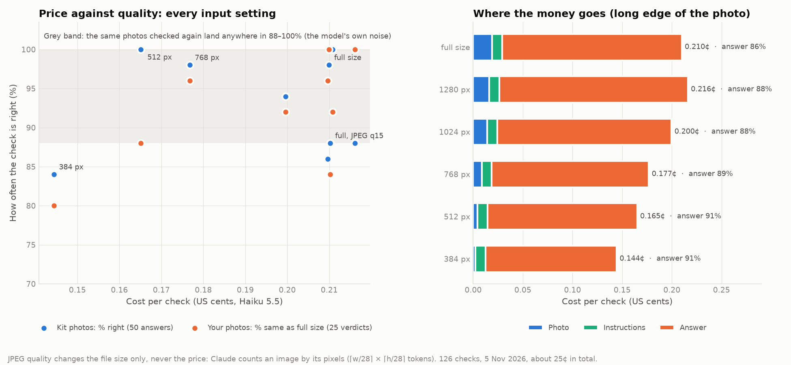
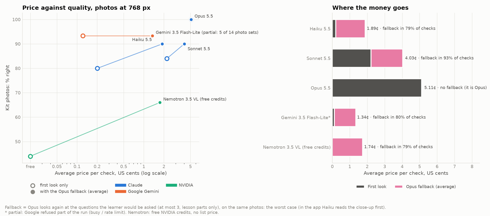

# The checker: what the learner has, from photos

**Status:** 5 November 2026. Built and in Parts Quest for Arduino (whole parts list) and LEGO (one gather card at a
time). This file: how the checker works, what a check costs and how to make it cheaper (section 3), and how easily
its models can be swapped (section 4). Choosing the model is in `RECOGNITION.md`.

---

## 1. What is in it

| File | What it does |
|---|---|
| `code/checker/gather.py` | The rules: match what was seen to the lesson's parts, compare (values, counts), substitutes (a resistor in a range, a board that can stand in), parts the catalogue does not know |
| `code/checker/gather_flow.py` | The Arduino check as the learner gets it: Haiku's first look, close-ups for what it could not settle, Opus once only when Haiku still cannot tell |
| `code/checker/lego_gather.py` | Splits a LEGO lesson into gather cards: by numbered bag, else about 10 pieces and at most 8 kinds per card, never splitting a sub-build |
| `code/checker/lego_check.py` | The LEGO card check: Haiku ticks off the card's list (there / other colour / unsure / not there), close-ups, Opus once |
| `code/checker/gather_vlm.py` | The one Claude call the checker uses (photos + text → JSON), with prices |

The flow is the same for both: **first look (Haiku) → questions → close-ups (Haiku) → Opus only for a close-up Haiku
still cannot read.** Both return the same result shape, so the page and Pip use one result screen.

## 2. How the photos go in today

1. The page (camera or upload) scales each photo to **at most 1600 px on the long edge** and saves it as JPEG at
   quality 0.88 (`canvasToPhoto` in `research/recognition/lab/game.html`): a phone photo becomes about 140 KB.
2. The server sends those bytes to Claude unchanged (`gather_vlm.ask`).
3. Claude prices an image by its pixels, not its file size: **⌈width/28⌉ × ⌈height/28⌉ tokens**. Haiku 5.5 is in
   the high-resolution tier (up to 2576 px on the long edge and 4784 tokens per image; anything larger is scaled down
   by the API). A 1600×1200 photo is 58 × 43 = **2,494 tokens**; a 768×576 photo is 28 × 21 = 588.
4. **JPEG quality does not change the price.** It changes only how many bytes are uploaded (speed on a slow phone
   connection), and heavy compression adds artefacts that can hurt the answer.

Prices (per million tokens, read 3 November 2026): Haiku 5.5 $0.10 in / $0.50 out; Opus 5.5 $4 / $20.

## 3. What a check costs, and what changes it (5 November 2026)

### 3.1 The test

`research/recognition/res_test.py` runs the production first look (Haiku through `gather_flow.first_look`, then the
rules) on two sets, at every input setting:

- **Kit photos:** the 10 labelled cases of `kit_test.py` (web photos of whole kits, 600–1280 px; 50 answers with the
  accepted verdicts). Measures **% right**.
- **Your photos:** the distinct big photos taken in Parts Quest (`runs/lab`, 1600 px; 25 part verdicts, no labels).
  Measures **% of verdicts that stay the same as at full size**.
- **Settings:** long edge 1600 (full) / 1280 / 1024 / 768 / 512 / 384 px at JPEG quality 85, and full size at JPEG
  quality 35 and 15. **Full size is run twice**: the difference between the two runs is the model's own noise.

126 checks, about 25¢ in total. Chart: `research/recognition/res_plot.py`.

| Setting | Image tokens per photo | KB per photo | Cost per check | Kit: % right | Your photos: % same as full |
|---|---|---|---|---|---|
| full size | 1,494 (yours) / 1,219 (kit) | 140 / 221 | 0.210¢ | 98% | 100% (the reference) |
| full size, run 2 | same | same | 0.211¢ | 100% | 92% |
| 1280 px | 1,050 / 1,219 | 106 / 221 | 0.216¢ | 88% | 100% |
| 1024 px | 763 / 1,167 | 85 / 213 | 0.200¢ | 94% | 92% |
| **768 px** | 528 / 667 | 68 / 130 | **0.177¢** | **98%** | **96%** |
| 512 px | 283 / 306 | 46 / 64 | 0.165¢ | 100% | 88% |
| 384 px | 159 / 171 | 28 / 38 | 0.144¢ | 84% | 80% |
| full, JPEG q35 | as full | 54 / 92 | 0.210¢ | 86% | 96% |
| full, JPEG q15 | as full | 35 / 56 | 0.210¢ | 88% | 84% |

(The kit photos are at most 1280 px, so for them "full" and "1280" are the same image.)

### 3.2 What it shows

1. **The answer is the bill.** The model's written answer (the JSON list of every object it sees, about 3,600 output
   tokens) is **86–91% of the cost of a check**. The photo is 9% at full size; the instructions 5%. Making photos
   smaller can never save more than about a tenth.
2. **The model's own noise is large.** The same photos, checked again, scored anywhere from 88% to 100% (full,
   full run 2 and 1280 px are the same kit images). Differences inside that band are not real: 1280 px "losing" to
   768 px is noise.
3. **768 px is as good as full size here and 16% cheaper per check** (0.177¢ against 0.210¢; the image tokens drop
   from about 1,500 to about 530). 512 px still scores well on the kit photos but drifts more on yours (88%).
   **384 px is clearly worse** on both sets: below the noise band.
4. **JPEG compression saves bytes, not money.** q15 cuts the upload from 140 KB to 35 KB at exactly the same price,
   and the answers got worse (84% on your photos). Quality 0.8–0.9 is right.
5. **Per lesson, the checker is cheap either way.** A first look (0.21¢) plus two Haiku close-ups (about 0.05¢
   each) is about 0.3¢; an Opus close-up, when needed, about 1¢. Far inside the €4 lesson limit, whose real cost is the voice tutor.

### 3.3 What to do (in order of savings)

1. **Shorten the answer (the big lever, not yet done).** The first look writes 8 fields for every object on the
   table, the ones the lesson does not need included. Options: drop the fields the rules never use, list objects
   that are not in the lesson by name only, cap the list. Halving the answer would cut a check by about 40%,
   four times more than any image setting.
2. **Send the first look at 768–1024 px on the long edge** (the server can scale it, so the page keeps 1600 px for
   close-ups). Saves about 10–16% per first look. 1024 px is the cautious choice until the repeats in 3.4 are done.
3. **Keep close-ups at full size.** A close-up exists to read small things (resistor bands, a board's name, how many
   studs). It was not tested at lower sizes and should not be shrunk without a test.
4. **Keep JPEG at quality 0.85–0.9.** Lower saves nothing.

### 3.4 Still to test

- **Repeats:** each setting three times, so differences smaller than the noise band can be read.
- **Gemini again** when Google's service and our rate limit allow (3.5).
- **The real flow's average price**: first look, Haiku close-ups, Opus only on unreadable close-ups, on photo sets
  with their close-ups, so the price is measured instead of bounded.
- **The answer trim** (3.3.1): same test, shorter output, check that the verdicts hold.
- **Close-ups at lower sizes**, on resistor bands and board names.
- **LEGO cards:** small pieces (1×1 plates, studs) may need more pixels than electronics; same test on gather-card
  photos once there are labelled ones.

### 3.5 Across models, with the Opus fallback paid for (5 November 2026)

`research/recognition/model_cost_test.py`: six models as the first look (Haiku, Sonnet and Opus 5.5; Gemini 3.5
Flash-Lite and 3.8 Flash; NVIDIA Nemotron 3.5 VL) at 1600 / 1024 / 768 / 512 px, on the same 14 photo sets (10
labelled kit cases, 4 of your Parts Quest photo sets). At full size and 768 px the **fallback** is paid for too:
Opus looks again, on the same photos, at the questions the learner would be asked (at most 3, lesson parts only).
That is the worst case: in the app the learner's close-up goes to Haiku first and Opus only when Haiku still cannot
read it. "Your photos" are scored against Opus at full size (no labels). About $6.20 in total. Chart:
`research/recognition/model_cost_plot.py`.

| Model | Size | First look | + Opus fallback | Average per check | Fallback ran | Kit right: first → with fallback | Your photos same as Opus: first → with fallback | Seconds |
|---|---|---|---|---|---|---|---|---|
| Haiku 5.5 | full | 0.22¢ | 1.88¢ | 2.10¢ | 79% | 88% → 88% | 92% → 92% | 22 |
| Haiku 5.5 | 1024 | 0.21¢ | – | 0.21¢ | – | 84% | 96% | 15 |
| Haiku 5.5 | 768 | 0.20¢ | 1.69¢ | 1.89¢ | 79% | 80% → 90% | 96% → 96% | 20 |
| Haiku 5.5 | 512 | 0.16¢ | – | 0.16¢ | – | 90% | 88% | 12 |
| Sonnet 5.5 | full | 2.58¢ | 2.21¢ | 4.80¢ | 100% | 98% → 100% | 92% → 96% | 18 |
| Sonnet 5.5 | 1024 | 2.45¢ | – | 2.45¢ | – | 86% | 96% | 12 |
| Sonnet 5.5 | 768 | 2.21¢ | 1.82¢ | 4.03¢ | 93% | 84% → 90% | 88% → 92% | 17 |
| Sonnet 5.5 | 512 | 2.09¢ | – | 2.09¢ | – | 86% | 84% | 11 |
| Opus 5.5 | full | 5.43¢ | – | 5.43¢ | – | 100% | 100% | 16 |
| Opus 5.5 | 1024 | 5.11¢ | – | 5.11¢ | – | 98% | 96% | 16 |
| Opus 5.5 | 768 | 5.11¢ | – | 5.11¢ | – | 100% | 92% | 17 |
| Opus 5.5 | 512 | 4.63¢ | – | 4.63¢ | – | 98% | 100% | 16 |
| Gemini 3.5 Flash-Lite | full | 0.16¢ | 1.43¢ | 1.60¢ | 67% | 94% → 94% | 100% → 93% | 41 |
| Gemini 3.5 Flash-Lite | 1024 | 0.16¢ | – | 0.16¢ | – | 88% | 70% | 40 |
| Gemini 3.5 Flash-Lite | 768 | 0.12¢ | 1.22¢ | 1.34¢ | 80% | 93% → 93% | 90% → 80% | 83 |
| Gemini 3.5 Flash-Lite | 512 | 0.18¢ | – | 0.18¢ | – | 100% | 80% | 41 |
| Gemini 3.8 Flash | full | 0.73¢ | 2.58¢ | 3.31¢ | 100% | 91% → 95% | 60% → 80% | 110 |
| Nemotron 3.5 VL (free credits) | full | 0.00¢ | 2.13¢ | 2.13¢ | 79% | 38% → 62% | 72% → 76% | 40 |
| Nemotron 3.5 VL (free credits) | 1024 | 0.00¢ | – | 0.00¢ | – | 56% | 72% | 34 |
| Nemotron 3.5 VL (free credits) | 768 | 0.00¢ | 1.74¢ | 1.74¢ | 79% | 44% → 66% | 84% → 84% | 31 |
| Nemotron 3.5 VL (free credits) | 512 | 0.00¢ | – | 0.00¢ | – | 42% | 76% | 29 |

Gemini was only partly measured: Google refused much of the run (HTTP 503 "high demand" and 429 rate limits on our
key), so Flash-Lite has 4–7 of 14 photo sets per size and 3.8 Flash only 5 at full size. One run per setting: the
noise from 3.2 (88–100% on the same photos) applies.

**What it shows**

1. **The fallback is the bill, not the first look.** With Haiku first, Opus was called in 79% of checks and the
   average price went from **0.2¢ to 1.9¢**: the fallback is about 90% of it. It bought little: kit answers 88% →
   88% at full size, 80% → 90% at 768 px.
2. **Most of that money was wasted.** About two-thirds of the questions sent to Opus were about parts that were
   simply not in the photo ("I can't see an LED"). No model can find a missing part in the same photo; only a new
   photo from the learner can.
3. **No first-look model is clearly cheaper than Haiku.** Gemini 3.5 Flash-Lite costs about the same (0.1–0.2¢)
   and scored well on the cases it finished, but it was slow (40–80 s against Haiku's 12–22 s) and Google refused
   a large part of the requests: not reliable enough for a learner waiting at the table. Sonnet costs 10× Haiku and
   was not better. Nemotron is free (NVIDIA credits) but got 38–56% right, so Opus would be needed almost every time.
4. **Opus alone is the most accurate (98–100%) at 4.6–5.4¢ a check.** That is 2.5× Haiku with the worst-case
   fallback, for clearly better answers. Still far inside the €4 lesson limit.
5. **Image size saves little for every model.** Opus 5.4¢ at full size against 4.6¢ at 512 px; Haiku 0.22¢ against
   0.16¢.

**What to do**

1. **Call Opus only for a close-up Haiku could not read, never for a missing part.** This is what the app already
   does (`server.flow`: a missing part asks the learner for a photo; Opus only after Haiku fails on a close-up),
   and it should stay that way: it turns the 1.9¢ worst case into roughly 0.2¢ + 0.05¢ per close-up + about 1¢ only
   on the rare unreadable close-up.
2. **Keep Haiku as the first look.** Revisit Gemini Flash-Lite when its service is stable (it is the only model at
   Haiku's price that matched it).
3. **Keep "Opus only" as an option** for when certainty matters more than a few cents (about 5¢ a check).
4. Then the answer trim from 3.3, which lowers every model's price.

## 4. Can the models be swapped without breaking anything?

**Within Claude: yes, mostly.** **To another provider: not yet, apart from the research scripts.**

| Part | Where the model is set | Swap to another Claude model | Swap to another provider (Gemini, NVIDIA, local) |
|---|---|---|---|
| Arduino check (`gather_flow`) | `FIRST`, `SECOND` constants | Change the string | Not plug-in: `gather_vlm.ask` speaks only to Anthropic |
| LEGO card check (`lego_check`) | `FIRST`, `SECOND` constants | Change the string | Same as above |
| Opus "whole look" (`gather.look`, benchmarks, command line) | `model=` argument | Pass it | Through `graph/extract.py`, Anthropic only |
| Lesson building (`graph/…`) | `model=` arguments and defaults per stage | Pass it (aliases opus / sonnet / haiku) | Anthropic only |
| Voice tutor (`tutor/live.py`) | `MODEL = "gemini-3.8-live"`, `VOICE` | n/a | Another Gemini Live model: change the string. Another realtime provider: rewrite the transport (the browser speaks Gemini Live's WebSocket protocol) |
| Free-voice tutor (`live.reply`) | Hardcoded `"claude-haiku-5-5"` in the call | Edit the line | Anthropic only |
| Research benchmarks (`research/recognition/*_bench.py`) | `--model` | Yes | **Yes**: Anthropic, Gemini and NVIDIA behind the same `ask(model, images, text)` |

What is already right: the prompts ask for plain JSON and the code checks it, so any model that returns that JSON
works with the rules; the research scripts already prove the same prompt runs on three providers.

What breaks or goes wrong today when a model is swapped:

1. **Two separate Claude callers** (`checker/gather_vlm.py` and `graph/extract.py`) plus one inline call in
   `live.reply`: three places to change.
2. **Prices are looked up by exact model name.** A model missing from `PRICES` costs **$0 in the logs, silently**,
   so the cost tracking would be wrong without any error.
3. **Provider-specific options** are passed everywhere (`output_config.effort`): another provider has no such field.
4. **The voice tutor is tied to Gemini Live's protocol** (audio formats, tool-call messages, interruptions, session
   resumption).

The fix (not done yet): one small model registry, e.g. `code/models.py`, holding for each model its provider, its
prices and its image tier, and one `ask(role, images, text)` that routes to the right provider (moving the
research adapters in). Each part names a **role** ("check first look", "check close-up", "check second look",
"tutor fallback") and the registry maps roles to models, from one config file or environment variables. A test
then runs every role against a stub model, and an unknown model fails loudly instead of costing $0. The voice
tutor stays its own adapter: a realtime voice API is a different kind of thing from a photo check.
