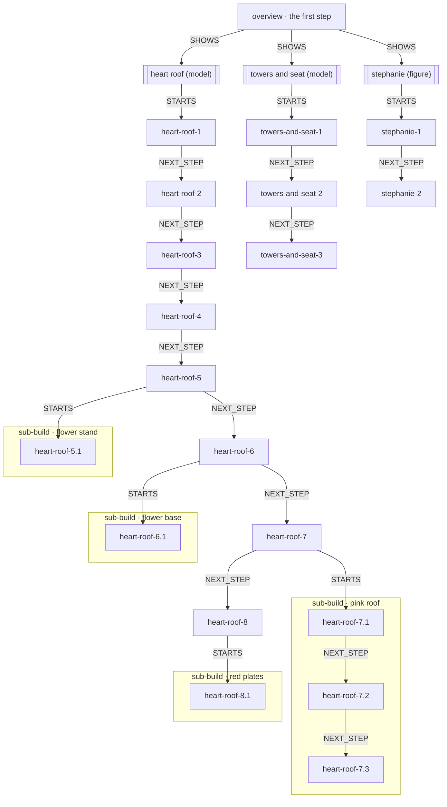
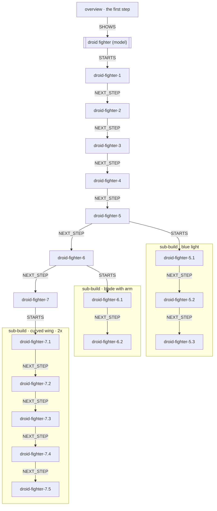
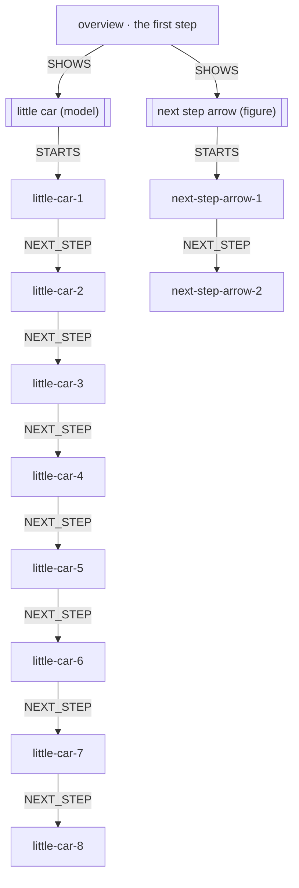

# Pinpoint Lesson Data

The data behind Pinpoint's lessons, as it is stored, section by section as on the shared page: https://claude.ai/artifact/AHdcjWezQiNFKGDAc9v5Yt (private until shared from its Share menu). Written from the lesson store by `python tests/tools/datastructure_md.py`; the specification of the structure (names, rules, every field) is [`DATA_STRUCTURE.md`](./DATA_STRUCTURE.md), and the research behind it is [`RESEARCH.md`](./RESEARCH.md) (R25, R26).

**Contents:** 0 how a lesson is made · 1 the four subgraphs of a lesson (Blink, LEGO 2134-1) · 2 the Arduino circuit up close · 3 booklet lessons (Stephanie and Mailbox, Vulture Droid, Car) · 4 the parts catalogue · 5 the polarity decision

## 0 · How a lesson is made: who does what

Each stage is done by **code** (exact, free, repeatable), by **Claude** (reading and writing, where judgement is needed), or is a **check** by code on what Claude produced. Nothing Claude writes is stored until code has checked it. Times and costs are from the Blink and Uno WiFi Rev2 lessons.

| # | Stage | Who | What | Checked by code | Time · cost |
|---|---|---|---|---|---|
| 1 | Match the parts list | code | Each item in the tutorial's parts list is matched to a catalogue part by name, aliases and model number; a generic name ('a capacitor') reuses the lessons' most-used one; a value goes on the copy (r1 {value: 220}) |  |  |
| 2 | Review the matches (second opinion) | Claude + check | A separate session with the catalogue in reach: right part, another existing part, or really new | R1 the part exists or a new id passes the naming rules; R3 the model numbers in the tutorial's name are the part's; a 'new' part is refused when the match already fits | 12.5 s · $0.04 |
| 3 | Add the parts that are really new | code, then Claude + check | Approved shops first (Adafruit, SparkFun, Pololu…); if none has it, Claude drafts the card | card format; naming rules N1–N6 | 16 s · $0.04 |
| 4 | Describe the new parts | Claude + check | Standard metadata, only for parts that have none (LEGO with a picture of the part) | M1–M11: polarity, sizes against the 3D shape, values against the card, every value's source | 7 s · $0.02 a part |
| 5 | Build the circuit | Claude + check | From the tutorial page, with the parts settled in steps 1–4 | E1–E11 (no short, every LED has a resistor, every pin the sketch uses is wired…); V4 every pin it wires is on the part | 31 s · $0.05 |
| 6 | Plan the steps | code, then Claude + check | Code suggests the steps with their exact holes; Claude orders, groups and writes the words, hints and troubleshooting | lesson rules (every part placed once, holes match the circuit…) | 38 s · $0.09 |
| 7 | Build the lesson network | code | The lesson record, the steps graph, the physical graph, the parts-list links, the code-to-pin links, the substitutions and the expected result | every link resolves; every fact once | 5 s · free |
| 8 | Teach it | Claude + code | The tutor answers the learner through tools; the progress checker says where the learner is from what they have wired |  |  |

**Why the parts come first.** Everything from step 5 on is built on which part each thing is. Matched, reviewed, added and described before anything uses them, a wrong match is fixed while it is cheap and a duplicate part is never made. In the test, a "220 ohm resistor" given the type of a capacitor passed every code check (a capacitor also has two legs); the reviewer caught it from the tutorial's own words, and code confirmed the fix.

**LEGO differs.** With a 3D model, the parts and joins come from the model by code. With only the booklet (section 3), the parts list comes from Rebrickable and Claude matches each step's new pieces to it.

## 1 · The four subgraphs of a lesson: two pilot lessons

Each lesson is a **lesson record** that points to its graphs: the **steps**, the **physical** part instances they gather and place, and through those the **parts catalogue**, which holds LEGO and Arduino parts together (`metadata.domain` says which kind each is).

### Blink an External LED (`blink`, arduino)

**Lesson record** (`lesson.json`)

| field | value |
|---|---|
| name | Blink an External LED |
| link | https://docs.arduino.cc/built-in-examples/basics/Blink/ |
| about | Build a tiny circuit with a resistor and a red LED on the breadboard, then make the LED blink on and off every second from pin 13. |
| how it works | The Arduino sets pin 13 to 5 volts (HIGH) and then to 0 volts (LOW). When the pin is HIGH, current flows from pin 13 through the resistor and the LED, and back to GND, so the LED lights up. When the pin is LOW there is … |
| troubleshooting | 3 entries |
| graphs | instruction: blink/instruction.json, physical: blink/physical.json, document: none |

**Parts list** (each row → the instances it accounts for)

| row | count | instances |
|---|---|---|
| arduino-uno |  | uno |
| breadboard |  | bb1 |
| led |  | led1 |
| resistor-220 |  | r1 |
| jumper-wire |  | wire1, wire2 |

**Steps graph** (`instruction.json`; NEXT_STEP runs down the table)

| step | kind | text | PLACES | MAKES | DEPENDS_ON | ALIGNS_WITH |
|---|---|---|---|---|---|---|
| gather | gather | Collect your Arduino Uno, a breadboard, one 220 ohm resistor, one red LED, one orange wire and one black wire. | uno, bb1 |  |  |  |
| step-1 | build | Put the 220 ohm resistor on the top half of the breadboard: one leg in column 10 and the other leg in column 14. Either way round works. | r1 | e5, e7 | gather |  |
| step-2 | build | Put the red LED's long leg in column 14 on the top half, in the same column as the resistor's right leg. Put its short leg in column 15. | led1 | e9, e11 | gather | step-1 |
| step-3 | build | Plug one end of the orange wire into pin 13 on the Arduino. Put the other end in column 10 on the top half, in the same column as the resis… | wire1 | e1, e3 | gather, step-1 |  |
| step-4 | build | Plug one end of the black wire into a GND pin on the Arduino. Put the other end in column 15 on the top half, in the same column as the LED… | wire2 | e13, e15 | gather, step-2 |  |
| upload-code | upload | Plug the Arduino into your computer with the USB cable, open the Arduino IDE and upload the Blink sketch (File > Examples > 01.Basics > Bli… |  |  |  |  |

**Physical graph** (`physical.json`): part instances and their definitions

| instance | type | definition | props |
|---|---|---|---|
| uno | arduino-uno | arduino-uno | {"wokwi": {"type": "wokwi-arduino-uno", "top": 0, "left": 0, "attrs": {}}} |
| bb1 | breadboard | breadboard | {"wokwi": {"type": "wokwi-breadboard-half", "top": 0, "left": 0, "attrs": {}}} |
| led1 | led | led | {"colour": "red", "wokwi": {"type": "wokwi-led", "top": 0, "left": 0, "attrs": { |
| r1 | resistor | resistor | {"value": "220", "wokwi": {"type": "wokwi-resistor", "top": 0, "left": 0, "attrs |
| wire1 | jumper-wire | jumper-wire | {"colour": "orange", "wokwi": {"connection": ["uno:13", "bb1:10t.a"], "colour": |
| wire2 | jumper-wire | jumper-wire | {"colour": "black", "wokwi": {"connection": ["uno:GND.1", "bb1:15t.a"], "colour" |

**Joins** (one vocabulary for every domain)

| edge | from | to | method | holds by | reversible |
|---|---|---|---|---|---|
| e1 | wire1:a | uno:13 | insert | spring | hand |
| e3 | wire1:b | bb1:10t.a | insert | spring | hand |
| e5 | r1:1 | bb1:10t.b | insert | spring | hand |
| e7 | r1:2 | bb1:14t.b | insert | spring | hand |
| e9 | led1:A | bb1:14t.c | insert | spring | hand |
| e11 | led1:C | bb1:15t.c | insert | spring | hand |
| e13 | wire2:a | uno:GND.1 | insert | spring | hand |
| e15 | wire2:b | bb1:15t.a | insert | spring | hand |

### Bison (`2134-1`, lego)

**Lesson record** (`lesson.json`)

| field | value |
|---|---|
| name | Bison |
| link | https://rebrickable.com/sets/2134-1/ |
| troubleshooting | 0 entries |
| graphs | instruction: 2134-1/instruction.json, physical: 2134-1/physical.json, document: none |

**Parts list** (each row → the instances it accounts for)

| row | count | instances |
|---|---|---|
| Brick 2 x 3 | 1 | b8 |
| Brick 2 x 2 with Eye with White Print on Two Sides, Offset | 1 | b7 |
| Brick 1 x 2 | 2 | b1, b2 |
| Plate 2 x 3 | 1 | b4 |
| Plate 2 x 2 | 1 | b3 |
| Plate 1 x 2 | 1 | b5 |
| Brick Sloped 45° 2 x 2 | 2 | b9, b10 |
| Plate Special 1 x 2 with Handles [Flat Ends / Low Attachment] | 1 | b6 |

**Steps graph** (`instruction.json`; NEXT_STEP runs down the table)

| step | kind | text | PLACES | MAKES | DEPENDS_ON | ALIGNS_WITH |
|---|---|---|---|---|---|---|
| step-1 | step | Stand a black 1x2 brick on the table and press the black 2x3 plate flat on top of it, lying lengthways with one end hanging out. Press a bl… | b1, b2, b3, b4, b5 | e1, e3, e5 |  |  |
| step-2 | step | Hold the white 1x2 plate with handles at the front, then press the red 2x2 eye brick onto the free end of the long black plate right behind… | b6, b7, b8, b9, b10 | e2, e4, e6, e7, e8, e9, e10 | step-1 |  |

**Physical graph** (`physical.json`): part instances and their definitions

| instance | type | definition | props |
|---|---|---|---|
| b1 | lego-3004 | lego-3004 | {"colour": "Black", "ldraw": "3004.dat", "ldraw_pos": [0.0, 0.0, 0.0], "ldraw_ro |
| b2 | lego-3004 | lego-3004 | {"colour": "Black", "ldraw": "3004.dat", "ldraw_pos": [40.0, 0.0, 0.0], "ldraw_r |
| b3 | lego-3022 | lego-3022 | {"colour": "Black", "ldraw": "3022.dat", "ldraw_pos": [30.0, -8.0, 0.0], "ldraw_ |
| b4 | lego-3021 | lego-3021 | {"colour": "Black", "ldraw": "3021.dat", "ldraw_pos": [-20.0, -8.0, 0.0], "ldraw |
| b5 | lego-3023 | lego-3023 | {"colour": "Black", "ldraw": "3023.dat", "ldraw_pos": [-40.0, 0.0, 0.0], "ldraw_ |
| b6 | lego-3839b | lego-3839b | {"colour": "White", "ldraw": "3839b.dat", "ldraw_pos": [-40.0, -40.0, 0.0], "ldr |
| b7 | lego-3003pe2 | lego-3003 | {"colour": "Red", "ldraw": "3003pe2.dat", "ldraw_pos": [-30.0, -32.0, 0.0], "ldr |
| b8 | lego-3002 | lego-3002 | {"colour": "Black", "ldraw": "3002.dat", "ldraw_pos": [20.0, -32.0, 0.0], "ldraw |
| b9 | lego-3039 | lego-3039 | {"colour": "Black", "ldraw": "3039.dat", "ldraw_pos": [0.0, -56.0, 0.0], "ldraw_ |
| b10 | lego-3039 | lego-3039 | {"colour": "Black", "ldraw": "3039.dat", "ldraw_pos": [20.0, -56.0, 0.0], "ldraw |

**Joins** (one vocabulary for every domain)

| edge | from | to | method | holds by | reversible |
|---|---|---|---|---|---|
| e1 | b1:stud.1.2 | b4:anti.1.3 | insert | friction | hand |
| e2 | b8:stud.2.2 | b10:anti.2.1 | insert | friction | hand |
| e3 | b2:stud.1.2 | b3:anti.2.2 | insert | friction | hand |
| e4 | b3:stud.2.2 | b8:anti.2.1 | insert | friction | hand |
| e5 | b5:stud.1.1 | b4:anti.2.1 | insert | friction | hand |
| e6 | b4:stud.2.2 | b7:anti.1.1 | insert | friction | hand |
| e7 | b4:stud.2.3 | b8:anti.1.3 | insert | friction | hand |
| e8 | b7:stud.1.2 | b6:anti.1.1 | insert | friction | hand |
| e9 | b7:stud.1.1 | b9:anti.1.1 | insert | friction | hand |
| e10 | b8:stud.2.3 | b9:anti.2.2 | insert | friction | hand |

## 2 · The Arduino circuit up close: what is connected to what

The electrical nets the joins make in Blink (breadboard strips and wires folded away, as CircuitQuest's checker compares them).

| net | ports on it |
|---|---|
| 1 | led1:A, r1:2 |
| 2 | led1:C, uno:GND |
| 3 | r1:1, uno:13 |

## 3 · Booklet lessons: builds, sub-builds, steps and parts

Three LEGO lessons made from their booklet PDFs alone (no 3D model used to build them). Each is a **lesson record** and a **steps graph**; there is no physical graph. Code cut the steps from the PDF (the booklet's layout: builds, main steps, boxed sub-builds and their "2x"), made an overlay of what changed in each, found the arrows, and measured the new area per colour; Claude read each step with its previous picture, the overlay and a numbered picture of every part; code checked every read, repaired leftovers, and checked that every piece of the parts list is placed.

- `overview` (the first step) **SHOWS** each build, in the booklet's order.
- Each build (`product` node: a model, or a figure built on its own) **STARTS** at its own step 1; **NEXT_STEP** runs only inside one build or one sub-build.
- Steps are numbered as the booklet: `flower-stand-7`; a sub-build's steps are inside the main step that needs it: `flower-stand-7.1`. The main step **STARTS** its sub-build (the edge carries its name and "2x"), and the sub-build is done just before the step.
- **PLACES** step → parts-list row, with a count (times the sub-build's 2x) and where it goes.
- Which build a step is in, and the whole order, are worked out from these edges; nothing is stored twice.

### Stephanie and Mailbox (`30105-1`)

|  |  |
|---|---|
| ready | yes: every piece of the parts list is placed |
| builds | heart roof, towers and seat, stephanie |
| sub-builds | 4 |
| steps | 19 |
| parts list | 28 rows, 41 pieces |
| order inside builds vs the set's 3D model (score only) | 0.568 |
| 3D model pieces matched to a step | 37/41 |
| made in | 404 s, $1.21, 36 Claude calls |
| to review | heart-roof-5.1: lego-33291 Dark Pink: no dark pink anywhere in this step's picture: is it really this colour, and really added in this step?; heart-roof-7.3: lego-3040b Dark Pink: no dark pink anywhere in this step's picture: is it really this colour, and really added in this step?; stephanie-1: lego-92818c01pr0002 Magenta: no magenta anywhere in this step's picture: is it really this colour, and really added in this step? |

**Structure** (`instruction.json`): SHOWS, STARTS and NEXT_STEP; a sub-build's steps inside the main step that needs it

**heart roof** (model; finished: The flower stand is shown from the front-left. At the bottom is a white base with a white sloped front. Dark brown and pink round studs sit on a black plate on the right. Pink flowers and a green flower stem sit on the left. Two white and gold posts rise from the base and hold up the roof. The roof…)

| step | booklet | instruction | what changed | places (PLACES → parts list) | review |
|---|---|---|---|---|---|
| `heart-roof-1` | [picture](data/lessons/booklet/30105-1/steps/step1.png) | Take the lime green round 2 x 2 brick with the axle hole and stand it on the table with its four studs pointing up. | This is the first step, so everything is new: the lime green round 2 x 2 brick is the only piece. | 1× #13 Brick Round 2 x 2 with Axle Hole (Lime) | — |
| `heart-roof-2` | [picture](data/lessons/booklet/30105-1/steps/step2.png) | Put the red 2 x 2 x 2 box on top of the lime round brick, with its four studs pointing up and its open side facing the front right. Then slide the white box door with the slot into the open front of the red box. | A red hollow box, 2 x 2 x 2, now sits on the lime round brick and covers its four studs. A white box door with a slot is drawn beside the model with arrows pointing to the open front of the red box, … | 1× #15 Box 2 x 2 x 2 [Hollow Studs] (Red); 1× #16 Box 2 x 2 x 2 Door with Slot (White) | — |
| `heart-roof-3` | [picture](data/lessons/booklet/30105-1/steps/step3.png) | Put four Bright Pink 1 x 1 cheese slopes on the four studs on top of the red box. Turn each slope so its sloped face points outwards, so together they make a little pink roof. | Four bright pink cheese slopes were added on top of the red box, covering its four studs. The white door is now in place in the front of the box. It is not new here. | 4× #17 Brick Sloped 30° 1 x 1 x 2/3 (Cheese Slope) (Bright Pink) | — |
| `heart-roof-4` | [picture](data/lessons/booklet/30105-1/steps/step7.png) | Press the white 2 x 4 plate flat on top of the white base, toward the front. Then push one gold spyglass piece onto the top of each white cone so they stand straight up, one on the left and one on the right. | This is a new build. The white 2 x 4 plate lies on top of the white base, and a gold spyglass piece stands on each of the two white cones at the back. | 1× #4 Plate 2 x 4 (White); 2× #22 Equipment Telescope / Torch / Spyglass, Support Round 1 x 1 x 1 2/3 (Pearl Gold) | — |
| `heart-roof-5.1` (sub-build flower stand) | [picture](data/lessons/booklet/30105-1/steps/step8.png) | Stand the green flower stem upright. Press one pink flower onto the middle stud of the stem and one onto the tip of the right prong. Then press the third pink flower onto the tip of the left prong, following the arrow. | This is the first picture of the sub-build, so everything is new: the green stem, the pink flower on its middle stud, the pink flower on the right prong, and a third pink flower that an arrow moves o… | 1× #10 Plant, Flower Stem (Green); 3× #9 Plant, Flower, Plate Round 1 x 1 with 4 Petals (Dark Pink) | lego-33291 Dark Pink: no dark pink anywhere in this step's picture: is it really this colour, and really added in this step? |
| `heart-roof-5` | [picture](data/lessons/booklet/30105-1/steps/step9.png) · [overlay](data/lessons/booklet/30105-1/overlays/step9.png) | Press the red 2 x 2 plate with the center stud onto the right side of the white plate, beside the right spyglass. Then place the finished flower sub-build (the green stem with three dark pink flowers) on the left and front studs of the white plate, next to th… | The finished flower sub-build (green stem with three dark pink flowers) was lowered onto the left and front of the white plate. A red 2 x 2 jumper plate was added on the right of the white plate, bes… | 1× #24 Plate Special 2 x 2 with Groove and Center Stud (Jumper) (Red) | — |
| `heart-roof-6.1` (sub-build flower base) | [picture](data/lessons/booklet/30105-1/steps/step10.png) | Take the grey hinge plate 2x2 and lay it flat with its four studs up. Press a bright pink round 1x1 plate onto the left stud and another onto the right stud. Then press a reddish brown round 1x1 plate onto the stud at the back, where the arrow points. Leave t… | This is the start of the sub-build, so every piece is new. There is a 2x2 base plate, two bright pink round plates on the left and right studs, and a reddish brown round plate dropping onto the back … | 1× #19 Hinge Brick 2 x 2 Top Plate Thin (Light Bluish Gray); 2× #20 Plate Round 1 x 1 with Solid Stud (Bright Pink); 1× #21 Plate Round 1 x 1 with Solid Stud (Reddish Brown) | — |
| `heart-roof-6` | [picture](data/lessons/booklet/30105-1/steps/step11.png) · [overlay](data/lessons/booklet/30105-1/overlays/step11.png) | Take the small black flat square plate (2x2). Press one dark reddish-brown round flat piece (1x1) onto a corner stud of the black plate, at the back or front corner, so it sits between the two pink round plates. Press the two bright pink round flat pieces ont… | A small black square plate was added on the right side of the white base, sitting on top of the red square plate and hiding it. The black plate has a dark reddish-brown round plate on one of its fron… | 1× #21 Plate Round 1 x 1 with Solid Stud (Reddish Brown) | added by a repair: 1x lego-6141 Reddish Brown |
| `heart-roof-7.1` (sub-build pink roof) | [picture](data/lessons/booklet/30105-1/steps/step12.png) | Take one white 2 x 4 plate and lay it flat with the studs facing up. This is the base of the small piece you build apart. | This is the first picture of the small build. One white 2 x 4 plate is new and everything else is empty. | 1× #4 Plate 2 x 4 (White) | — |
| `heart-roof-7.2` (sub-build pink roof) | [picture](data/lessons/booklet/30105-1/steps/step13.png) · [overlay](data/lessons/booklet/30105-1/overlays/step13.png) | Put the red 1x2 brick on the two back studs in the middle of the white 2x4 plate. Then put the red 1x2 plate with one stud on the two studs right in front of the brick. Its single stud should sit in the middle, facing up. | A red 1x2 brick was added on the back two studs of the white plate. A red 1x2 jumper plate with one stud was added on the two studs in front of it. Together they cover four of the white plate's eight… | 1× #2 Brick 1 x 2 (Red); 1× #11 Plate Special 1 x 2 with 1 Stud with Groove (Jumper) (Red) | — |
| `heart-roof-7.3` (sub-build pink roof) | [picture](data/lessons/booklet/30105-1/steps/step14.png) | Put one dark pink sloped brick on the left and one on the right of the red parts, so each sits on the white plate with its slope facing outward. Then press the white 1x1 brick with the stud on its side onto the single stud of the red flat piece in the middle.… | Two dark pink 45° sloped bricks were added, one on each side of the red brick and red jumper plate on the white plate. One white 1x1 brick with a stud on one side was added on the single stud of the … | 2× #6 Brick Sloped 45° 2 x 1 with Bottom Pin (Dark Pink); 1× #23 Brick Special 1 x 1 with Stud on 1 Side (White) | lego-3040b Dark Pink: no dark pink anywhere in this step's picture: is it really this colour, and really added in this step? |
| `heart-roof-7` | [picture](data/lessons/booklet/30105-1/steps/step15.png) · [overlay](data/lessons/booklet/30105-1/overlays/step15.png) | Take the finished pink roof you built and slide it onto the top of the two gold telescope posts. The white plate on the underside of the roof sits on top of both posts, with the white stud-side brick facing toward the front. | The finished roof sub-build (white plate, red plate, white side-stud brick and pink slopes) was lowered onto the two gold telescope posts. No loose pieces were added. The rest of the model is unchang… | — | — |
| `heart-roof-8.1` (sub-build red plates) | [picture](data/lessons/booklet/30105-1/steps/step18.png) | Take one red 3 x 2 plate with a rounded end and a hole. Press a second red 3 x 2 rounded plate on top of it, the same way round, so the rounded ends and holes line up and the studs of the lower plate are covered. | This is the start of a new sub-build. Two red rounded 3 x 2 plates are shown: one as the base and one pressed down onto it, stacked directly on top with matching orientation. | 2× #8 Plate Special 3 x 2 with Rounded End, Hole (Red) | — |
| `heart-roof-8` | [picture](data/lessons/booklet/30105-1/steps/step19.png) · [overlay](data/lessons/booklet/30105-1/overlays/step19.png) | Take the finished red heart and press it onto the studs on the right side of the pink roof, so the heart leans over the front of the stand and its studs face out to the front. | The red heart, built in the previous step, now goes onto the roof. An arrow points down to it. It covers the right part of the roof's red and white pieces. The rest of the stand is the same as before… | — | — |

**towers and seat** (model; finished: A white base with a white sloped brick at each short end, the slopes rising up and outward. A white cone 1x1 stands on the top stud at the high outer end of each slope. Between the slopes sits a black 2x2 plate with four studs, covering the black hinge brick. It is tilted slightly in the picture, r…)

| step | booklet | instruction | what changed | places (PLACES → parts list) | review |
|---|---|---|---|---|---|
| `towers-and-seat-1` | [picture](data/lessons/booklet/30105-1/steps/step4.png) | Take the white 2 x 4 brick and lay it flat with the studs up. Take the white 1 x 4 brick and slide it up against the long side of the 2 x 4 brick, so the two bricks touch side by side and the ends line up. | This starts a new build, so both bricks are new: the white 2 x 4 brick and the white 1 x 4 brick. The arrows show the 1 x 4 brick moving against the long side of the 2 x 4 brick. | 1× #1 Brick 2 x 4 (White); 1× #3 Brick 1 x 4 (White) | — |
| `towers-and-seat-2` | [picture](data/lessons/booklet/30105-1/steps/step5.png) | Put a white 3 x 1 sloped brick on each side of the white base, so the two slopes face each other with a gap between them. Then press the black 1 x 2 hinge base into the gap, at the back of the base, with the two front studs left bare. | Two white sloped 3 x 1 bricks were added, one on each side of the base, forming a V-shaped gap. A black 1 x 2 hinge brick base was added in the gap at the back. Nothing was moved or covered up. | 2× #14 Brick Sloped 33° 3 x 1 (White); 1× #12 Hinge Brick 1 x 2 Base (Black) | — |
| `towers-and-seat-3` | [picture](data/lessons/booklet/30105-1/steps/step6.png) · [overlay](data/lessons/booklet/30105-1/overlays/step6.png) | Press a white cone onto the top stud of each white sloped brick, so the two cones stand up like little towers. Then lay the black 2x2 plate between the slopes so it covers the black hinge piece. Leave the two white base studs in front of it showing. | Two white cones were added, one on the top stud of each sloped brick. A black 2x2 plate was added between the slopes, hiding the black hinge brick. The front two base studs are still visible. | 2× #18 Cone 1 x 1 [Top Groove] (White); 1× #5 Plate 2 x 2 (Black) | — |

**stephanie** (figure; finished: The finished minidoll girl stands upright and faces the front. She has long straight bright yellow hair with a fringe, a light nougat face with blue eyes and pink lips, a white halter top with pink and purple star prints, and a magenta layered skirt. Her light nougat legs end in magenta shoes with …)

| step | booklet | instruction | what changed | places (PLACES → parts list) | review |
|---|---|---|---|---|---|
| `stephanie-1` | [picture](data/lessons/booklet/30105-1/steps/step16.png) | Build the girl minidoll. Start with the hips, skirt and legs with the shoes. Press the torso with the white star top onto the top of the hips. Press the face onto the neck of the torso. Then put the long yellow hair on top of the head. | This starts a new build. All four minidoll parts are new: the yellow hair, the head, the torso with arms, and the hips with skirt and legs. They are lined up so they can be pressed together from the … | 1× #26 Hair Long Straight [2 Holes] (Bright Light Yellow); 1× #25 Minidoll Head, Light Blue Eyes, Pink Lips and Open Mouth Print (Light Nougat); 1× #27 Minidoll Torso Girl with White Halter Top with Stars Print, Light Nougat Arms and Hands (Light Nougat); 1× #28 Minidoll Hips and Layered Skirt with Light Nougat Legs and Magenta Shoes Print (Magenta) | lego-92818c01pr0002 Magenta: no magenta anywhere in this step's picture: is it really this colour, and really added in this step? |
| `stephanie-2` | [picture](data/lessons/booklet/30105-1/steps/step17.png) | Put the white letter tile with the red seal into the minidoll girl's hand, on the right side of the picture, so she holds the envelope with the seal facing out. | The assembled minidoll from the last step is now standing complete. The only new piece is the white letter tile with the red seal, held in her hand on the right of the picture. Nothing else was added. | 1× #7 Tile 1 x 2 with Letter with Script and Seal Print (White) | — |

**Parts list** (`lesson.json` → `parts.json`): each row, the steps that place it, and the part's card and metadata

| # | part | colour | name | count | placed | placed by | card | description | size | studs / anti-studs | metadata checks |
|---|---|---|---|---|---|---|---|---|---|---|---|
| #1 | lego-3001 | White | Brick 2 x 4 | 1 | 1/1 | `towers-and-seat-1` | lego-3001 | The classic 2 x 4 brick with eight studs on top and sockets underneath. | 2 × 4 | 8 / 8 | passed |
| #2 | lego-3004 | Red | Brick 1 x 2 | 1 | 1/1 | `heart-roof-7.2` | lego-3004 | A basic LEGO brick, one stud wide and two studs long, with two studs on top and two stud sockets underneath. | 1 × 2 | 2 / 2 | passed |
| #3 | lego-3010 | White | Brick 1 x 4 | 1 | 1/1 | `towers-and-seat-1` | lego-3010 | A 1 x 4 brick with four studs on top and sockets underneath. | 1 × 4 | 4 / 4 | passed |
| #4 | lego-3020 | White | Plate 2 x 4 | 2 | 2/2 | `heart-roof-4`, `heart-roof-7.1` | lego-3020 | A flat LEGO plate two studs wide and four long. Studs on top, hollow underside that clutches studs below. | 2 × 4 | 8 / 8 | passed |
| #5 | lego-3022 | Black | Plate 2 x 2 | 1 | 1/1 | `towers-and-seat-3` | lego-3022 | A flat square LEGO plate, two studs by two studs, with four studs on top and four sockets underneath. | 2 × 2 | 4 / 4 | passed |
| #6 | lego-3040b | Dark Pink | Brick Sloped 45° 2 x 1 with Bottom Pin | 2 | 2/2 | `heart-roof-7.3` | lego-3040b | A 45-degree sloped brick, 2 x 1, with one stud on the top flat part. Underneath is a hollow tube-like pin to grip studs. | 1 × 2 | 1 / 2 | passed |
| #7 | lego-3069bpr0055 | White | Tile 1 x 2 with Letter with Script and Seal Print | 1 | 1/1 | `stephanie-2` | lego-3069bpr0055 | A 1 x 2 tile with a smooth top that has a printed letter design on it. It has no studs on top. | 1 × 2 | 0 / 2 | passed |
| #8 | lego-3176 | Red | Plate Special 3 x 2 with Rounded End, Hole | 2 | 2/2 | `heart-roof-8.1` | lego-3176 | A flat 3 x 2 plate with one rounded end and a hole near it. It has six studs on top and six sockets underneath. | 2 × 3 | 6 / 6 | C1 |
| #9 | lego-33291 | Dark Pink | Plant, Flower, Plate Round 1 x 1 with 4 Petals | 3 | 3/3 | `heart-roof-5.1` | lego-33291 | A small round 1 x 1 plate shaped like a flower with four petals. It has one stud with a hole through it on top. | 1 × 1 | 1 / 1 | passed |
| #10 | lego-3741 | Green | Plant, Flower Stem | 1 | 1/1 | `heart-roof-5.1` | lego-3741 | A plant stem with a stud-sized base and three thin leaves splaying out. It pushes onto a stud. | 1 × 1 | 1 / None | M4; C1 |
| #11 | lego-3794b | Red | Plate Special 1 x 2 with 1 Stud with Groove (Jumper) | 1 | 1/1 | `heart-roof-7.2` | lego-3794b | A 1 x 2 plate with a single stud on top, placed off-centre. It lets a piece sit half a stud off the grid. | 1 × 2 | 1 / 2 | passed |
| #12 | lego-3937 | Black | Hinge Brick 1 x 2 Base | 1 | 1/1 | `towers-and-seat-2` | lego-3937 | The lower half of a hinge brick, 1 x 2, with two studs on top and a hinge fork at the back. It pairs with a hinge top piece. | 1 × 2 | 2 / 2 | C1 |
| #13 | lego-3941 | Lime | Brick Round 2 x 2 with Axle Hole | 1 | 1/1 | `heart-roof-1` | lego-3941 | A round 2 x 2 brick with four studs on top and a cross-shaped axle hole through the middle. An axle can pass through it so it can turn or be driven. | 2 × 2 | 4 / 4 | passed |
| #14 | lego-4286 | White | Brick Sloped 33° 3 x 1 | 2 | 2/2 | `towers-and-seat-2` | lego-4286 | A sloped brick 3 studs long and 1 wide, with the slope falling at about 33 degrees. It has one stud at the high end. | 1 × 3 | 1 / 3 | passed |
| #15 | lego-4345b | Red | Box 2 x 2 x 2 [Hollow Studs] | 1 | 1/1 | `heart-roof-2` | lego-4345b | A hollow 2 x 2 box, 2 bricks tall, open at the front. It has four studs on top and a hinge at the bottom edge for a door. | 2 × 2 | 4 / 4 | passed |
| #16 | lego-4346 | White | Box 2 x 2 x 2 Door with Slot | 1 | 1/1 | `heart-roof-2` | lego-4346 | A flat door for the 2 x 2 x 2 box, with a slot near the top. It hinges at the bottom and has studs on its top edge. |  | 4 / None | C1; C1 |
| #17 | lego-54200 | Bright Pink | Brick Sloped 30° 1 x 1 x 2/3 (Cheese Slope) | 4 | 4/4 | `heart-roof-3` | lego-54200 | A tiny sloped piece, one stud wide and long and two-thirds of a brick tall. It sits on top of other pieces to make a smooth sloping edge. | 1 × 1 | 0 / 1 | C1 |
| #18 | lego-59900 | White | Cone 1 x 1 [Top Groove] | 2 | 2/2 | `towers-and-seat-3` | lego-59900 | A small cone one stud wide and one brick tall, with a hollow ring at the top. It fits onto a stud from above. | 1 × 1 | 0 / 1 | passed |
| #19 | lego-6134 | Light Bluish Gray | Hinge Brick 2 x 2 Top Plate Thin | 1 | 1/1 | `heart-roof-6.1` | lego-6134 | A hinge piece with a 2 x 2 top plate that swivels on a base hinge part. It lets two sections of a build fold at an angle. | 2 × 2 | 4 / 4 | passed |
| #20 | lego-6141 | Bright Pink | Plate Round 1 x 1 with Solid Stud | 2 | 2/2 | `heart-roof-6.1` | lego-6141 | A small round plate, one stud in size, with a solid round stud on top. It is used as a decoration or small connector. | 1 × 1 | 1 / 1 | passed |
| #21 | lego-6141 | Reddish Brown | Plate Round 1 x 1 with Solid Stud | 2 | 2/2 | `heart-roof-6.1`, `heart-roof-6` | lego-6141 | A small round plate, one stud in size, with a solid round stud on top. It is used as a decoration or small connector. | 1 × 1 | 1 / 1 | passed |
| #22 | lego-64644 | Pearl Gold | Equipment Telescope / Torch / Spyglass, Support Round 1 x 1… | 2 | 2/2 | `heart-roof-4` | lego-64644 | A small round support piece shaped like a telescope or torch, used as a minifigure accessory. It has a stud at the top and a hollow underneath. | 1 × 1 | 1 / 1 | M4 |
| #23 | lego-87087 | White | Brick Special 1 x 1 with Stud on 1 Side | 1 | 1/1 | `heart-roof-7.3` | lego-87087 | A 1 x 1 brick with a stud on top and another stud on one side. It lets you build sideways. | 1 × 1 | 2 / 1 | C1 |
| #24 | lego-87580 | Red | Plate Special 2 x 2 with Groove and Center Stud (Jumper) | 1 | 1/1 | `heart-roof-5` | lego-87580 | A flat 2 x 2 plate with one stud in the centre and a groove on top. It is often called a jumper plate because it lets you offset pieces by half a stud. | 2 × 2 | 1 / 4 | passed |
| #25 | lego-92198pr0002 | Light Nougat | Minidoll Head, Light Blue Eyes, Pink Lips and Open Mouth Pr… | 1 | 1/1 | `stephanie-1` | lego-92198pr0002 | A printed head for a minidoll figure, with eyes, lips and an open mouth. It presses onto the neck of a minidoll torso. |  | None / None | passed |
| #26 | lego-92255 | Bright Light Yellow | Hair Long Straight [2 Holes] | 1 | 1/1 | `stephanie-1` | lego-92255 | A long straight hair piece for a minifigure or minidoll head. It fits over the head and hangs down the back. |  | None / None | C1 |
| #27 | lego-92456c01pr0019 | Light Nougat | Minidoll Torso Girl with White Halter Top with Stars Print,… | 1 | 1/1 | `stephanie-1` | lego-92456c01pr0019 | A printed minidoll torso with arms and hands attached. It has a neck pin for the head. |  | None / None | passed |
| #28 | lego-92818c01pr0002 | Magenta | Minidoll Hips and Layered Skirt with Light Nougat Legs and … | 1 | 1/1 | `stephanie-1` | lego-92818c01pr0002 | A printed Minidoll lower body with hips, a layered skirt and legs with printed shoes. It is a single moulded piece that joins to a Minidoll torso. |  | None / None | passed |

### Vulture Droid (`30055-1`)

|  |  |
|---|---|
| ready | yes: every piece of the parts list is placed |
| builds | droid fighter |
| sub-builds | 3 |
| steps | 17 |
| parts list | 17 rows, 42 pieces |
| order inside builds vs the set's 3D model (score only) | 0.91 |
| 3D model pieces matched to a step | 42/42 |
| made in | 230 s, $0.63, 25 Claude calls |
| to review | nothing |

**Structure** (`instruction.json`): SHOWS, STARTS and NEXT_STEP; a sub-build's steps inside the main step that needs it

**droid fighter** (model; finished: The finished droid fighter model, seen from above at an angle. In the middle is the dark bluish-grey wedge-plate body. On top sit dark blue plates, a light grey tile strip, and the dark blue curved brick that points to the back. Four long curved wings in dark bluish grey surround it, two on the lef…)

| step | booklet | instruction | what changed | places (PLACES → parts list) | review |
|---|---|---|---|---|---|
| `droid-fighter-1` | [picture](data/lessons/booklet/30055-1/steps/step1.png) | Lay the dark bluish gray 3 x 6 wedge plate flat with its studs up. Press one dark blue 2 x 2 grooved tile onto the studs at the right end of the plate. Press the second dark blue 2 x 2 grooved tile down onto the two studs at the top-left corner of the plate. | This is the first step. The dark bluish gray wedge plate is the starting base. One dark blue tile is already resting on its right end. A second dark blue tile is dropped straight down onto the two st… | 1× #2 Wedge Plate 3 x 6 Cut Corners (Dark Bluish Gray); 2× #7 Tile 2 x 2 with Groove (Dark Blue) | — |
| `droid-fighter-2` | [picture](data/lessons/booklet/30055-1/steps/step2.png) · [overlay](data/lessons/booklet/30055-1/overlays/step2.png) | Take two light bluish gray 1 x 3 tiles. Lay them side by side, flat, so they bridge the gap between the two dark blue tiles on the base. They cover the studs in the middle of the base and touch the blue tile on each side. | Two light bluish gray 1 x 3 tiles were added side by side across the middle of the base, between the two dark blue tiles, covering the studs there. Nothing else moved. | 2× #16 Tile 1 x 3 (Light Bluish Gray) | — |
| `droid-fighter-3` | [picture](data/lessons/booklet/30055-1/steps/step3.png) | Turn the whole model upside down so the grey underside faces you and the dark blue strip shows along the back edge. First, take one black 1x2 plate with a clip on the end. Press it down onto the exposed dark blue strip along the back edge, right next to the g… | The model is now upside down. Two black 1x2 plates with a clip on the end are added. One sits on the dark blue strip along the back edge next to the grey wedge's underside, with its clip pointing out… | 2× #17 Plate Special 1 x 2 with Clip Horizontal on End (Black) | added by a repair: 1x lego-63868 Black |
| `droid-fighter-4` | [picture](data/lessons/booklet/30055-1/steps/step4.png) · [overlay](data/lessons/booklet/30055-1/overlays/step4.png) | Turn the model so the studs face up. Press one light grey round 2 x 2 plate with the rounded bottom onto the studs at the upper back of the dark grey wedge. Press the second one onto the studs at the right-hand end of the wedge, near the black clip. | Two light bluish grey round 2 x 2 plates were added. One covers the studs at the upper back of the wedge, next to the black clip plate. The other covers studs on the right half of the wedge. Everythi… | 2× #4 Plate Round 2 x 2 with Rounded Bottom [Boat Stud] (Light Bluish Gray) | — |
| `droid-fighter-5.1` (sub-build blue light) | [picture](data/lessons/booklet/30055-1/steps/step5.png) | Take one light bluish gray round 2 x 2 plate with the rounded bottom and put it on the table with its four studs facing up. This is the start of a small build that you will add to the model later. | This is the first piece of the sub-build. The round 2 x 2 plate is new and nothing else is in the picture. | 1× #4 Plate Round 2 x 2 with Rounded Bottom [Boat Stud] (Light Bluish Gray) | — |
| `droid-fighter-5.2` (sub-build blue light) | [picture](data/lessons/booklet/30055-1/steps/step6.png) | Press the dark blue 1 x 2 plate onto the left half of the round plate. Then press the light bluish gray 1 x 2 plate with the side handle onto the right half, next to the blue one. Point its handle bars out to the back right. | Two plates were added on top of the round plate: a dark blue 1 x 2 plate on the left and a light bluish gray 1 x 2 side-handle plate on the right. The round plate is now mostly covered. | 1× #5 Plate 1 x 2 (Dark Blue); 1× #3 Plate Special 1 x 2 Side Handle [Free Ends] (Light Bluish Gray) | — |
| `droid-fighter-5.3` (sub-build blue light) | [picture](data/lessons/booklet/30055-1/steps/step7.png) · [overlay](data/lessons/booklet/30055-1/overlays/step7.png) | Press one trans-light blue round 1x1 plate onto each of the two studs of the light bluish gray plate with the handle bars. | Two trans-light blue round 1x1 plates were added, one on each stud of the light bluish gray handle plate. Nothing else moved. | 2× #14 Plate Round 1 x 1 with Solid Stud (Trans-Light Blue) | — |
| `droid-fighter-5` | [picture](data/lessons/booklet/30055-1/steps/step8.png) · [overlay](data/lessons/booklet/30055-1/overlays/step8.png) | Pick up the finished little blue piece you just built: a dark blue 2x2 tile with a light grey round plate on top and a light grey side-handle plate at its back right. Lower it onto the middle of the grey wedge, between the two round grey plates, so the handle… | The finished sub-build (a dark blue 2x2 tile with a light grey round plate on top and a light grey side-handle plate) is added in the middle of the grey wedge, between the two round plates. Nothing e… | — | — |
| `droid-fighter-6.1` (sub-build blade with arm) | [picture](data/lessons/booklet/30055-1/steps/step9.png) | Take the dark gray 1 x 2 plate with the handle on one end and lay it flat with the studs up. Press the dark gray cheese slope onto the stud closest to the handle, so the slope points toward the handle. | This is the start of the sub-build, so everything is new. The dark gray 1 x 2 plate with handle on the end is the base. The dark gray cheese slope is coming down from above onto its right stud, the o… | 1× #13 Plate Special 1 x 2 with Handle on End [Closed Ends] (Dark Bluish Gray); 1× #11 Brick Sloped 30° 1 x 1 x 2/3 (Cheese Slope) (Dark Bluish Gray) | — |
| `droid-fighter-6.2` (sub-build blade with arm) | [picture](data/lessons/booklet/30055-1/steps/step10.png) | Put the dark blue curved 3 x 1 brick on the left stud of the dark grey plate, so it sits right up against the grey slope and curves away to the left. Then clip one end of the black arm into the handle at the right end of the plate, so the arm points out to th… | A dark blue curved 3 x 1 brick was added on the left stud of the plate, next to the grey slope. A black arm with two clips was added, with one clip on the handle at the right end of the plate. The pl… | 1× #10 Brick Curved 3 x 1 No Studs (Dark Blue); 1× #6 Arm Mechanical with 2 Clips [Battle Droid] (Black) | — |
| `droid-fighter-6` | [picture](data/lessons/booklet/30055-1/steps/step11.png) | Turn the grey base model over so the studs face up. Take the blue curved piece you built (the one with the black arm hanging off it) and swing it over, following the red arrow. Click the end of the black arm onto the small clip on the base, in the middle of t… | The base is flipped over so the studs face up. The finished blue curved sub-build with its arm now appears beside the base, with an arrow showing it swinging in so the arm clips onto the base. No new… | — | — |
| `droid-fighter-7.1` (sub-build curved wing, 2x) | [picture](data/lessons/booklet/30055-1/steps/step12.png) | Take the black 1 x 2 plate with the side handle (closed ends) and the black 1 x 2 plate with two horizontal clips. Press the handle bar of the first plate into the two clips of the second plate so they snap together. Build this 2 times. | This is the first step of this sub-build, so both black plates are new. The side-handle plate is above and will move down and to the right. The clip plate is below and does not move. The two arrows s… | 2× #9 Plate Special 1 x 2 [Side Handle Closed Ends] (Black); 2× #12 Plate Special 1 x 2 with Clips Horizontal [Thick U-Clips] (Black) | — |
| `droid-fighter-7.2` (sub-build curved wing, 2x) | [picture](data/lessons/booklet/30055-1/steps/step13.png) · [overlay](data/lessons/booklet/30055-1/overlays/step13.png) | Take two dark blue 1x4 plates. Lay them on top of the black clip piece, one on each side of the handle bar, with a gap between them so the bar shows. Press both down so they sit side by side, studs up. | Two dark blue 1x4 plates were added on top of the black snapped-together pieces, side by side with a gap between them. They cover most of the black plates' tops, leaving the handle bar and the right … | 4× #8 Plate 1 x 4 (Dark Blue) | — |
| `droid-fighter-7.3` (sub-build curved wing, 2x) | [picture](data/lessons/booklet/30055-1/steps/step14.png) · [overlay](data/lessons/booklet/30055-1/overlays/step14.png) | Take two dark bluish gray curved 4 x 1 bricks. Put one on top of each dark blue 1 x 4 plate so they lie side by side along the plates, with the high end at the left and the curve sloping down to the right. | Two dark bluish gray curved 4 x 1 bricks were added, one on each dark blue 1 x 4 plate. They cover the studs on those plates. Nothing else moved. | 4× #15 Brick Curved 4 x 1 No Studs [Stud Holder with Asymmetric Ridges] (Dark Bluish Gray) | — |
| `droid-fighter-7.4` (sub-build curved wing, 2x) | [picture](data/lessons/booklet/30055-1/steps/step15.png) · [overlay](data/lessons/booklet/30055-1/overlays/step15.png) | Take two dark blue 1 x 2 plates. Put one on the front end of each long dark blue plate, right in front of the grey curved brick, so each one sticks out past the front with one stud showing. | Two dark blue 1 x 2 plates were added, one at the front end of each dark blue 1 x 4 plate. They cover the front studs of the long plates and leave one stud of each showing at the front. | 4× #5 Plate 1 x 2 (Dark Blue) | — |
| `droid-fighter-7.5` (sub-build curved wing, 2x) | [picture](data/lessons/booklet/30055-1/steps/step16.png) · [overlay](data/lessons/booklet/30055-1/overlays/step16.png) | On each strip, press a dark bluish gray curved 4 x 1 brick over the front studs so the curve slopes down to the front. Then put a light bluish gray grille tile 1 x 2 on each strip right behind that curved brick, with the grooves running lengthwise. Build this… | The front studs of both strips are now covered. On each strip a dark bluish gray curved 4 x 1 brick sits at the front, followed by a light bluish gray grille tile 1 x 2 behind it. The dark blue studs… | 4× #15 Brick Curved 4 x 1 No Studs [Stud Holder with Asymmetric Ridges] (Dark Bluish Gray); 4× #1 Tile Special 1 x 2 Grille with Bottom Groove (Light Bluish Gray) | — |
| `droid-fighter-7` | [picture](data/lessons/booklet/30055-1/steps/step17.png) | Take the four finished curved wing pieces you built before. Clip the two wings with the blue panels and open grille ends onto the top-left and the left side of the dark grey body. Clip the two plain grey wings with the blue strips onto the right side and the … | The four finished curved wing sub-builds are now attached around the central body, two on the left and two on the right. The body's dark blue curved brick now sits in place on top. No loose pieces ar… | — | — |

**Parts list** (`lesson.json` → `parts.json`): each row, the steps that place it, and the part's card and metadata

| # | part | colour | name | count | placed | placed by | card | description | size | studs / anti-studs | metadata checks |
|---|---|---|---|---|---|---|---|---|---|---|---|
| #1 | lego-2412b | Light Bluish Gray | Tile Special 1 x 2 Grille with Bottom Groove | 4 | 4/4 | `droid-fighter-7.5` | lego-2412b | A flat 1 x 2 tile with grille ridges on top and a groove along the underside. It has no studs on top, so it gives a smooth finish. | 1 × 2 | 0 / 2 | passed |
| #2 | lego-2419 | Dark Bluish Gray | Wedge Plate 3 x 6 Cut Corners | 1 | 1/1 | `droid-fighter-1` | lego-2419 | A flat 3 x 6 wedge-shaped plate with both front corners cut off. It has studs on top and anti-stud sockets underneath. | 3 × 6 | 18 / 18 | C1; C1; M7 |
| #3 | lego-2540 | Light Bluish Gray | Plate Special 1 x 2 Side Handle [Free Ends] | 1 | 1/1 | `droid-fighter-5.2` | lego-2540 | A 1 x 2 plate with a handle bar sticking out of one long side. Used to hold clips or hinge pieces. | 1 × 2 | 2 / 2 | passed |
| #4 | lego-2654 | Light Bluish Gray | Plate Round 2 x 2 with Rounded Bottom [Boat Stud] | 3 | 3/3 | `droid-fighter-4`, `droid-fighter-5.1` | lego-2654 | A round 2 x 2 plate with a rounded underside, like a boat hull. It has four studs on top. | 2 × 2 | 4 / None | C1 |
| #5 | lego-3023 | Dark Blue | Plate 1 x 2 | 5 | 5/5 | `droid-fighter-5.2`, `droid-fighter-7.4` | lego-3023 | A thin LEGO plate one stud wide and two long, with two studs on top and two sockets underneath. | 1 × 2 | 2 / 2 | passed |
| #6 | lego-30377 | Black | Arm Mechanical with 2 Clips [Battle Droid] | 1 | 1/1 | `droid-fighter-6.2` | lego-30377 | A thin mechanical arm for a droid figure, with a clip at each end. One end also has a pin that fits a figure's body. |  | 0 / 0 | C1 |
| #7 | lego-3068b | Dark Blue | Tile 2 x 2 with Groove | 2 | 2/2 | `droid-fighter-1` | lego-3068b | A flat 2 x 2 tile with a smooth top and a small groove along the side. It has no studs on top, so nothing clips onto it. | 2 × 2 | 0 / 4 | passed |
| #8 | lego-3710 | Dark Blue | Plate 1 x 4 | 4 | 4/4 | `droid-fighter-7.2` | lego-3710 | A thin 1 x 4 plate with four studs on top and four sockets underneath. | 1 × 4 | 4 / 4 | passed |
| #9 | lego-48336 | Black | Plate Special 1 x 2 [Side Handle Closed Ends] | 2 | 2/2 | `droid-fighter-7.1` | lego-48336 | A 1 x 2 plate with two studs on top and a rod-shaped handle along one long side with closed ends. Another piece's clip can grip the handle. | 1 × 2 | 2 / 2 | passed |
| #10 | lego-50950 | Dark Blue | Brick Curved 3 x 1 No Studs | 1 | 1/1 | `droid-fighter-6.2` | lego-50950 | A curved 3 x 1 slope with no studs on top. It has three anti-stud sockets underneath. | 1 × 3 | 0 / 3 | passed |
| #11 | lego-54200 | Dark Bluish Gray | Brick Sloped 30° 1 x 1 x 2/3 (Cheese Slope) | 1 | 1/1 | `droid-fighter-6.1` | lego-54200 | A tiny sloped piece, one stud wide and long and two-thirds of a brick tall. It sits on top of other pieces to make a smooth sloping edge. | 1 × 1 | 0 / 1 | C1 |
| #12 | lego-60470a | Black | Plate Special 1 x 2 with Clips Horizontal [Thick U-Clips] | 2 | 2/2 | `droid-fighter-7.1` | lego-60470a | A 1 x 2 plate with two studs on top and two open clips at one end, pointing sideways. The clips hold a bar or handle. | 1 × 2 | 2 / 2 | passed |
| #13 | lego-60478 | Dark Bluish Gray | Plate Special 1 x 2 with Handle on End [Closed Ends] | 1 | 1/1 | `droid-fighter-6.1` | lego-60478 | A 1 x 2 plate with two studs on top and a bar handle at one end. The bar can be gripped by a clip. | 1 × 2 | 2 / 2 | passed |
| #14 | lego-6141 | Trans-Light Blue | Plate Round 1 x 1 with Solid Stud | 2 | 2/2 | `droid-fighter-5.3` | lego-6141 | A small round plate, one stud in size, with a solid round stud on top. It is used as a decoration or small connector. | 1 × 1 | 1 / 1 | passed |
| #15 | lego-61678 | Dark Bluish Gray | Brick Curved 4 x 1 No Studs [Stud Holder with Asymmetric Ri… | 8 | 8/8 | `droid-fighter-7.3`, `droid-fighter-7.5` | lego-61678 | A curved sloping piece, 1 stud wide and 4 long, with no studs on top. It attaches by sockets underneath. | 1 × 4 | 0 / 4 | C1; C1 |
| #16 | lego-63864 | Light Bluish Gray | Tile 1 x 3 | 2 | 2/2 | `droid-fighter-2` | lego-63864 | A flat smooth tile, 1 stud wide and 3 long, with no studs on top. It gives a clean finished surface. | 1 × 3 | 0 / 3 | passed |
| #17 | lego-63868 | Black | Plate Special 1 x 2 with Clip Horizontal on End | 2 | 2/2 | `droid-fighter-3` | lego-63868 | A 1 x 2 plate with two studs on top and a horizontal clip sticking out from one end. The clip grips a bar or rod. | 1 × 2 | 2 / 2 | passed |

### Car (`30103-1`)

|  |  |
|---|---|
| ready | yes: every piece of the parts list is placed |
| builds | little car, next step arrow |
| sub-builds | 0 |
| steps | 10 |
| parts list | 20 rows, 32 pieces |
| order inside builds vs the set's 3D model (score only) | 1.0 |
| 3D model pieces matched to a step | 32/35 |
| made in | 170 s, $0.51, 18 Claude calls |
| to review | nothing |

**Structure** (`instruction.json`): SHOWS, STARTS and NEXT_STEP; a sub-build's steps inside the main step that needs it

**little car** (model; finished: A small white car seen from the front-left. The pink tile sits on the front of the white bracket under the light grey grille, and the clear windscreen sits over the middle with its two studs on top. White studs sit on the front and rear of the white body, and the lavender and pink plates and the bl…)

| step | booklet | instruction | what changed | places (PLACES → parts list) | review |
|---|---|---|---|---|---|
| `little-car-1` | [picture](data/lessons/booklet/30103-1/steps/step1.png) | Take the black vehicle base and put it flat in front of you with the studs facing up. The wheel pins stick out at the four corners, two on each long side. | This is the first step, so the black vehicle base is the first and only piece. It is placed flat with its studs facing up. | 1× #3 Vehicle Base 4 x 7 x 2/3 with 3 x 4 Recessed, Wheel Pins (Black) | — |
| `little-car-2` | [picture](data/lessons/booklet/30103-1/steps/step2.png) · [overlay](data/lessons/booklet/30103-1/overlays/step2.png) | Put the pink panel with the tall wall and little divider on the studs at the left end of the black base, with the wall at the far left. Then lay two pink 1x2 tiles flat on the black studs next to it, one after the other toward the right, to make a pink bed. | A Bright Pink panel with central divider was added at the left end of the middle of the base, and two Bright Pink grooved tiles were laid flat beside it toward the right, covering some of the black s… | 1× #19 Panel 1 x 2 x 1 with Rounded Corners and Central Divider (Bright Pink); 2× #7 Tile 1 x 2 with Groove (Bright Pink) | — |
| `little-car-3` | [picture](data/lessons/booklet/30103-1/steps/step3.png) · [overlay](data/lessons/booklet/30103-1/overlays/step3.png) | Press the yellow 2 x 2 plate onto the four studs at the left end of the black base, beside the tall pink wall. Then press the light grey 2 x 2 plate onto the four studs at the right end of the base, over the end of the pink tiles. | Two new 2 x 2 plates were added: a yellow one on the left end of the base and a light bluish grey one on the right end. They cover the black studs at those ends. The pink pieces stay where they were. | 1× #4 Plate 2 x 2 (Yellow); 1× #5 Plate 2 x 2 (Light Bluish Gray) | — |
| `little-car-4` | [picture](data/lessons/booklet/30103-1/steps/step4.png) · [overlay](data/lessons/booklet/30103-1/overlays/step4.png) | Put one white 1 x 3 brick along the front of the black base, just to the right of the yellow plate. Put the second white 1 x 3 brick along the back, on the left side, so the pink seat sits between the two bricks. Then press the white 2 x 4 wheel arch onto the… | Three white pieces were added on top of the base. A white 1 x 3 brick went at the front, to the right of the yellow plate. A second white 1 x 3 brick went at the back left. A white studded wheel arch… | 2× #8 Brick 1 x 3 (White); 1× #14 Wheel Arch, Mudguard 2 x 4 Studded with Hole (White) | — |
| `little-car-5` | [picture](data/lessons/booklet/30103-1/steps/step5.png) · [overlay](data/lessons/booklet/30103-1/overlays/step5.png) | Put the white mudguard with headlights on the left end of the base, over the yellow plate. Put a lavender 1x2 plate on top of each long white brick, one on the back side and one on the front side. Next to each lavender plate, on the end nearest the mudguard, … | A white mudguard with headlights was added over the left end, covering the yellow plate. A medium azure clip plate and a lavender 1x2 plate were added on top of each of the two long white bricks, one… | 1× #10 Mudguard 2 x 4 with Molded Headlights (White); 2× #9 Plate Special 1 x 1 with Clip Light, Bar Hole [Thick Ring] (Medium Azure); 2× #6 Plate 1 x 2 (Medium Lavender) | — |
| `little-car-6` | [picture](data/lessons/booklet/30103-1/steps/step6.png) · [overlay](data/lessons/booklet/30103-1/overlays/step6.png) | Put the white bracket on the front left end of the car, with its four holes facing out to the front. Press the azure panel into the seat spot at the back right, with its tall side at the back. Then press the lavender 1x2 plate down onto the two white studs ju… | A white bracket was added at the front left end, over the white mudguard. A Medium Azure panel was added at the back right in the seat area. A Medium Lavender 1x2 plate is shown with arrows going dow… | 1× #11 Bracket 1 x 2 - 2 x 2 (White); 1× #12 Panel 1 x 2 x 1 [Rounded Corners] (Medium Azure); 1× #6 Plate 1 x 2 (Medium Lavender) | — |
| `little-car-7` | [picture](data/lessons/booklet/30103-1/steps/step7.png) · [overlay](data/lessons/booklet/30103-1/overlays/step7.png) | Put the clear windscreen over the middle of the car so it rests on the plates, with its two studs on top. Put the light grey grille tile on the front of the car with its grooves facing forward. Then slide the pink tile onto the front of the white bracket, whe… | A clear windscreen was added over the middle of the car. A light grey grille tile was added at the front of the car above the white bracket. A pink tile is shown to the front left with arrows pointin… | 1× #2 Windscreen 3 x 4 x 1 1/3 with 2 Studs on Top (Trans-Clear); 1× #1 Tile Special 1 x 2 Grille with Bottom Groove (Light Bluish Gray); 1× #7 Tile 1 x 2 with Groove (Bright Pink) | — |
| `little-car-8` | [picture](data/lessons/booklet/30103-1/steps/step10.png) · [overlay](data/lessons/booklet/30103-1/overlays/step10.png) | Push a silver wheel into each black tyre. Press the four finished wheels onto the wheel pins on the sides of the car, two on each side, one at the front and one at the back. Then sit the girl in the car seat with her hands on the front, facing forward. | Four black tyres with silver wheels are on the wheel pins, two on the near side (front and rear) and two hidden on the far side. The girl, already built, now sits in the car seat with her arm reachin… | 4× #13 Tyre 14 x 6 Solid Smooth (Black); 4× #20 Wheel 11 x 6 with Smooth Hubcap (Flat Silver) | — |

**next step arrow** (figure; finished: The picture shows only a plain lavender background with one dark arrow pointing to the right. No pieces and no model are drawn, so there is nothing to build in this step.)

| step | booklet | instruction | what changed | places (PLACES → parts list) | review |
|---|---|---|---|---|---|
| `next-step-arrow-1` | [picture](data/lessons/booklet/30103-1/steps/step8.png) | Build the girl figure. Push the dark blue skirt and legs up onto the bottom of the lavender-top torso. Press the head with the green eyes onto the neck of the torso. Then press the black wavy hair down onto the top of the head. | This is a new build. All four pieces are new: the hair, the head, the torso and the hips with skirt and legs. The arrows show them being joined from top to bottom. | 1× #15 Minidoll Head, Green Eyes, Pink Lips and Closed Mouth Print (Light Nougat); 1× #16 Hair Long Wavy, Partially Tied Back [2 Holes] (Black); 1× #17 Minidoll Torso Girl with Medium Violet Top with Flowers Print, Light Nougat Arms and Hands (Light Nougat); 1× #18 Minidoll Hips and Layered Skirt with Light Nougat Legs and Lavender Shoes Print (Dark Blue) | — |
| `next-step-arrow-2` | [picture](data/lessons/booklet/30103-1/steps/step9.png) | Nothing to add here. Keep the finished minidoll girl ready and carry on to the next step. | No piece is added. The arrow is not a part. It only points on to the next step. The minidoll from the previous step is unchanged. | — | — |

**Parts list** (`lesson.json` → `parts.json`): each row, the steps that place it, and the part's card and metadata

| # | part | colour | name | count | placed | placed by | card | description | size | studs / anti-studs | metadata checks |
|---|---|---|---|---|---|---|---|---|---|---|---|
| #1 | lego-2412b | Light Bluish Gray | Tile Special 1 x 2 Grille with Bottom Groove | 1 | 1/1 | `little-car-7` | lego-2412b | A flat 1 x 2 tile with grille ridges on top and a groove along the underside. It has no studs on top, so it gives a smooth finish. | 1 × 2 | 0 / 2 | passed |
| #2 | lego-2437 | Trans-Clear | Windscreen 3 x 4 x 1 1/3 with 2 Studs on Top | 1 | 1/1 | `little-car-7` | lego-2437 | A sloped windscreen piece, 3 studs wide and 4 long, with two studs on top at the front. It has side supports and sockets underneath. | 3 × 4 | 2 / 12 | M4; M4; C1 |
| #3 | lego-2441 | Black | Vehicle Base 4 x 7 x 2/3 with 3 x 4 Recessed, Wheel Pins | 1 | 1/1 | `little-car-1` | lego-2441 | A flat vehicle base plate, 4 x 7, with a recessed middle and four wheel pins sticking out the sides. Studs on top, sockets underneath. | 4 × 7 | 28 / 28 | C1; C1 |
| #4 | lego-3022 | Yellow | Plate 2 x 2 | 1 | 1/1 | `little-car-3` | lego-3022 | A flat square LEGO plate, two studs by two studs, with four studs on top and four sockets underneath. | 2 × 2 | 4 / 4 | passed |
| #5 | lego-3022 | Light Bluish Gray | Plate 2 x 2 | 1 | 1/1 | `little-car-3` | lego-3022 | A flat square LEGO plate, two studs by two studs, with four studs on top and four sockets underneath. | 2 × 2 | 4 / 4 | passed |
| #6 | lego-3023 | Medium Lavender | Plate 1 x 2 | 3 | 3/3 | `little-car-5`, `little-car-6` | lego-3023 | A thin LEGO plate one stud wide and two long, with two studs on top and two sockets underneath. | 1 × 2 | 2 / 2 | passed |
| #7 | lego-3069b | Bright Pink | Tile 1 x 2 with Groove | 3 | 3/3 | `little-car-2`, `little-car-7` | lego-3069b | A flat 1 x 2 tile with a smooth top and a small groove along the side. It has no studs on top. | 1 × 2 | 0 / 2 | passed |
| #8 | lego-3622 | White | Brick 1 x 3 | 2 | 2/2 | `little-car-4` | lego-3622 | A standard 1 x 3 brick with three studs on top and three sockets underneath. | 1 × 3 | 3 / 3 | passed |
| #9 | lego-4081b | Medium Azure | Plate Special 1 x 1 with Clip Light, Bar Hole [Thick Ring] | 2 | 2/2 | `little-car-5` | lego-4081b | A 1 x 1 plate with one stud on top and a small ring-shaped clip on the side. The clip grips a bar or handle. | 1 × 1 | 1 / 1 | M4; M4; C1 |
| #10 | lego-44674 | White | Mudguard 2 x 4 with Molded Headlights | 1 | 1/1 | `little-car-5` | lego-44674 | A 2 x 4 plate-like piece with curved mudguard arches over each end. Four studs sit in the middle and it forms car wheel arches. | 2 × 4 | 4 / 8 | passed |
| #11 | lego-44728 | White | Bracket 1 x 2 - 2 x 2 | 1 | 1/1 | `little-car-6` | lego-44728 | An angle bracket with a 1 x 2 plate on top and a 2 x 2 plate standing at right angles. Studs point up on the top and out on the side. | 2 × 2 | 4 / 4 | M4; C1; C1 |
| #12 | lego-4865b | Medium Azure | Panel 1 x 2 x 1 [Rounded Corners] | 1 | 1/1 | `little-car-6` | lego-4865b | A thin 1 x 2 panel standing 1 brick tall, with rounded corners. It has two studs on its base and fits where a thin wall is needed. | 1 × 2 | 2 / 2 | C1 |
| #13 | lego-50951 | Black | Tyre 14 x 6 Solid Smooth | 4 | 4/4 | `little-car-8` | lego-50951 | A solid, smooth rubber-like tyre that stretches over a 14 mm wheel rim. It has no studs or sockets. |  | 0 / 0 | C1 |
| #14 | lego-60212 | White | Wheel Arch, Mudguard 2 x 4 Studded with Hole | 1 | 1/1 | `little-car-4` | lego-60212 | A wheel arch plate, 2 studs wide and 4 long, with a curved cut-out for a wheel and studs on top. It has a pin hole in the side. | 2 × 4 | 8 / None | C1 |
| #15 | lego-92198pr0005 | Light Nougat | Minidoll Head, Green Eyes, Pink Lips and Closed Mouth Print | 1 | 1/1 | `next-step-arrow-1` | lego-92198pr0005 | A printed head for a minidoll figure, with eyes, lips and a closed mouth. It presses onto the neck of a minidoll torso. |  | None / None | passed |
| #16 | lego-92258 | Black | Hair Long Wavy, Partially Tied Back [2 Holes] | 1 | 1/1 | `next-step-arrow-1` | lego-92258 | A long wavy hair piece, partly tied back, for a minifigure or minidoll head. It fits over the head. |  | None / None | C1 |
| #17 | lego-92456c01pr0011 | Light Nougat | Minidoll Torso Girl with Medium Violet Top with Flowers Pri… | 1 | 1/1 | `next-step-arrow-1` | lego-92456c01pr0011 | A printed minidoll torso with arms and hands attached. It has a neck pin for the head. |  | None / None | passed |
| #18 | lego-92818c01pr0001 | Dark Blue | Minidoll Hips and Layered Skirt with Light Nougat Legs and … | 1 | 1/1 | `next-step-arrow-1` | lego-92818c01pr0001 | A printed Minidoll lower body with hips, a layered skirt and legs with printed shoes. It is a single moulded piece that joins to a Minidoll torso. |  | None / None | passed |
| #19 | lego-93095 | Bright Pink | Panel 1 x 2 x 1 with Rounded Corners and Central Divider | 1 | 1/1 | `little-car-2` | lego-93095 | A small panel one stud wide and two long, one brick tall, with rounded corners and a divider wall in the middle. It has two studs on top and two sockets undern… | 1 × 2 | 2 / 2 | C1 |
| #20 | lego-93594 | Flat Silver | Wheel 11 x 6 with Smooth Hubcap | 4 | 4/4 | `little-car-8` | lego-93594 | A large plastic wheel with a smooth hubcap and a single axle hole in the centre. A tyre fits around it. |  | None / None | C1 |

## 4 · The parts catalogue (`code/graph/parts/parts.json`)

One catalogue, 1,315 parts, LEGO and Arduino together; each part's `metadata.domain` says which kind it is, and its drafted metadata (standard fields, every value's source named) sits beside its card.

| domain | parts | with drafted metadata | polarized |
|---|---|---|---|
| arduino | 173 | 172 | 110 |
| lego | 1142 | 351 | 1 |

**Most common categories**

| domain | category | parts |
|---|---|---|
| lego | plate | 168 |
| lego | brick | 159 |
| lego | minifig | 119 |
| lego | decoration | 111 |
| lego | technic | 108 |
| lego | tile | 86 |
| lego | slope | 66 |
| lego | wheel | 58 |
| lego | hinge | 38 |
| arduino | board | 32 |
| arduino | sensor | 27 |
| lego | panel | 18 |
| lego | bar | 14 |
| lego | Minifig Upper Body | 14 |
| arduino | display | 12 |
| lego | Technic Beams | 10 |

**Substitutes: what can be swapped, and where it is stored**

| level | stored in | example |
|---|---|---|
| a copy of a part: what it may differ in and still be right | `parts.json` → the part's `metadata.substitutes` (from `SUBSTITUTES` in `code/graph/parts/part_catalogue.py`) | 1145 parts; `led`: colour free; `jumper-wire`: colour and length; `resistor`: value by role; every LEGO part: colour free |
| this lesson's instances (worked out for its circuit) | the lesson's `lesson.json` → `substitutions.parts` | Blink: `r1` 150-600 ohm, in series with the LED: (5 V - 2 V) / 5-20 mA |
| pins the code's pin may move to | the lesson's `lesson.json` → `substitutions.pins`, from the board card's pin facts in `parts.json` (`can`, `same_as`, `reserved`; `code/graph/arduino/pins.py`) and the sketch | Blink: `uno:13` → 2-12, A0-A5; 0 and 1 refused (USB upload and Serial) |
| what a port can go into or onto | `parts.json` → the part's `metadata.fits` (by code, from `FITS` in `code/graph/lesson_store.py`): each port kind → the other port's kind, method, what holds it, how it is undone, example parts | `resistor` lead → breadboard hole, header socket, female jumper end or clip, screw terminal (tool), solder pad (tool) |
| ports that stand in for each other | `parts.json` → the part's `metadata.interchangeable` (by code: a part that is not polarized, pins marked the same, groups joined inside, a breadboard's strip rule) | groups `{kind, ports, why}`: `resistor` not-polarized [1, 2]; `arduino-uno` same-pin [GND.1, GND.2, GND.3]; `breadboard` 126 strips such as [12t.a … 12t.e] and 4 rails [tp.1 … tp.63]; never an `led`'s legs (polarized). `part_catalogue.swaps('breadboard', '12t.c')` → 12t.a, 12t.b, 12t.d, 12t.e |
| the same part under two names (identity, not a swap) | `naming.SAME_PART` (packaging; revisions are other hardware), `lego_ids.same_part` (a print or mould of the same design) | `lego-3003pr0053` is `lego-3003` |

Not stored yet: a part for another part (two 1 x 2 plates for one 2 x 2), and lesson-level substitutions for booklet lessons (they use the part-level colour rule only).

### A part, in full

Every field one part carries: its card (identity, ports, behaviour, electrical values) and its metadata (drafted by Claude in the standard fields, each value's source named, checked by code), plus the fields code works out: what it fits, how a learner can connect it, which ports can swap, and what a copy may differ in.

#### `resistor`

| field | value |
|---|---|
| id · name | `resistor` · 100Ω Resistor |
| domain · category | arduino · resistor |
| aliases | ohm resistor, pull-down resistor, pull-up resistor, resistor, resistors |
| description | A two-leg part that limits electric current. It can go in either direction. |
| material | `carbon` `metal` (Carbon or metal film body with metal leads) |
| size | – |
| ports | 2: 2 lead (1, 2) |
| port names | – |
| polarized | no: either way round |
| if power is reversed | `n/a` |
| rotation symmetry | – |
| connected inside | – |
| electrical | – |
| specifications | – |
| connect by | `breadboard` on a breadboard (no solder); `header-socket` into a header socket (on a board); `female-jumper` with a female jumper wire or a clip; `screw-terminal` in a screw terminal (with a screwdriver); `solder` soldered (to a pad, a perfboard or a wire) |
| takes (into its sockets, holes, terminals) | – |
| fits | lead → breadboard-hole (insert, spring, undo by hand), header-socket (insert, spring, undo by hand), wire-end (push-on, spring, undo by hand), screw (clamp, force, undo by tool), pad (solder, material, undo by tool) |
| joins (drafted, as codes) | `lead` → `breadboard-hole` (`insert`, `spring`, undo `hand`) |
| interchangeable ports (groups) | `not-polarized` 1, 2 |
| substitutes (a copy may differ in) | {"value": "by-role", "why": "worked out per lesson: a resistor in series with an LED may take any value that keeps its current between about 5 and 20 mA"} |
| tips for the learner | Either way round works; read the colour bands for the value. |
| card made by · metadata | `verified` · `drafted`, confidence 0.9 |
| metadata checks | all passed |

#### `led`

| field | value |
|---|---|
| id · name | `led` · LED |
| domain · category | arduino · led |
| aliases | 5mm led, blue led, generic led, green led, light emitting diode, red led, white led, yellow led |
| description | A light-emitting diode that glows when current flows from anode to cathode. It needs a resistor to limit current. |
| material | `semiconductor` `plastic` (Plastic-encased semiconductor) |
| size | – |
| ports | 2: 2 lead (A, C) |
| port names | – |
| polarized | yes: say which way round |
| if power is reversed | `no-harm` |
| rotation symmetry | – |
| connected inside | – |
| electrical | {"forward_v": 2.0, "current_ma": 20.0, "needs_series_resistor": true} |
| specifications | current_ma 20.0 (card); forward_v 2.0 (card); interface ['digital'] (general-knowledge) |
| connect by | `breadboard` on a breadboard (no solder); `header-socket` into a header socket (on a board); `female-jumper` with a female jumper wire or a clip; `screw-terminal` in a screw terminal (with a screwdriver); `solder` soldered (to a pad, a perfboard or a wire) |
| takes (into its sockets, holes, terminals) | – |
| fits | lead → breadboard-hole (insert, spring, undo by hand), header-socket (insert, spring, undo by hand), wire-end (push-on, spring, undo by hand), screw (clamp, force, undo by tool), pad (solder, material, undo by tool) |
| joins (drafted, as codes) | `lead` → `breadboard-hole` (`insert`, `spring`, undo `hand`) |
| interchangeable ports (groups) | – |
| substitutes (a copy may differ in) | {"free": ["colour"], "why": "any colour lights the same way (forward voltage differs a little)"} |
| tips for the learner | The longer lead is the anode (A, +); the flat edge marks the cathode (C). · Always use a series resistor. |
| card made by · metadata | `verified` · `drafted`, confidence 0.85 |
| metadata checks | all passed |

#### `arduino-uno`

| field | value |
|---|---|
| id · name | `arduino-uno` · Arduino Uno R3 |
| domain · category | arduino · board |
| aliases | arduino, arduino board, arduino uno rev3, genuino uno, uno r3, uno rev3 |
| description | The classic Arduino board built around the ATmega328P microcontroller. Its female headers take jumper wires, and a USB-B port is used for power and programming. |
| material | `pcb` `metal` `plastic` (fibreglass PCB with plastic headers and metal parts) |
| size | – |
| ports | 29: 29 header-socket |
| port names | {'mode': 'prefix', 'prefixes': ['GND']} |
| polarized | no: either way round |
| if power is reversed | `damage` |
| rotation symmetry | – |
| connected inside | – |
| electrical | {"logic_v": 5.0, "max_pin_current_ma": 40.0} |
| specifications | maker Arduino (general-knowledge); model A000066 (general-knowledge); chip ATmega328P (general-knowledge); supply_v_min 7.0 (general-knowledge); supply_v_max 12.0 (general-knowledge); logic_v 5.0 (card); max_pin_current_ma 40.0 (card); interface ['digital', 'analog', 'pwm', 'i2c', 'spi', 'uart', 'usb'] (general-knowledge); digital_pins 14 (card); analog_pins 6 (card); pwm_pins ['3', '5', '6', '9', '10', '11'] (general-knowledge) |
| connect by | – |
| takes (into its sockets, holes, terminals) | `lead` a part's leg (resistor, LED…); `header-pin` a header pin; `pin` a module's pin; `wire-end` a male jumper wire |
| fits | header-socket → lead (insert, spring, undo by hand), header-pin (insert, spring, undo by hand), pin (insert, spring, undo by hand), wire-end (insert, spring, undo by hand) |
| joins (drafted, as codes) | `header-socket` → `wire-end`, `lead` (`insert`, `spring`, undo `hand`) |
| interchangeable ports (groups) | `same-pin` GND.1, GND.2, GND.3 |
| substitutes (a copy may differ in) | – |
| tips for the learner | Pins 0 and 1 are also used by USB serial; avoid them while uploading. · Power pins are on the side with 5V, 3.3V, GND and VIN. |
| card made by · metadata | `verified` · `drafted`, confidence 0.85 |
| metadata checks | all passed |

#### `breadboard`

| field | value |
|---|---|
| id · name | `breadboard` · Solderless breadboard |
| domain · category | arduino · breadboard |
| aliases | full breadboard, half breadboard, medium breadboard, mini breadboard, solderless breadboard |
| description | A plastic board with spring-clip holes joined in strips, used to build circuits without solder. |
| material | `metal` `plastic` (plastic with metal clips) |
| size | – |
| ports | 1: 1 breadboard-hole (<column><bank>.<row>) |
| port names | Holes are named '<column><bank>.<row>': column 1-63 (a full breadboard, as in Wokwi; a half board has 1-30), bank 't' (top half, rows a-e) or 'b' (bottom half, rows f-j), e.g. '12t.c', '7b.h'. The 5 holes of one column-bank are one strip. Power rails: 'tp.<n>', 'tn.<n>', 'bp.<n>', 'bn.<n>' (each rail is one strip). |
| polarized | no: either way round |
| if power is reversed | `n/a` |
| rotation symmetry | – |
| connected inside | – |
| electrical | – |
| specifications | – |
| connect by | – |
| takes (into its sockets, holes, terminals) | `lead` a part's leg (resistor, LED…); `header-pin` a header pin; `pin` a module's pin; `wire-end` a male jumper wire |
| fits | breadboard-hole → lead (insert, spring, undo by hand), header-pin (insert, spring, undo by hand), pin (insert, spring, undo by hand), wire-end (insert, spring, undo by hand) |
| joins (drafted, as codes) | `breadboard-hole` → `wire-end`, `header-pin`, `lead` (`insert`, `spring`, undo `hand`) |
| interchangeable ports (groups) | `strip` 1t.a, 1t.b, 1t.c, 1t.d, 1t.e; `strip` 1b.f, 1b.g, 1b.h, 1b.i, 1b.j; `strip` 2t.a, 2t.b, 2t.c, 2t.d, 2t.e; `strip` 2b.f, 2b.g, 2b.h, 2b.i, 2b.j; `strip` 3t.a, 3t.b, 3t.c, 3t.d, 3t.e; `strip` 3b.f, 3b.g, 3b.h, 3b.i, 3b.j; … 130 groups in all (126 strip, 4 rail) |
| substitutes (a copy may differ in) | – |
| tips for the learner | The 5 holes in a column-half are connected; the two halves are not. · Power rail strips run along the length. |
| card made by · metadata | `verified` · `drafted`, confidence 0.9 |
| metadata checks | all passed |

#### `lego-3069b`

| field | value |
|---|---|
| id · name | `lego-3069b` · Tile 1 x 2 with Groove |
| domain · category | lego · tile |
| aliases | – |
| description | A flat 1 x 2 tile with a smooth top and a small groove along the side. It has no studs on top. |
| material | `abs` `plastic` (ABS plastic) |
| size | 1 × 2 studs · 8.0 × 16.0 × 3.2 mm |
| ports | 2: 2 anti-stud (anti.1.1, anti.1.2) |
| port names | – |
| polarized | no: either way round |
| if power is reversed | `n/a` |
| rotation symmetry | 180° |
| connected inside | – |
| electrical | – |
| specifications | maker LEGO (general-knowledge); model 3069b (card); stud_count 0 (general-knowledge); anti_stud_count 2 (card) |
| connect by | – |
| takes (into its sockets, holes, terminals) | – |
| fits | – |
| joins (drafted, as codes) | `anti-stud` → `stud` (`clutch`, `friction`, undo `hand`) |
| interchangeable ports (groups) | – |
| substitutes (a copy may differ in) | {"free": ["colour"], "why": "a colour swap builds the same shape (AR check accepts it)"} |
| tips for the learner | Smooth top: nothing can be attached above it. |
| card made by · metadata | `claude` · `drafted`, confidence 0.92 |
| metadata checks | all passed |

## 5 · What "polarized" means (decided 2026-10-19)

**Definition:** polarized = the part can be fitted the wrong way round (turned or flipped in its holes, or its plug put on backwards) and then does not work or is damaged, so the lesson must say which way round. What a power/ground swap does is a separate metadata field, reverse_power.

**Why:** ['It is what the code uses the flag for: circuit_lesson.py says which leg goes where for a polarized part; ar_circuit.py checks its orientation.', 'It explains every card already marked polarized: under it Claude agreed with all 50 (verified CircuitQuest modules such as adxl335, pir-motion-sensor, atmega328p among them) and disagreed with none.', "The narrow reading ('two legs, one way round') contradicts 31 of those 50, and the research shows a swap damages most modules (servo, DS18B20, OLEDs, CMOS chips), so a learner must be told which way round."]

Under this definition the cards that were already marked polarized were all kept, and 57 cards marked not polarized but able to be fitted backwards were changed: `{'part': '74hc165', 'was': False, 'now': True, 'reverse_power': 'damage'}`, `{'part': '74hc595', 'was': False, 'now': True, 'reverse_power': 'damage'}`, `{'part': 'a4988', 'was': False, 'now': True, 'reverse_power': 'damage'}`, `{'part': 'attiny85', 'was': False, 'now': True, 'reverse_power': 'damage'}`, `{'part': 'bmp180', 'was': False, 'now': True, 'reverse_power': 'damage'}`, `{'part': 'dht22', 'was': False, 'now': True, 'reverse_power': 'damage'}`, `{'part': 'ds1307-rtc', 'was': False, 'now': True, 'reverse_power': 'damage'}`, `{'part': 'ds18b20', 'was': False, 'now': True, 'reverse_power': 'damage'}`, `{'part': 'epaper-2in9', 'was': False, 'now': True, 'reverse_power': 'damage'}`, `{'part': 'esp32-c3-devkitm1', 'was': False, 'now': True, 'reverse_power': 'damage'}`, `{'part': 'esp32-c6-devkitc1', 'was': False, 'now': True, 'reverse_power': 'damage'}`, `{'part': 'esp32-devkit-v1', 'was': False, 'now': True, 'reverse_power': 'damage'}`, `{'part': 'esp32-s2-devkitm1', 'was': False, 'now': True, 'reverse_power': 'damage'}`, `{'part': 'esp32-s3-devkitc1', 'was': False, 'now': True, 'reverse_power': 'damage'}`, `{'part': 'gas-sensor', 'was': False, 'now': True, 'reverse_power': 'damage'}`, `{'part': 'hc-sr04', 'was': False, 'now': True, 'reverse_power': 'damage'}`, `{'part': 'hx711', 'was': False, 'now': True, 'reverse_power': 'damage'}`, `{'part': 'ili9341-lcd', 'was': False, 'now': True, 'reverse_power': 'damage'}`, `{'part': 'ili9341-touch-lcd', 'was': False, 'now': True, 'reverse_power': 'damage'}`, `{'part': 'ir-receiver', 'was': False, 'now': True, 'reverse_power': 'damage'}`, `{'part': 'ky-040', 'was': False, 'now': True, 'reverse_power': 'damage'}`, `{'part': 'lcd1602', 'was': False, 'now': True, 'reverse_power': 'damage'}`, `{'part': 'led-matrix', 'was': False, 'now': True, 'reverse_power': 'damage'}`, `{'part': 'led-ring', 'was': False, 'now': True, 'reverse_power': 'damage'}`, `{'part': 'led-strip', 'was': False, 'now': True, 'reverse_power': 'damage'}`, `{'part': 'max7219-matrix', 'was': False, 'now': True, 'reverse_power': 'damage'}`, `{'part': 'mfrc522', 'was': False, 'now': True, 'reverse_power': 'damage'}`, `{'part': 'microsd-card', 'was': False, 'now': True, 'reverse_power': 'damage'}`, `{'part': 'mpu6050', 'was': False, 'now': True, 'reverse_power': 'damage'}`, `{'part': 'neopixel', 'was': False, 'now': True, 'reverse_power': 'damage'}`, `{'part': 'nlsf595', 'was': False, 'now': True, 'reverse_power': 'damage'}`, `{'part': 'nokia-5110-screen', 'was': False, 'now': True, 'reverse_power': 'damage'}`, `{'part': 'oled-ssd1306', 'was': False, 'now': True, 'reverse_power': 'damage'}`, `{'part': 'photoresistor-sensor', 'was': False, 'now': True, 'reverse_power': 'no harm, does not work'}`, `{'part': 'relay-module', 'was': False, 'now': True, 'reverse_power': 'damage'}`, `{'part': 'servo', 'was': False, 'now': True, 'reverse_power': 'damage'}`, `{'part': 'seven-segment', 'was': False, 'now': True, 'reverse_power': 'no harm, does not work'}`, `{'part': 'sh1107-oled', 'was': False, 'now': True, 'reverse_power': 'no harm, does not work'}`, `{'part': 'stm32-bluepill', 'was': False, 'now': True, 'reverse_power': 'damage'}`, `{'part': 'tm1637-7segment', 'was': False, 'now': True, 'reverse_power': 'damage'}`, `{'part': 'raspberry-pi-4', 'was': False, 'now': True, 'reverse_power': 'damage'}`, `{'part': 'arduino-nano-33-iot', 'was': False, 'now': True, 'reverse_power': 'damage'}`, `{'part': 'microsd-card-media', 'was': False, 'now': True, 'reverse_power': 'not applicable'}`, `{'part': 'arduino-nano-33-ble-sense', 'was': False, 'now': True, 'reverse_power': 'damage'}`, `{'part': 'arduino-nano-33-ble', 'was': False, 'now': True, 'reverse_power': 'damage'}`, `{'part': 'arduino-nano-every', 'was': False, 'now': True, 'reverse_power': 'damage'}`, `{'part': 'arduino-nano-rp2040-connect', 'was': False, 'now': True, 'reverse_power': 'damage'}`, `{'part': 'sd-card-breakout-microsd-spi', 'was': False, 'now': True, 'reverse_power': 'damage'}`, `{'part': 'arduino-mkr-wifi-1010', 'was': False, 'now': True, 'reverse_power': 'damage'}`, `{'part': 'water-pump-12v', 'was': False, 'now': True, 'reverse_power': 'no harm, does not work'}`, `{'part': 'bme280', 'was': False, 'now': True, 'reverse_power': 'damage'}`, `{'part': 'raspberry-pi-5', 'was': False, 'now': True, 'reverse_power': 'damage'}`, `{'part': 'rpi-3b', 'was': False, 'now': True, 'reverse_power': 'damage'}`, `{'part': 'raspberry-pi-3', 'was': False, 'now': True, 'reverse_power': 'damage'}`, `{'part': 'arduino-mkr-gsm-1400', 'was': False, 'now': True, 'reverse_power': 'damage'}`, `{'part': 'arduino-opta-wifi', 'was': False, 'now': True, 'reverse_power': 'no harm, does not work'}`, `{'part': 'arduino-mkr-gsm-1400', 'was': False, 'now': True, 'reverse_power': 'damage'}`
