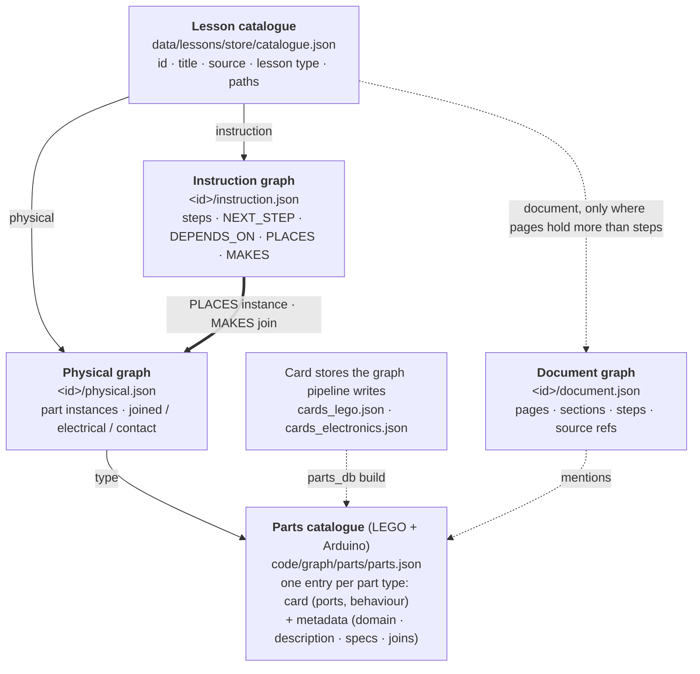
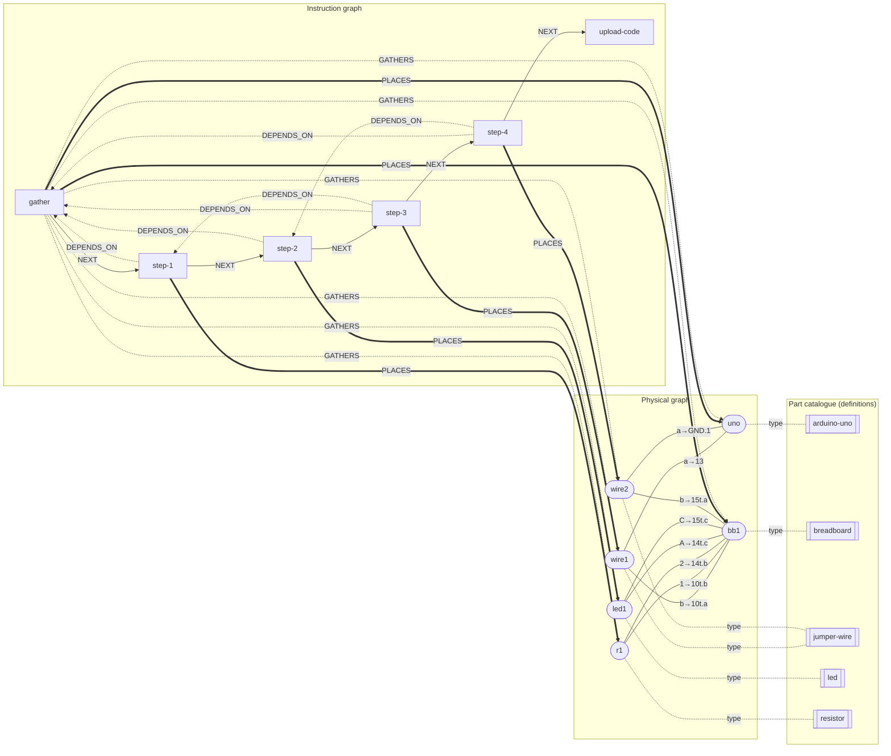
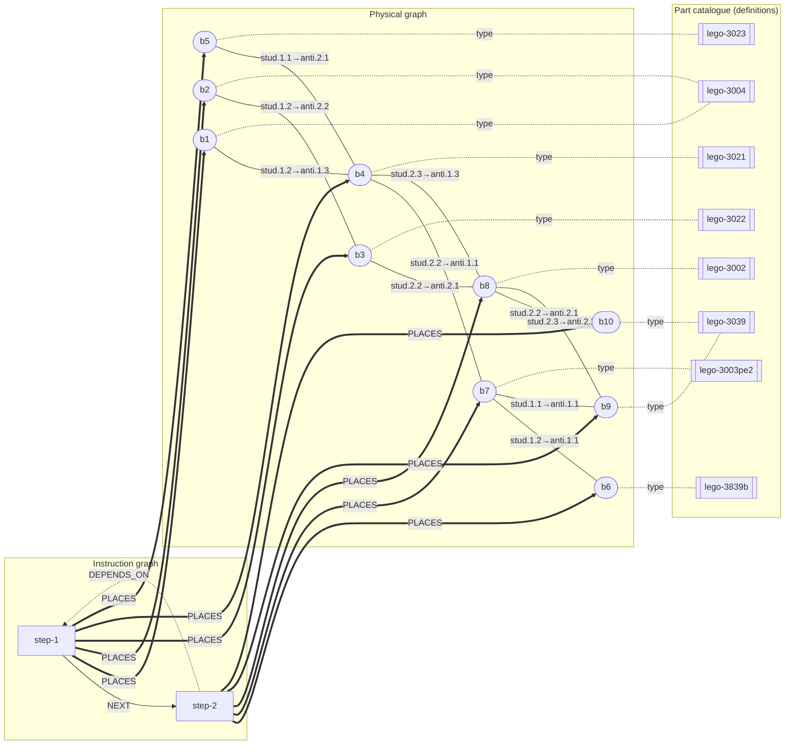

# Pinpoint: Data Structure for Lessons

> **Version:** 0.3 · **Date:** 4 November 2026 (0.2: 22 October; 0.1: 19 October). 0.3 adds §10: the
> database (Neo4j), being integrated.
>
> How a lesson is stored: one **lesson catalogue** that links each lesson to the graphs it actually has, a
> **parts catalogue** of definitions (LEGO and Arduino in one, `code/graph/parts/parts.json`), and the graphs themselves. Piloted on one Arduino lesson (Blink) and one
> small LEGO set (2134-1). Code: `code/graph/lesson_store.py` (store and assembler), `code/graph/parts/part_metadata.py`
> (metadata drafted by Claude, checked by code). One graph per manual and its connection types:
> [`GRAPH_SPEC.md`](./GRAPH_SPEC.md). How lessons are planned: [`LESSONS.md`](./LESSONS.md). The data as it is
> stored, section by section as on the shared page *Pinpoint Lesson Data*: [`DATASTRUCTURE.md`](./DATASTRUCTURE.md)
> (generated: `python tests/tools/datastructure_md.py`). The research behind it: [`RESEARCH.md`](./RESEARCH.md) R25, R26, R27
> (batch tests, §8), R29 (the database, §10).

---

## 1. What it is called

The structure is a **multi-layer labelled property graph** with a **type–instance split**:

| Our term | Standard name | Where the name comes from |
|---|---|---|
| The whole structure | **Multilayer network**: several graphs (layers) over related nodes, joined by inter-layer edges | Kivelä et al., "Multilayer networks", *J. Complex Networks* 2014 |
| Each graph | **Labelled property graph (LPG)**: typed nodes and edges carrying key–value properties; parallel edges allowed (a multigraph) | The model behind Neo4j and ISO GQL (ISO/IEC 39075:2024) |
| Physical graph (mechanical joins) | **Liaison graph**: parts as nodes, physical contacts and joins as edges | Bourjault 1984; De Fazio & Whitney 1987 (assembly sequence planning) |
| Physical graph (electrical edges) | **Netlist**: which pins are connected | Electronic design (EDA) |
| Instruction graph (DEPENDS_ON) | **Precedence graph**: which operations must come before which | Assembly line balancing and assembly planning |
| Instruction graph (NEXT_STEP) | **Assembly sequence**: one linear extension (topological order) of the precedence graph | As above |
| Part catalogue vs physical graph | **Type–instance** (Type Object pattern). Knowledge graphs call it **TBox / ABox**; CAD and PLM call it **part definition / part occurrence** (STEP: *next_assembly_usage_occurrence*) | Description logics; ISO 10303 (STEP) |
| Lesson catalogue | **Registry** (catalogue) of each lesson's available representations | Data catalogue pattern |
| Document graph (only where pages hold more than steps) | **Document structure tree** with **provenance** (page, region, extraction confidence) | Layout analysis; W3C PROV |

In one sentence: *each lesson is a multilayer labelled property graph. Its layers are an assembly precedence graph
(instructions) and a liaison graph or netlist (physical), joined by PLACES and MAKES edges, and its nodes are typed by a
parts catalogue.*

## 2. The architecture



**Rules**

1. **A lesson lists only what it has.** A missing representation is `null` in the catalogue, never an empty graph. A
   booklet-only LEGO lesson has a record and a steps graph, and no physical graph (its steps carry their booklet
   page and picture).
2. **Definitions vs instances.** Three identical pins are **one definition** in the part catalogue and **three nodes**
   in the physical graph. Anything that differs between copies is an instance property: colour, a resistor's value,
   a LEGO print (`3003pe2` is definition `lego-3003` plus the print).
3. **Every link has evidence.** PLACES points at a real instance and MAKES at a real join of the physical graph. DEPENDS_ON records `via`:
   either the physical edge that joins onto a part the earlier step added, or `check:<part>` when the step's check
   names that part. Nothing is invented. A PDF that does not establish a connection gets no physical edge.
4. **Every fact is stored once.** What follows from stored facts is worked out when it is read, by one function,
   never stored a second time: a step's previous step (the reverse of NEXT_STEP), the first step (the head of the
   chain), which instances the gather step collects (through the parts list), a program's pins (its code links), a
   join's electrical twin (it follows from the joined edge), which side goes in (always `u`). The lesson builder's
   `single_facts` check names anything stated twice.
5. **IDs** follow GRAPH_SPEC §3 (`b4`, `r1`, `wire2`, `e7`, `uno:13`, `b4:stud.2.3`), not new names.

## 3. The files

### 3.1 Lesson catalogue (`catalogue.json`) and the lesson record (`<id>/lesson.json`)

`catalogue.json` is an index: one row per lesson with its id, name, type and the path of its lesson record; the record holds the paths of its graphs. The
**lesson record** holds what the lesson says about itself as a whole, and points to its graphs:

| Field | Blink | Bison (LEGO 2134-1) |
|---|---|---|
| `name`, `link`, `lesson_type`, `difficulty` | "Blink an External LED", docs.arduino.cc link, arduino, beginner | "Bison" (Rebrickable), rebrickable.com link, lego |
| `description` (about), `how_it_works` | from the tutorial | — (the planner's `notes` instead) |
| `troubleshooting` | entries that span several steps, each with its `evidence` | — |
| `try_next` | "change delay(1000) to delay(200) …" | — |
| `expected_result` | the final check, the circuit's nets worked out from the physical graph, and whether they agree | — |
| `parts_list` | from the gather step; each row points to the instances it accounts for (`jumper-wire` → `wire1`, `wire2`) | Rebrickable's inventory with counts and colours; each row points to its instances (`lego-3039` Black ×2 → `b9`, `b10`); all 10 pieces accounted for |
| `substitutions` | pins the code may move to, what each part may differ in (§3.7) | — |
| `graphs`, `stats` | paths to instruction / physical / document; time and cost (the first step is the head of NEXT_STEP) | same |

A parts-list row matches instances by base design and colour, so Rebrickable's printed `3003pr0053` and the 3D
model's `3003pe2` are both `lego-3003`. A row the build does not fill, or an instance no row covers, is named as a
problem.

**Content lives at the narrowest place it applies to.** The sketch, its walkthrough and its links to the circuit
sit on the upload step, with "you should see …". A troubleshooting entry moves down to a step only when its fix
names parts that one step places (e.g. "swap the long and short legs" → step-2, which places the LED), or when it
is about the code and the upload. Anything spanning steps stays on the lesson. Every moved entry keeps its place in
the source list, so the source rebuilds exactly (§3.6).

### 3.2 Steps graph (`<id>/instruction.json`)

Only steps (and, for LEGO, the sub-assemblies they build).

| Edge | From → to | Attributes | Example |
|---|---|---|---|
| `NEXT_STEP` | step → next step. The previous step is its reverse, worked out when read (not stored) | | `step-1 → step-2` |
| `DEPENDS_ON` | step → a step that must come first (**strict order** when the learner builds). One kind: its `via` joins show why. A join goes onto a part that step puts out, or a wire's end goes next to a part that step put in (a wire has no place of its own) | `via`: the joins | Blink: every build step → gather `via` its joins into the board and breadboard; `step-3 → step-1 via [e3 wire1:b→10t.a, e5 r1:1→10t.b]` (the same strip); Bison `step-2 → step-1 via [e4, e6, e7]` |
| `ALIGNS_WITH` | step → a step whose part this step's part must share a breadboard column with. **No order**: it only checks the two are in the same column as each other, whichever column that is | `ports`: [this step's port, the other's port, planned strip] | Blink `step-2 → step-1 [led1:A with r1:2, 14t]` (the LED and the resistor) |
| `CHECK_NEEDS` | step → a step whose part this step's check names, when nothing else links the two (a DEPENDS_ON or ALIGNS_WITH already implies it). **No order**: the check completes once that part is in | `parts` | none left in Blink or Fade: each of their checks names a part the step depends on or shares a column with |
| `GATHERS` | the gather step → the lesson's parts list. The instances it collects are the ones the list's rows point at (not stored again) | | `gather → lesson:parts_list` |
| `PLACES` · `MAKES` | step → part instance it puts in place · step → a `joined` edge it makes (its `electrical` twin follows from it; the new part's port is the join's `u_port`) | | `step-2 PLACES led1`, `step-2 MAKES e9` |
| `PROGRAMS` | the upload step → the board it loads the sketch onto. The pins it uses are the program's code links (§3.7), not stored on the edge | | `upload-code → uno` |
| `BUILDS` · `ATTACHES` | LEGO step → sub-assembly | `into`: the bigger sub-assembly | `step-n → sub:<name>` |

A step carries its own `text`, `goal`, `hints`, `why`, `troubleshooting` and, for the upload step, `program`
(file, text, walkthrough, `links`) and `expected`.

### Connection names: one vocabulary for every domain

The same names mean the same thing in LEGO and Arduino (and later furniture). A domain uses the edges it needs;
it never invents its own name for one of these.

| Graph | Edge | Means | LEGO (Bison) | Arduino (Blink) |
|---|---|---|---|---|
| steps | `NEXT_STEP` | the suggested order | step-1 → step-2 | gather → step-1 → … → upload-code |
| steps | `PLACES` | step → the part it puts in place | step-1 places b1–b5 | step-2 places led1 |
| steps | `MAKES` | step → a join it makes | step-1 makes b1:stud.1.2 → b4:anti.1.3 | step-2 makes led1:A → 14t.c |
| steps | `DEPENDS_ON` | must come first, `via` the joins | step-2 → step-1 (the 2×3 brick sits on step 1's pieces) | step-3 → step-1 (the wire goes next to the resistor's leg) |
| steps | `ALIGNS_WITH` | two parts meet through a connector part, either order | (a Technic pin joining two beams, later) | led1:A and r1:2 in one breadboard strip |
| steps | `CHECK_NEEDS` | the step's check names another step's part, when nothing else links them | | |
| steps | `GATHERS` | gather step (or a bag) → the parts list | (a bag, later) | gather → the parts list |
| steps | `PROGRAMS` | step → the board it loads code onto | (a SPIKE hub, later) | upload-code → uno |
| steps | `BUILDS` · `ATTACHES` | step → a sub-assembly it builds · attaches | sub-builds | (a soldered module, later) |
| physical | `joined` | held together: `method`, `holds_by`, `freedom`, `reversible` from one table (`code/graph/lesson_store.py`, GRAPH_SPEC §5.2), `u` the side that goes in | stud into anti-stud: insert · friction · rigid · hand | lead or wire end into a breadboard hole: insert · spring · rigid · hand |
| physical | `contact` | touching, not fastened: `method: rest` when one rests on the other | 4 in Bison | |
| physical | `electrical` | current can flow between the two ports | | one per wire end and leg |

A value an edge states itself is its own fact and is kept: a header soldered on is `solder`, undone with a `tool`.
Where that is not the table's value, the lesson builder lists it under `join_notes` for review. Domain extras sit
under their own name (`wokwi` on an Arduino edge) and never replace these fields. Across the 97 Arduino circuits
the table gives 1,816 of 2,145 joins; the rest have a part whose card names no ports.

### 3.3 Physical graph (`<id>/physical.json`)

The nodes and edges of GRAPH_SPEC §4–5, plus the catalogue they are typed by:

```json
{"part_catalogue": "code/graph/parts/parts.json",
 "nodes": [{"id": "b4", "type": "lego-3021", "label": "Plate  2 x  3",
            "props": {"colour": "Black", "ldraw": "3021.dat", "ldraw_pos": [-20.0, -8.0, 0.0], "ldraw_rot": [[...]],
                      "anchor": {"column": 0.56, "row": 1.0, "layer": -3.6, "turn": 270.0, "tilt": 0.0, "roll": 0.0},
                      "official_step": 4, "official_sub": ""}}],
 "edges": [{"id": "e7", "type": "joined", "u": "b4", "u_port": "stud.2.3", "v": "b8", "v_port": "anti.1.3",
            "method": "clutch", "holds_by": "friction", "freedom": "rigid", "reversible": "hand",
            "direction": {"from": "b4", "into": "b8"}}]}
```

| Property | Where | Meaning |
|---|---|---|
| `ldraw_pos`, `ldraw_rot` | LEGO node | the piece's place in the 3D model (LDU, stood upright) |
| `anchor` | LEGO node | its place in the lesson's anchor frame for AR: column, row, layer (studs, plates), turn, tilt, roll |
| `official_step`, `official_sub` | LEGO node | LEGO's own step and sub-build for the piece |
| `wokwi` | Arduino node | the Wokwi part: type, top, left, attrs; for a wire, its connection, colour and route |
| `direction` | joined edge | GRAPH_SPEC §5.1: which side goes into which |
| `touch` | LEGO contact edge | the box method's word for a touch no stud, pin or clip explains: contact, rest, insert |
| `wokwi` | Arduino edge | the colour, route and ends of the Wokwi connection it draws |

A connection that is mechanical and electrical (a wire end in a hole) is two edges between the same ports. A LEGO
piece's `sits_on`, `holds` and `fastens` are **not stored twice**: they are its edges (fastens = joined; holds =
every edge; sits_on = the clutch edges whose stud is in it). The audit (§3.6) checks they agree with the source.

### 3.4 The parts catalogue (`code/graph/parts/parts.json`)

**One catalogue for every domain**: 1,229 parts, 1,058 LEGO and 171 Arduino, one entry per part type, keyed by its id.
Each entry is the part's **card** (what code trusts: ports, inside behaviour, polarity, electrical values) plus a
**`metadata`** block whose `domain` says which kind of part it is:

```json
"led": {"part_type_id": "led", "display_name": "LED", "category": "led",
        "ports": [{"id": "A", "kind": "lead"}, {"id": "C", "kind": "lead"}], "intrinsic_behaviour": {...},
        "electrical": {"forward_v": 2.0, "current_ma": 20.0, "needs_series_resistor": true},
        "metadata": {"domain": "arduino", "source_catalogue": "code/graph/parts/arduino/cards_electronics.json",
                     "card_made_by": "verified", "description": "A light-emitting diode ...", "joins": [...], ...}}
```

| Metadata field | Example (`led`) |
|---|---|
| `domain` | **`lego` · `arduino`** (the Arduino set also holds the 6 Raspberry Pi parts the electronics lessons use) |
| `source_catalogue`, `card_made_by` | the card store it came from; who made the card: `code` (LDraw), `verified` (CircuitQuest), `claude` |
| `description` | "A light-emitting diode that glows when current flows from anode to cathode ..." |
| `material` | "plastic with semiconductor" |
| `specifications` | `forward_v 2.0 V (card)`, `current_ma 20.0 mA (card)`; each has a `basis`: card · image · general knowledge |
| `joins` | per port kind: `mates_with`, `method`, `holds_by`, **`reversible`** (hand · tool · damaging · permanent), `checked` |
| `size_studs`, `dimensions_mm` | LEGO only: "1 x 2", [8, 16, 3.2] |
| `learner_tips` | "The longer leg is the anode (A, positive) ..." |
| `card_issues` | where Claude thinks the card is wrong (code checks the claim) |
| `status`, `checks_failed`, `via` | `drafted (claude)`; failed checks; `vlm` (LEGO, with a picture) or `llm` (Arduino) |

**One id per part type, so a new lesson only adds what is new.** Claude gets strict naming rules before it builds,
and code checks every new type against them and against the catalogue before storing it (`code/graph/parts/naming.py`;
GRAPH_SPEC §3). A lesson with one new part adds one card. Part metadata is drafted only for parts that have none
(`part_metadata <lesson>` skips the rest; `--redo` asks again).

Claude only writes the metadata block, never the card. The graph pipeline (`v3.py`, `code/graph/parts/`) still adds
new cards to its two card stores while it builds graphs; `python graph.parts.parts_db build` merges them in, keeping
every metadata block, and refuses an id found in both. So far 8 LEGO parts (the pilot set's) and all 171 Arduino
parts have drafted metadata.


**What a part fits, and which ports can swap, by code.** Each electronics part also carries two fields worked out by
code (not drafted by Claude, whose `joins` names only the most common mate):
- `metadata.fits`: each port kind → everything it can go into or onto (`joins.FITS`): the other port's kind,
  `method`, `holds_by`, `reversible`, and example catalogue parts with that port. A `resistor`'s lead: a breadboard
  hole, a header socket, a female jumper end or clip, a screw terminal (undone with a tool), a solder pad.
- `metadata.interchangeable`: ports that can stand in for each other, written out as groups
  `[{kind, ports, why}]`: `not-polarized` (`resistor` [1, 2], never an `led`'s A and C), `card-symmetric`,
  `same-pin` (`arduino-uno` [GND.1, GND.2, GND.3]), `joined-inside` (a wire's two ends), and for the breadboard every
  `strip` ([12t.a … 12t.e], 126 of them) and `rail` ([tp.1 … tp.63], 4). One port's swaps are worked out on read:
  `part_catalogue.swaps("breadboard", "12t.c")` → 12t.a, 12t.b, 12t.d, 12t.e (not 12b.f: across the gap). 115 parts have
  `fits`, 47 have interchangeable ports. The breadboard is a full one, columns and rail holes 1-63, as the lessons use.
- `metadata.connect_by` `[{way, tool, text}]` and `metadata.takes` `[{what, text}]`: the same as codes, with plain
  words for the learner and the tutor (`way`: breadboard, header-socket, female-jumper, onto-header-pin,
  screw-terminal, solder; `tool`: screwdriver, soldering iron, or none). A `resistor`
  connects on a breadboard (no solder), into a header socket, with a female jumper wire or a clip, in a screw
  terminal (with a screwdriver), or soldered (to a pad, a perfboard or a wire); an `arduino-uno`'s headers take a
  part's leg, a header pin, a module's pin or a male jumper wire.

**Codes, not free text.** So that code can check and answer before Claude is asked, everything in a part's metadata
except its `description`, its `learner_tips` and the reasons (`why`) is codes and numbers. Claude drafts in words;
`part_metadata.normalize` turns a draft into codes by code (on every draft, recheck and catalogue build; running it
twice changes nothing), and keeps the original phrase only where it says more:

| Field | Stored as | Example |
|---|---|---|
| `size_studs` | `[w, l]` studs, shorter first | `[1, 2]` |
| `reverse_power` | `damage` · `no-harm` · `protected` · `n/a` | `damage` (a servo) |
| `material` | codes (`abs`, `plastic`, `pcb`, `metal`, `glass`, `copper`, `ceramic`, `rubber`…); the phrase in `material_text` | `["carbon", "metal"]` |
| `joins[].mates` | port-kind codes (`stud`, `anti-stud`, `breadboard-hole`, `header-pin`, `header-socket`, `wire-end`, `lead`, `screw`, `pad`, `usb-micro`, `grove`, `minifig-neck`…); the phrase in `mates_text` | `["breadboard-hole", "wire-end"]` |
| `basis` | `card` · `image` · `maker-page` · `general-knowledge` | |
| `specs.interface`, `specs.wireless` | lowercase codes, no "none" | `["i2c", "spi", "uart"]` |
| `substitutes.value` | `by-role` | |
| `status` | `drafted` (with `drafted_by`, `via`: `llm` or `vlm`) | |
| `checks_failed` | `[{rule, message}]` | `{"rule": "M4", "message": "…"}` |
| `connect_by` · `takes` · `fits` · `interchangeable` | codes, by code (above) | |

**Every new part follows the same rules** (`part_metadata.describe_new`), whichever way the lesson is made: the
parts-first stage for an Arduino link (after the shop lookups), the lesson store's `build` (any part the lesson uses,
including one the circuit builder added mid-build), and the booklet route (every part of the set's inventory is
carded first, `pdf_lesson.card_parts`). 1 the part has a card; 2 Claude drafts its metadata, only if it has none; 3
code checks the draft (M1-M11, C1); 4 it is stored as codes (`normalize`); 5 the catalogue is rebuilt, which adds the
fields code works out (fits, connect_by, takes, interchangeable, substitutes, pin facts). A part that already has
metadata is never asked again.

**Who reads these fields.** The progress checker takes which holes are one strip, which pins are the same and which
legs swap from `interchangeable` (`part_catalogue.connection`, `part_catalogue.either_way`), the same facts the tutor and the
page show; the circuit builder's part list carries each part's `connect_by` and `takes` codes.

Every field a part carries, for five example parts, is in [`DATASTRUCTURE.md`](./DATASTRUCTURE.md) ("A part, in full").
### 3.5 Booklet-only lessons (PDF, no 3D model)

A LEGO set whose only source is the booklet PDF (no 3D model) has **no physical graph**: models were not good at
working out exact joins from pictures, so none is guessed. The lesson is the record and the steps graph, and the
steps point at **parts-list rows** instead of instances (`code/graph/lego_booklet/pdf_lesson.py`). A booklet step *is* the lesson
step, so it is one node: where it came from in the booklet is part of the step, not a second graph.

| Graph | Nodes | Edges |
|---|---|---|
| lesson record | `result` (the finished set: picture, description); parts list: one row per Rebrickable inventory row (part, colour, name, count, the steps that add it); `source` {booklet PDF, pages}; `order: strict` | — |
| steps | `overview` (the first step: "Today you build a mailbox, a flower stand and Stephanie"); one `product` node per **build** (a model, or a figure built on its own: `name`, `role`, `result` = its last step's picture and description); `step` nodes numbered as the booklet: `stand-7`, and a sub-build's steps inside the main step that needs it: `stand-7.1`. A step holds its words (`text`, `description`, `what_changed`), `times` (a sub-build's "2x"), `confidence`, `view`, and `source` {page, crop, picture, overlay, booklet label, changed regions, arrows}; `callout`, `problems`, `added_by_repair` when there are any | `SHOWS` overview → each build {order}; `STARTS` build → its step 1, and main step → its sub-build's first step {name, times}; `NEXT_STEP` only inside one build or one sub-build; `PLACES` step → `lesson:parts_list/i` {count (× times), where} |

Worked out, not stored: which build a step is in, a build's last step and parts, and the whole order
(`lesson_store._order`: the overview, each build in SHOWS order, a step's sub-build just before the step).

**The booklet's layout, by code** (`booklet_layout.py`): main steps are the largest step-number digits; a new build
starts where the numbers start again (a mailbox 1-3, then a flower stand 1-8 on one page), read column by column;
a sub-build is a cream panel with its own smaller numbers (none: one step), "2x" beside it, attached in the main step
its dark connector line leads into, else the next main step in reading order; a panel whose line leads elsewhere (a
figure drawn finished beside it) is a build of its own, and that finished picture is its last step. Two steps one
above the other are split at the empty strip between their pictures, not at the lower number (a mailbox taller than
its "2"). Each step is compared with its own previous step (in its build or sub-build); the first step of a build or
sub-build starts from nothing. Build and sub-build names: one small call with the set's name at the end.

Results (order scored only inside each build; separate builds have no order between them):

| Set | Builds · sub-builds | Steps | Ready | Order | Model pieces matched | Cost |
|---|---|---|---|---|---|---|
| 30103-1 Car | white car, Stephanie | 9 | yes (2 to review) | 1.000 | 30/35 | $0.59 |
| 30105-1 Stephanie and Mailbox | mailbox, flower stand (4 sub-builds), Stephanie | 19 | yes | 0.976 | 34/41 | $0.99 |
| 30055-1 Vulture Droid | droid starfighter (3 sub-builds, the wing 2x) | 17 | yes | 0.910 | 42/42 | $0.60 |

Before the layout parser the two new sets came out at 0.64 and 0.73: the cutter took the sub-build numbers for main
steps and mixed the two builds' steps together. Every part of the three sets now has a card and metadata (8 minidoll
parts carded, 54 parts drafted: $0.51).

What a step adds is stored only in its `PLACES` edges (not also on the node). `document` stays in the catalogue's
list of graph kinds for a source whose pages carry more than steps (a manual with sections, text pages).

**Ready only when every piece is placed.** `assemble` works it out for every booklet-only lesson (it is not
stored): for each parts-list row, the steps' PLACES counts must add up to the row's count, or the lesson is not
ready (`checks.ready`, `checks.problems`). What a repair or the end allocation placed is listed in `checks.review`.
Lessons with a physical graph already had theirs: every instance placed by exactly one step, every join made once.

**No step out of order.** A PDF lesson keeps the booklet's order strictly (no `DEPENDS_ON` / `ALIGNS_WITH`: there is
no physical graph to derive them from).

How one is made:

| | Who | What |
|---|---|---|
| 1 parts list | code | the set's inventory from Rebrickable (all 106 booklets are covered; 45,646 sets in the dump) |
| 2 parts sheet | code | a picture of every row in its colour (Rebrickable's render, else the element photo), numbered as the list: `parts_sheet.png` |
| 3 cut steps | code | each numbered step's picture (`steps/stepN.png`), cut to the step itself (`step_diff.tighten`: a dark divider line the booklet draws, or the rows where the step's own background ends, stops the cut, so a "rate this set" panel or an advert of other sets is left out), its red-box changes enlarged (`zooms/`), and an **overlay** (`overlays/stepN.png`): the previous picture lined up on this one (ORB features + a homography), what was already there faded to grey, what changed in colour with a red outline; specks, page lines and a new page's background are left out |
| 4 read each step | Claude (Sonnet) | gets the parts sheet, the previous picture, this picture, the overlay and the enlarged changes; says which numbered rows this step adds, how many, where, describes the whole model in full and what changed, and writes the instruction |
| 5 check each read | code | every row exists, never more than is left, the call-out box agrees, no part ids in the words; problems go back (up to 2 repairs). Each read is also told what the previous step added, and that a piece drawn beside the model with arrows is added in that step (not again in the next) |
| 6 repair leftovers | Claude (Opus) + code | Claude counts each piece no step added inside every step's change; code gives it to the first step showing more than its read had; copies still left go to the step if it is the only one seen adding that piece (flagged for review) |
| 5s size | code | `booklet_size`: each part's outline from the booklet's angle (its LDraw model), step 1's single piece for the picture's scale, and each step's new pixels sorted by colour (coloured parts only: in a line drawing black outlines, white, clear and grey parts cannot be told apart); a colour with over 1.5x the area the read's pieces of it cover is asked about once while reading |
| 5a arrows | code | `step_diff.arrows`: the booklet's arrows from the PDF (a red line ending in a small filled red head; the line is often clipped, so its visible start is found by walking back along it in the picture). They are taken out of every change (overlay, areas), and each read is told where each arrow starts and points, with the area around the start enlarged (cut from the clean PDF): the piece is there, and an arrow is never a part |
| 6b balance | code + Claude | `booklet_size.balance`: two neighbouring steps compared by their whole new area (every colour, white too; the scale cancels): where one shows under 0.45 of the other's new area for what it was read to add, the pieces whose move would even them out are the candidates; one kind is moved by code, several are put to Claude with both pictures, and only a candidate is taken; both steps are reworded |
| 6s symmetry | code | the 3D route's S11 (left/right twins together): copies still left, where exactly one step added the same number on one side, are that step's hidden twins on the far side; a Left part and its Right twin more than a step apart are flagged. The reading prompt also says it: count hidden twins |
| 6z size fill | code | copies still left go to the one step whose unexplained area of their colour they fit (outlines 0.6-2x the unexplained area: a piece partly hidden shows less, never more); flagged for review |
| 6a allocate | Claude (Opus) + code | the last try before the lesson is final: pieces still left get a step from Claude, who sees every step's picture, what it was read to add and its descriptions; code takes an answer only for a real step, within what is left, when the step's own words name the piece's colour and Claude's confidence is at least 0.6; each one is flagged on the step for review |
| 6b reword | Claude + code | a step the repair added to is reworded so its instruction and what changed cover every piece; no part ids (checked) |
| 7 build | code | record and steps graph (each step with its booklet page and picture); registered as `<set>-pdf` |
| 8 score | code | only where a 3D model exists (never used to build): pieces matched to a step, and how often two pieces come in the same order as the model |

Car (30103-1, 32 pieces, 8 steps): with the parts list as text only, the two pink 1x2 tiles under the seat were
missed in every run (Sonnet and Opus counted 0 or 1, order agreement 0.909-0.941). **With the numbered parts sheet
both were read in step 2 the first time**; 0 pieces left over, order agreement **0.981**, 30/35 model pieces matched
(the other 5 are the minifigure's pieces, which the inventory lists as whole figure parts). 135 s, $0.42.
**Adding the overlay** (and the two descriptions): order agreement **1.000**, with no repairs; the white bracket moved
from step 4 to step 6, where the model has it. 119 s, $0.40. The overlay is a hint, not the truth: on the last step
the cut takes in the whole back page, and the rule that ignores the top of a picture (where the parts box sits)
hides the car, so the overlay misses the wheels and the figure; the descriptions still name them from the pictures.
**Cut to the step** (fixes that): step 7 lost the "rate this set" panel and step 8 the advert of other sets below
it; step 7's grille tile is then read directly, and step 8 no longer counts step 7's pink tile (drawn beside the car
with arrows) as new. Final: 0 left over, order agreement **1.000**, 30/35 matched, 122 s, $0.29. Run to run, the two
pink tiles under the seat stay the hardest read (0, 1 or 2 found in step 2 across runs); the repair's count and the
only-step rule exist for them.

**Which of the 3D route's rules (lesson.py) apply.** S1 every piece once: the parts check. S7 LEGO's order: the
booklet's, strictly. S11 twins: the symmetry rule. S4, S5, S10, S12, S13 (how to group a step) hold already: the
booklet's grouping is LEGO's own, which those rules accept by definition. S2, S6, S8 (no floating piece, can get to
its place, room for a finger) need the 3D geometry, which a booklet-only lesson does not have.

**300 DPI** (the booklets' own resolution; was 150): the seams between the two pink tiles are sharp lines in the
enlarged crop. Two runs: run 1 read every piece in the right step with no repair (order agreement 1.000, $0.38, the
stored lesson); run 2 missed both tiles again, its repair and allocation refused to guess, and the lesson was NOT
READY (the gate held). The step 2 tiles remain the one read that varies between runs.

**Size by code.** Steps read right measure 0.5-1.1 of the area their coloured pieces cover (median 0.71-0.79: a new
piece is partly hidden by what is built). Run 2's step 2, read as the pink panel alone, measures **1.7x**: the size
question fires, and on its leftovers the size fill puts the two tiles in step 2, where the 3D model has them (offline,
on run 2's saved reads). Run 1 raises no size question at all. A third run (with it on) read every piece right first
time and nothing fired: READY, order 1.000, $0.36. It also showed that run 1's white mudguard (step 4) belongs to
step 5: the order score cannot see that (the two are next to each other in the model), the areas did.

**Balance, on that run** (the headlight mudguard read in step 4): step 4 showed 0.33 of step 5's new area for its
pieces. Code's candidates: the two white mudguards (the white bricks do not fit by size). Claude, shown both steps:
"in step 4 the front of the car is still a bare yellow 2x4 plate ... in step 5 a white 2x4 mudguard with curved
fenders and molded headlights covers the yellow front plate". Moved to step 5, both steps reworded: READY, order
1.000, every piece now where the booklet adds it.

**Pieces drawn high up, and pieces that moved.** The step comparison used to leave out the top 22% of every picture
(where bigger sets print the parts box), which hid a piece floating above the model on arrows (step 6's lavender
plate) and, earlier, step 8's wheels. Now only the step number's corner is left out (the parts box is found by its
colour). Two kinds of change are not new pieces and are taken out: where the previous step's arrows pointed (the
floating piece is now in place there; a disc as large as that piece), and pixels that are now the step's own
background (something went away). A fresh run with all of it: READY, order 1.000, the headlight mudguard read in step
5 and the floating plate in step 6 directly, one of step 2's tiles placed by the recount, $0.54.

### 3.5b The vocabulary, and the level 1 validator

**One vocabulary** (`code/graph/parts/part_metadata.py`) lists every code field of a part's metadata and the codes it may take: port
kinds, what a join mates with (port kinds and connectors), join method, holds by, reversible, reverse power,
materials, basis, interfaces, wireless, swap-group kinds, connect-by ways, takes, tools, status. Claude's drafting
schema is built from it, so a new part is drafted in these codes; `normalize` converts older drafts; the validator
checks against it. Free text is only the description, the tips, the reasons (`why`) and an original phrase kept
beside its code (`material_text`, `mates_text`).

**The level 1 validator** (`python ./pinpoint lesson_store validate`, report in `data/validation/`) checks that every
stored lesson and every part follow the structure's own rules, by code:

| Rule | Lessons |
|---|---|
| L1 | the record has its required fields, and every graph it lists is there |
| L2 | the assembler's checks: links resolve, every fact once, every piece placed, the code's pins wired (a pin the source reads unwired on purpose carries `unwired: <why>` on its code link, listed for review) |
| L3 | the order reaches every step exactly once |
| L4 | step ids follow the naming (`step-3`, `gather`, `upload-code`, `flower-stand-7`, `flower-stand-7.1`) |
| L5 | only known node kinds and edge types, with the fields an edge type needs |
| L6 | every part the lesson uses has a card and metadata |

| Rule | Parts |
|---|---|
| P1 | only known metadata fields |
| P2 | every code field holds codes of the vocabulary |
| P3 | the card's port kinds are known |
| P4 | a described part has every drafted field it needs |
| P5 | an electronics part with ports has what code works out (fits, connect_by or takes, interchangeable) |
| P6 | the id follows the naming pattern |
| P7 | no card is another card under a second id (N7: one shop page, or its model number) |

First run (20 October 2026): **6/8 lessons and 1,234/1,238 parts valid, 0.3 s.** It found a real data error in the Sea
Helicopter lesson (4017-1: two joins use a stud `stud.2.2` that `lego-3660` does not have), the Uno WiFi Rev2 sketch
reading an unwired pin (A1), a join with a port kind outside the vocabulary (`heat-shrink`'s `sleeve`, added), the
join table using two `holds_by` values the schema does not allow (fixed: a screw terminal clamps by `force`, solder
holds by `material`), and four cards that may be one part under two ids (`arduino-mkr1000` and its `-headers` and
`-wifi` copies; `temp-dht11` and `dht11`).

**The fixes, and how a data error is fixed.** A data error is fixed where it comes from, then the rule that let it in
is tightened, so it cannot come back:

| Issue | Cause | Fix | Stops it coming back |
|---|---|---|---|
| Sea Helicopter joins use `lego-3660:stud.2.2` | the card had no top studs | `add_shape_studs` adds the studs the LDraw shape has to 68 LEGO cards; lesson rebuilt, audit lossless | cards get their studs from the shape |
| four, then **eleven**, groups of cards from one shop page | a board read once by its power pins and once by its headers (`-headers`, `-pins`), or a part named twice (`temp-dht11`; the ingest prompt still taught that name) | `merge.py`: one id per part, the fullest port list (`BAT` kept as an alias of `BATT`), the richer electrical facts, metadata rechecked; 15 ids became redirects; 12 lessons re-pointed. The MKR1000 and the MKR WiFi 1010 are two boards (`arduino-mkr1000`, `arduino-mkr-wifi-1010`); the Nano 33 BLE card had the Sense's page and name (fixed, its metadata redrafted) | N7 refuses a card from a page that has one; P7 checks it over the catalogue; the ingest prompt no longer teaches `temp-dht11` |
| Uno WiFi Rev2 sketch reads `A1`, nothing wired | not an error: the tutorial prints a "random reading" from a floating pin | its code link carries `unwired: <why>` | an unwired pin without a reason is still an L2 error |

After the fixes: **8/8 lessons and 1,223/1,223 parts valid** (157 electronics parts, 1,066 LEGO), 61 tests pass.

### 3.6 Lossless: the audit

The network is the data, so nothing in the old files may be lost. `audit` **rebuilds the original files from the
network alone** (`export_arduino`, `export_lego`) and compares them field by field with the files the lesson was
made from:

```
python -m graph.lesson_store audit blink 2134-1
blink lesson.json: lossless        blink graph.json: lossless      blink diagram.json: lossless
blink stats.json: lossless         blink code.ino: lossless
2134-1 lesson.json: 4 differences  2134-1 stats.json: lossless
```

The four LEGO differences are one join: the handle plate `b6` sits on the red brick `b7` (`b7:stud.1.2 →
b6:anti.1.2`). The saved lesson (15 October) was made before the stud matcher learned plates with handles, so it
has `b6` held only by touching. The network is built from the 3D model by today's code, so the audit is flagging a
**stale source file**, not data loss. A test (`test_lesson_network_is_lossless`) also checks that a field the
network does not know about is reported.

### 3.7 Pins, code links and substitutions (making the code adaptable)

- **Pins are sub-parts with capabilities.** A board's ports in `parts.json` carry `can` (digital · analog · pwm ·
  interrupt · i2c · spi · uart), `builtin` (LED_BUILTIN), `reserved` (pins 0/1 carry the USB upload) and `same_as`
  (every GND). They come from CircuitQuest's board cards plus each board's documented pinout (Uno, Nano, Mega,
  Leonardo: `code/graph/arduino/pins.py`). 12 boards are annotated. A board whose PWM pins are not documented refuses a
  PWM swap rather than guessing.
- **The code is linked to the circuit when the lesson is built** (`code/graph/arduino/pins.py`, its links). Every place the sketch
  names a pin is linked to the port it means and records what the code needs from it. Blink:
  `pinMode(LED_BUILTIN, …)` lines 28/33/35 → `uno:13`, needs digital. Fade: `int led = 9` → `uno:9`, needs
  digital + pwm. A comment next to a line that uses the pin is linked too; a header comment about the board is not.
  Library pins (Wire, Serial) are `fixed`; a computed pin (an array) is `unresolved` and cannot be moved.
- **A pin can stand in** when it can do everything the code needs, is not reserved, and is not used by another part.
  Blink's pin 13 → any free digital pin; Fade's pin 9 → only 3, 5, 6, 10, 11 (PWM); each other pin gets a reason.
- **Part-level substitutes** sit on the definition (`metadata.substitutes`): an LED or a LEGO piece in any colour,
  a wire in any colour or length. A resistor's range is worked out per lesson from what it does. Blink's 220 Ω in
  series with the LED may be 150–600 Ω, which keeps the LED between 5 mA (an assumption: still clearly lit) and the
  LED card's 20 mA.
- **Adapting stays outside the lesson.** A learner's wiring is a session map (planned port → actual port). The
  code is rewritten at exactly the linked places (`code_links.rewrite`), and the step checks and the expected
  result read ports through the same map. The lesson is never edited.
- **The expected result is worked out from the circuit**, not trusted as a copy. Blink's and Fade's stored final
  checks both agree with the nets of their physical graphs.

## 4. How a lesson is put together (`assemble`)

```mermaid
sequenceDiagram
    participant A as assemble(lesson_id)
    participant LC as Lesson catalogue
    participant IG as Instruction graph
    participant PG as Physical graph
    participant PC as Part catalogue + metadata
    A->>LC: row for lesson_id
    LC-->>A: paths of the graphs it has
    A->>PG: instances and edges
    A->>PC: definition of every instance type (exact, base design, or family)
    PC-->>A: card + drafted metadata; ports checked
    A->>IG: walk NEXT_STEP from the first step
    loop each step
        A->>PG: resolve PLACES (instances) and MAKES (joins)
        A->>IG: DEPENDS_ON must point back along NEXT_STEP
    end
    A-->>A: checks + parts list + timing
```

Checks while assembling: every listed file exists; every instance has a definition; every port is on its definition
(`exact`, `pattern` such as the breadboard's `<column><bank>.<row>`, or only `kind`); NEXT_STEP is one chain;
DEPENDS_ON only points back; every PLACES and MAKES target exists; every part is added once and every join is made once.
Missing join attributes on an edge are filled from the metadata of the side that holds (the socket), and only from
joins that passed their checks.

```
python -m graph.lesson_store build arduino blink      # store the graphs and register the lesson
python -m graph.lesson_store build lego 2134-1
.venv-research/bin/python graph.parts.part_metadata blink 2134-1   # draft + check metadata (Claude)
python -m graph.lesson_store show blink 2134-1        # assemble -> <id>/assembled.json, assembled.md
python -m graph.lesson_store mermaid blink            # the diagrams below
```

### 4.1 Building in any order, within the rules (Arduino)

When the learner builds, **DEPENDS_ON is strict order** and **ALIGNS_WITH only checks alignment**. NEXT_STEP is
just the suggested order. A wire has no place of its own: its ends go where the parts it connects went
(its DEPENDS_ON goes via the wire's join and the part's join into the same strip), so a wire never fixes a column. A part's leg does, even if the wire went in first.
Two parts that share a column (ALIGNS_WITH) may go in either order: the first one fixes the column, and the other
must be in the same one, not necessarily the planned one.

`code/graph/arduino/graphs.py` (progress) takes what the learner has wired (in the order it went in) and their pin map, and builds the
learner's **layout** (planned strip → strip actually used):

| Learner does (Blink) | Result |
|---|---|
| Orange wire before the resistor | step-3 **too early**: "step-1 first (via e3, e5)" |
| Wire in 10, then resistor in 12/16 | resistor done; the wire is **wrong**: "must go in column 12t, with r1:1" |
| LED first, in 14/15 | step-2 done: ALIGNS_WITH sets no order; the resistor's leg must then go to the LED's column |
| Resistor in 12/16, then LED in 16/20 | both done: aligned with each other, not in the planned columns |
| Both LED legs in one column | **wrong**: two nets joined (a short) |
| Resistor turned round, other holes, GND.2, pin 12 with the pin map 13 → 12 | done |

Board pins must be exactly right, read through the pin map, and every GND pin is GND. A step not done yet gets its
real target ("16t, where that strip's other part already is", or "any free column, e.g. 15t"). LEGO is not covered
yet: there a piece put on early can stop a later one going in, so it needs GRAPH_SPEC's `blocks` edges (computed by
`assembly.py`, not yet stored in the graph).

### 4.2 Adding a new lesson

**The order: parts first.** Everything after the parts is built on them, so the parts are settled first, and
described, before the circuit is built (`part_review.parts_first`, run by `circuit_lesson.py` before the circuit):

| # | Stage | Who | Checked by code |
|---|---|---|---|
| 1 | Match the parts list | code: each item of the tutorial's hardware list to a catalogue type | — |
| 2 | Review the matches | Claude, with the catalogue tools: confirm, change to an existing type, or new | R1 the type exists or a new id passes the naming rules; R3 the item's model numbers are the type's; a "new" part is refused when the matched catalogue part fits the item's name. Only what code confirms counts |
| 3 | Add the parts that are really new | code: the approved shops; Claude drafts the card if none has it | card format, naming rules N1-N6 |
| 4 | Describe the new parts | Claude: standard metadata, only for parts that have none | M1-M11 |
| 5 | Build the circuit | Claude, told the settled parts | E1-E11; V4 every port it wires is on the part (R2 moved here: it needs the circuit) |
| 6 | Plan the steps | code suggests, Claude orders and writes | lesson rules |
| 7 | Build the lesson network | code | links resolve, every fact once |
| 8 | Teach it | Claude tutor + code progress checker | — |

Why: when the review came after the circuit, a type it changed left the circuit, the steps and the network built
on the wrong part, and a part whose card step 3 had just drafted could turn out to be one the catalogue already had.
Now a wrong match is fixed before anything uses it, and a duplicate is never made.

Tested on the Uno WiFi Rev2 tutorial's list (board, generic LED, 220 Ω resistor, breadboard, jumper wires): all 5
confirmed, 12.5 s, $0.04. With planted wrong answers (offline test `test_parts_first_review_is_checked_by_code`):
"change the R4 WiFi to `arduino-uno`" refused (R3), "new `resistor-220`" read as the catalogue's `resistor`, "new
`ultrasonic-sensor-x`" for an HC-SR04 refused (the catalogue's `hc-sr04` fits).

**The first run (19 October 2026)**, before the order changed:

The Uno WiFi Rev2 web-server lesson: an LED and a 220 Ω resistor on a breadboard, driven from pin 2, on a board
the catalogue did not have.

| Step | What happened | Time, cost |
|---|---|---|
| Build the network (code) | 5 of 6 instances resolved to existing definitions and reused their metadata; `uno1` (`arduino-uno-wifi-rev2`) had none, so the upload step could not find its board | 4.7 s |
| Naming check | First said the new board "looks like" the Uno R4 WiFi: a bug (a revision was treated as packaging). Fixed: `rev2`, `r4` count as other hardware. Then: a new part, passes | |
| Card from approved sources | Adafruit, SparkFun, Pololu: none sells it; each wrong match rejected; stopped at the 3-check budget | 33 s, $0.06 |
| Card drafted by Claude | 29 header pins in the catalogue schema; passed the schema gate, the naming rules, and covers every port the lesson uses; stored as made by Claude | 16 s, $0.04 |
| Rebuild + metadata | all 6 definitions exact, PROGRAMS edge present; metadata drafted for **1** part, 4 reused | 7 s, $0.02 |

**Was the part really new?** Before it was added, its id was not in the catalogue, no card had "WiFi Rev2" as a name
or alias, and the search's nearest cards were other boards (Uno R3, Uno R4 WiFi, Opta WiFi, MKR1000 WiFi, Uno R4
Minima). The Uno R4 WiFi is other hardware (an RA4M1 board; the Rev2 is ATmega4809), so it was right to add it.

**Was it filled in correctly?** Checked against Arduino's store page: 14 digital pins (5 PWM), 6 analog, LED_BUILTIN
25, 6-20 V recommended input. Claude's draft had 7-12 V and LED_BUILTIN 13: both corrected, its values kept as
`overridden`. The store page does not say which pins are PWM, so the card carries none: a PWM swap on this board is
refused, not guessed. Claude's other facts (the NINA-W13 module, PWM on 3, 5, 6, 9, 10, I2C on A4/A5) are marked
`general knowledge`, not `card`. The GND rule the Uno card has was added.

**Found and fixed on the way:** the parts-list matcher treated any name with "WiFi" or "screen" as not a part (meant
for "a Wi-Fi network", "a computer screen"), so a WiFi board in a tutorial's parts list was dropped; and it only
tried the single best search hit, so "Arduino UNO R4 WiFi" matched nothing once the Rev2 card existed. A sketch that
uses Serial no longer gets its serial pins offered as stand-ins. Still open: the sketch reads `A1`, which nothing is
wired to (deliberate here: a "random reading" from a floating pin).

**Conversations, with questions that are not about the current step.** `tutor_test.py --conversations` runs one
session per lesson: the learner goes step by step ("Done. Next.") and then asks things the current step does not
hold. Blink, at step 4: what the whole lesson is about; every part with counts; which step put the resistor in and
where both ends of the black wire go; what ends up electrically connected to pin 13 (the orange wire and the
resistor's leg directly, the LED only through the resistor, not its short leg); what was done two steps ago.
Sea Helicopter, after step 3: what the set is and how many pieces; which pieces are still to come (b8-b13, exactly
the pieces steps 4 and 5 place). **15/15 turns, 61 s, $0.08.** It noted that an Arduino parts-list row has no count
(the tutorial's gather step gives none); the lesson tool now reads it from the instances the row covers.

**The naming check uses the part metadata too.** A lookalike (N4) is vetoed when the two parts' metadata differs on
an identity fact (chip, interface, logic voltage, what a power swap does). And N5 (for review) flags cards whose
names do not look alike but whose category, polarity, ports and model number match and whose names share most words,
with nothing in the metadata against it: in the catalogue, three bulb/socket cards, two 868 MHz antennas, and
`dht11` / `temp-dht11` (one card is the bare sensor, the other the Grove module: a real question, so it is only
flagged).

### 4.4 Standard metadata and a second look at a new lesson's parts

**Metadata has one standard set of fields** (`part_metadata.Specs`, schema version 2): maker, model, chip;
supply_v_min, supply_v_max, logic_v, max_pin_current_ma, current_ma, forward_v (the card's own electrical names, so
code compares them); resistance_ohm, capacitance_uf; interface, digital_pins, analog_pins, pwm_pins, wireless,
measures; and for LEGO stud_count, anti_stud_count, slope_angle_deg. Null when a field does not apply. Every field
filled in names its basis: card, image, maker page or general knowledge (check M11). All 187 drafted parts were
redrafted in it ($1.81 in all); `chip` is filled in for 73 and `model` for 67, so near-identical boards are told
apart by data (Uno WiFi Rev2 ATmega4809, Uno R4 WiFi Renesas RA4M1, Uno ATmega328P).

**A reviewer checks the parts** (`code/graph/arduino/part_review.py`). It now runs on the parts list before the circuit (stage 2
in §4.2); the lesson-level review below is kept for auditing a finished lesson. A separate Claude session
gets every instance (the lesson's own name for it, its assigned type, the ports the lesson uses on it, the step that
places it) and read-only tools over the catalogue (`search_parts`, `part`), and for each one confirms the type,
changes it to an existing type, or says the part is new. Code then checks every answer: R1 the type exists (or a
new one passes the naming rules), R2 it has every port the lesson uses, R3 the model numbers in the lesson's own name
are in its names, model or chip. Only changes code confirms are applied (`--apply`), and the review is kept in the
lesson record.

| Test | Result | Time, cost |
|---|---|---|
| The Uno WiFi Rev2 lesson as built | all 6 instances confirmed | 23 s, $0.05 |
| A copy with three wrong types planted: board `arduino-uno`, LED `rgb-led`, 220 Ω resistor `capacitor-100nf` | all 3 changed to the right type, each confirmed by code; after `--apply` the copy equals the real lesson | 23 s, $0.05 |

Code alone flags the wrong board (R3: "Rev2" is not the Uno's) and the wrong LED (R2: no legs A and C), but not the
capacitor: it has two legs too. The reviewer caught it from the lesson calling it a "220 ohm resistor".

**A generic name reuses a part we have.** "Resistor", "a capacitor", "a motor", "red LED": a name with no model number,
maker or board variant names no particular part, so it is never a new part (naming rule N6). It reuses the catalogue
part of that kind that the lessons use most (`naming.generic_default`): "capacitor" is `capacitor-100nf` (4 lessons),
"potentiometer" `potentiometer-10k` (15), "button" `pushbutton` (21), "battery" `lipo-battery` (3). A value the
lesson gives goes on the copy (`r1 {value: 220}`), and while some ids still carry a value, a stated value picks the
card that carries it ("10uF capacitor" is `capacitor-10uf`). The parts-list matcher, the naming check and the reviewer
all use this one rule.

### 4.2b A LEGO set with a 3D model: Sea Helicopter (4017-1)

13 pieces. The set's Rebrickable inventory points at every model piece: 12 by the same id and colour, the printed
slope by its base design (Rebrickable `3298pr0017` is LDraw `3298p19`). All 9 part types have cards; metadata was
drafted for the 7 without it, with pictures (24 s, $0.05), and the other 2 reused. The checks found two LEGO cards
that list no studs (`2479` propeller, `3660` inverted slope), and two checker limits: special pieces' stud-like
features are counted as studs, and a tile's pin is measured as part of its height.

**Where inventory and model can confuse parts** (`code/graph/parts/lego/lego_ids.py`; ten small sets: 1-30 mismatches each before,
mostly 0-2 after):

| Case | Example | Rule |
|---|---|---|
| Colour spelt differently | "Trans-Neon Green" / "Trans Neon Green" | colour names compared without spaces and hyphens |
| A print | `3298pr0017` (Rebrickable) / `3298p19` (LDraw) | the base design; Rebrickable's print links |
| A mould variant | `3747b` / `3747a`, `4222` / `4222a` | the letter suffix; Rebrickable's mould and alternate links |
| Two numbers, one part | `3070b` / `30039`, both "Tile 1 x 1 with Groove" | the same name in both catalogues |
| The same part, another colour | MINI TIE Fighter's dish: Trans-Clear / Sand Blue | matched, with a note (a colour swap is accepted) |
| Really another piece | Helicopter: two 3x1 slopes listed, one 3x2 slope modelled | a problem: the fan-made model differs from the set |
| One row, many pieces | a whole Fabuland figure / its 7 pieces | a problem: needs sub-part data neither source has |


### 4.3 An agent with the data (tested 19 October 2026)

`code/graph/tutor_mcp.py` serves the store to an agent as read-only tools: `lessons`, `lesson`, `step`, `part`,
`instance`, `substitutions`, `progress`. `code/tests/tools/tutor_test.py` gives 10 learner messages to fresh Claude
(Sonnet) sessions that see the data only through those tools, and code grades each answer for the facts it must
contain and the tools it must use.

| Case | The agent | Result |
|---|---|---|
| Start Blink | parts and the first step (resistor in columns 10 and 14) | pass |
| What next after the resistor | the LED: long leg in 14, short leg in 15 | pass |
| "Resistor in 12/16, wire in 10: OK?" | called `progress`: the resistor is fine, the wire must move to 12; the LED's new targets | pass |
| Pin 7 instead of 13 (Blink) | yes; change the three `LED_BUILTIN` in the sketch; pins 0/1 are ruled out | pass |
| Pin 8 instead of 9 (Fade) | no: pin 8 has no PWM; use 3, 5, 6, 10, 11 | pass |
| Why the resistor; which way round | limits the LED's current; either way | pass |
| The LED never lights | the lesson's checks, LED the right way round first | pass |
| Servo power swapped | damage (from the part's metadata) | pass |
| Parts for the new lesson | the Uno WiFi Rev2, breadboard, LED, 220 Ω, 2 wires | pass |

With three LEGO cases added (Sea Helicopter: the first step; when the propeller goes on and what it sits on; may
a red slope stand in for the trans-green one): **13/13, 164 s, $0.08**. The colour question first got "probably,
but the lesson has no substitution data": LEGO lessons did not carry the `substitutions` block. They do now, as
every lesson does. The first run scored 9/10 only because the grader insisted on the `step` tool where
the `lesson` tool holds the same step text; the answer itself was right.

## 5. Visualisation: the two pilot lessons

Generated from the stored files (`python -m graph.lesson_store mermaid <id>`). Thick arrows are PLACES to part
instances (MAKES, to joins, is left out to keep it readable); dotted arrows inside the instruction graph are
DEPENDS_ON. Shapes: circle = lesson, parallelogram = program and code blocks, flag = explanation, hexagon = check.

### 5.1 Arduino: Blink



### 5.2 LEGO: 2134-1 (10 pieces)



## 6. Pilot results (19 October 2026)

| | Blink | LEGO 2134-1 |
|---|---|---|
| Physical graph | 6 instances; 8 joined + 8 electrical edges | 10 instances; 10 stud joins + 4 contacts |
| Instruction graph | 18 nodes (6 steps, lesson, program, 4 code blocks, 3 explanations, final check); 49 edges | 3 nodes (2 steps, lesson); 23 edges |
| Lossless (audit) | all 5 source files rebuild exactly | stats exact; lesson differs only where the saved lesson is stale (§3.6) |
| Broken links when assembled | 0 | 0 |
| Definitions found | 6/6 exact | 9 exact, 1 by base design (`3003pe2` → `3003`) |
| Ports on their definition | 20 exact + 12 pattern / 32 | 18 exact + 2 kind-only / 20 (was 0 exact: see §7) |
| Edge fields filled from part metadata | 8 (only from joins that passed their checks) | 0 (the 3D model gives them all) |
| Assemble time | ≈3 ms | ≈9 ms |

**Part metadata for the whole electronics catalogue** (171 cards, Sonnet, 12 cards a call, 3 calls at once):

| | |
|---|---|
| First run | 171 cards in 135 s wall, $0.91 |
| Redo of the cards with no joins or failed checks | 73 cards in 101 s wall, $0.51 |
| Cards with join metadata (holds_by, **reversible**) | 168 / 171; 207 joins, 42 of them on cards that list no ports |
| Reversible | hand 191 · tool 10 (screw terminals, a caster's screw holes) · permanent 6 (solder pads and lugs) |
| Specifications | 2.7 per card; basis: 353 from the card, 108 general knowledge |
| Checks failed now | 2: M10 (§7) |

## 7. What the pilot found and fixed

1. **LEGO port names did not match the cards.** Stud joins were named `stud.<n>` / `anti`, while the cards use
   grid cells `stud.<i>.<j>` / `anti.<i>.<j>`, so no LEGO port matched exactly. **Fixed** in
   `lego_model.connections`: both sides are now named by their grid cell (`lego_model.grid` and `cell`). The grid
   drops edge rows with no material under them, so a handle sticking out is not a cell. 18/20 now match exactly.
2. **The remaining 2 are a wrong card.** `lego-3039` (Slope 45° 2 x 2, a Claude-drafted card) lists 2 anti-stud
   cells, but the real shape has 4. Code's own check C1 finds it. The card itself is not changed yet.
3. **Claude's metadata needs code checks.** Without them: dimensions for the handle plate were first judged against a
   box that included the handles (a checker bug, now fixed), "polarized" was read as "has a direction" (prompt now
   says electrical only), and breadboard holes were said to hold by friction rather than spring (M8). Each check:
   M1 coverage, M2 port kinds, M3 polarity, M4 size and mm against the real shape, M5 reversibility against the
   lesson's edges, M6 electrical values against the card, M7 Claude's card claims against the shape, M8 holding
   against GRAPH_SPEC §5.1, C1 card port counts against the shape.
4. **40 electronics cards have no ports** (`74hc595`, `lcd1602`, `mpu6050` …), so a join cannot be tied to a port.
   Their metadata describes the connectors as sold and is marked `card_has_no_ports`. The pins are not in the repo
   (the CircuitQuest cards and `wokwi_types.json` do not list them), so adding them is a separate catalogue task.
5. **Polarity: decided (19 October 2026).** `polarized` means *the part can be fitted the wrong way round (turned
   or flipped in its holes, or its plug put on backwards) and then does not work or is damaged*, so the lesson must
   say which way round. This is how the code uses the flag (`circuit_lesson.py` says which leg goes where;
   the AR step check (`code/tests/research/ar_circuit.py`) checks orientation). Asked with this definition, Claude agreed with **all 50** cards already
   marked polarized (verified CircuitQuest modules such as `adxl335`, `pir-motion-sensor` and `atmega328p` among
   them) and disagreed with none. Its only disagreements were **57** cards marked not polarized that can be fitted
   backwards (chips, sensor modules, boards on a breadboard, the servo plug), so those 57 were set to polarized in
   `cards_electronics.json`. The list and the reasons are in `data/reference/polarity_decision.json`. What a wrong fit
   *does* is a separate metadata field, **`reverse_power`** (damage · no harm, does not work · protected · not
   applicable). Across the 171 Arduino parts now: damage 99, no harm 28, not applicable 44.
   Check M10 holds it to this research:

   | Part | Power and ground swapped | Evidence |
   |---|---|---|
   | Servo | damage | destroys the control board ([Kpower](https://www.kpower.com/insight_bldc/7897.html), [Pololu forum](https://forum.pololu.com/t/maestro-servo-control-different-servos/21868)) |
   | DS18B20 | damage | datasheet limit −0.5 V on any pin; users report it got hot and was dead ([MySensors](https://forum.mysensors.org/post/37116), [PicBasic](https://www.picbasic.co.uk/forum/showthread.php?p=46426)) |
   | SSD1306 / SH1107 OLED | damage | the maker warns it breaks in under a second ([Heltec](https://github.com/Heltec-Aaron-Lee/heltec0.96OLED)); some survive ([softsolder](https://softsolder.com/2017/06/12/generic-i%c2%b2c-128x64-oled-displays-beware-swapped-vcc-and-gnd/)) |
   | TM1637, NLSF595 (CMOS) | damage | supply rated to −0.5 V; reversal forward-biases the protection diodes and can trigger latch-up ([onsemi AN-339](https://www.onsemi.com/pub/Collateral/AN-339.pdf), [Analog Devices](https://www.analog.com/en/resources/analog-dialogue/raqs/raq-issue-19.html)) |
   | Bare 7-segment display | no harm, does not work | each segment is an LED rated for 5 V reverse ([datasheet](https://futurlec.com/LED/7FR5641AS.shtml)) |

   The SH1107 entry is by analogy with the SSD1306 (same kind of module). For a researched part the research wins
   over Claude's answer, which is kept as `overridden`.
6. **Rules win over Claude, visibly.** Where GRAPH_SPEC §5.1 rules a port kind (M8, M9), code writes the rule's value
   and keeps Claude's as `overridden`. That settled the last special cases. For `midi-jack`, the CircuitQuest card
   puts its pins in the breadboard, so they come out by hand (Claude said soldered, permanent). For
   `battery-snap-9v`, its female header housing holds by spring contacts (Claude said form). Leads and wire ends
   are not ruled, because a screw terminal clamps (force) and a JST or RJ45 plug locks by shape (form). Two flags
   remain and are Claude errors: `potentiometer-10k` and `grove-i2c-hub` have power pins but were given
   `reverse_power: not applicable`.
7. **Known gaps.** A pair of pieces joined by several studs keeps one stud edge (`connections` stores one per pair).
   The `lego-3839b` card calls its handles `clip` ports, but they are bars. The LEGO pilot lessons have no set
   name stored.

## 8. What the batch tests added (20–22 October 2026)

Two batches of 10 LEGO sets (each from its booklet PDF and from its 3D model) and 10 Arduino links. The method and
results are in [`RESEARCH.md`](./RESEARCH.md) R27. **Batch two was not made without issues on the first run** (12 of
30 cases had a problem). After one round of rule fixes, all 29 lessons are READY with 0 problems, and 1 Arduino page
is correctly refused. Every fix went into the creation code as a rule. This section lists what changed in the
stored data and in the rules that judge it.

### 8.1 Booklet lessons (§3.5)

Files in `data/lessons/booklet/<set>/`, besides those in §3.5:

| File | What | Made by |
|---|---|---|
| `layout_check.json` | Claude's look at each page with code's cut drawn on it: `fixes` {`crops` {"<page>:<number>@<x>,<y>": box}, `into` {"sub-N": main step or "own build"}, `not_panel` [ids], `other_set_pages` [pages]}, plus each page's answer, what code took and what it refused; `layout_check/pageN.png` is what Claude was shown | `booklet_check.check` |
| `numbers.json` | a scanned booklet's step numbers as Claude read them per page (kind, rough place); code snaps each to its glyph | `booklet_check.read_numbers` |
| `alternate_models.json` | a 3-in-1 set's models B and C: [{build, steps, pages}], left out of this lesson | `pdf_lesson.first_model` |

Rules the cut and the reads now follow:

- **One model, this set's.** A page that builds a combination with another set is not cut. Code finds it when the
  page names this set and another set number (years and the booklet's long code are not set numbers, and the first
  page never counts); Claude's page check can also say so (`other_set`). For a set in Rebrickable's Creator 3-in-1
  theme (672) whose numbers start again at 1 for another build of 5 or more main steps, the lesson is model A only.
- **The parts list is a hard limit** (`enforce_inventory`): a piece is never placed more times than the set has.
- **Every piece is used**, except in a 3-in-1 set's model A, which may leave pieces for models B and C (`allocate`'s
  `use_all`). Model A's parts list is then the pieces its steps place, each row with the set's own count
  (`set_count`; `build(model_a=True)`). A piece Claude only guesses a step for goes there anyway; one with no answer
  goes on the last step. Each such piece is flagged on its step's `problems` ("placed here by guess", "not found in any step"), so a reviewer
  sees it, and is listed in `added_on_reconcile`.
- **Balance** (§3.5, 6b) is off by default (`--balance`): scored against the 3D models, it moved more pieces wrong
  than right.

The score against a 3D model (`booklet_eval.score`, never used to build) returns {model_pieces, exact, shifted,
wrong, missed, exact_share, model_steps, booklet_steps, model_follows_booklet}. Minifigure pieces are left out on
both sides. A set's assembly row (a lever, 298c02) counts once against the model's pieces of it.
`model_follows_booklet` is false when the 3D model has under 0.8 as many steps as the booklet's main steps; such a
model was not drawn to the booklet, and its score is a lower bound.

### 8.2 LEGO 3D-model lessons (§3.3)

- **Attached sub-assemblies.** In the steps graph, an attach step makes the joins between the sub-assembly and the
  rest. From then on the sub-assembly's pieces belong to what it went onto, so a later step's piece placed on them
  makes its joins there (before, those joins were "never made").
- **Shortcut pieces.** A 3D model can hold an LDraw shortcut as one piece, such as a wheel rim with its tyre
  (6014bc02). The parts-list match (`lego_ids.match`) opens the shortcut (`shortcut_parts`), and the one instance
  accounts for each listed row it is made of (rim and tyre). `matched_by` says "part of the model's 6014c02 (LDraw
  shortcut)".
- **Minifigures (27 October).** Rebrickable lists a minifigure's torso and legs as single assembled parts, but
  LDraw's breakdown of the same piece is sometimes shorter than the whole figure. `lego_ids.components` then uses
  the MINIFIG rule's full breakdown (torso, arms, hands, hips, legs). A minifigure piece that still matches
  nothing goes in the parts list's notes ("minifigure piece: ..."), not its problems. The store build makes a card
  for every part in the parts list as well as the graph's nodes (`lesson_store.card_missing`).
- **Order fix (`lego_3d.lesson.fix_order`, 27 October).** Three new moves, each kept only if it lowers the count:
  - **Early piece later.** One piece put too early makes every piece after it look late (S7). It moves later, to
    the step with its own official step's pieces.
  - **S14 support.** The support goes into the step of the piece sitting on it, else that piece into the
    support's step.
  - **S6 within one step.** The piece in the way goes into the next step.
  S14 lets LEGO's own order pass: if the booklet puts the support in later, that is not an issue. fix_order stops
  trying moves after 300 s. Before that limit, 7635-1 (186 pieces) took 100 min. The sub-assembly push-on test
  (`assembly.clear_block`) now slides the one piece toward the block rather than the whole block toward it. That
  gives the same counts, and one check of 7635-1 went from 96 s to 10 s. Its whole order fix
  now takes 30 s, with the same result (57 → 54 issues).
  - **4431-1:** 21 issues → 3 (S3 minifigure bed rests on the model, S6 in step 67, S12 one step in two areas).
  - **13 saved lessons:** 71 issues → 66, none worse.

### 8.3 Arduino lessons (§3.3, §3.7)

- **Code links** (§3.7). A link to the board pin the card names `LED_BUILTIN` (as `builtin`, or as one of the
  pin's aliases) carries `builtin_led: true`. Set up or driven by `pinMode` and `digitalWrite`, it needs no wire, and
  neither does a `digitalRead` of the same pin (toggling the LED reads its own state). The check notes "the board's
  built-in LED, no wire needed" instead of a problem. Only reading the pin alone still needs a wire. In `analogRead`, a bare number is the
  analog input: `analogRead(0)` links to `A0`.
- **Nets** (`lesson_store.nets`). A net joins ports of **at least two parts**. A part's `internal_pass_through` joins
  its ends into one net **only for a cable or connector** (its wires: category `cable` or `connector`, or
  `is_connector_only`). A component's pass-through (a resistor's 1-2, an LED's A-C, a driver chip's input to its
  output) is a path through the part, so its two sides are two nets. Batch one had followed every part's
  pass-through, which merged Blink's three nets into one; that is fixed.
- **Final check through a connector's pin** (`lesson_store.compare_check`). A final check may name a net through a
  connector's pin: "header pin 15 to r1:1" and "header pin 15 to lcd1:A". The pin is folded away, so pairs that meet
  at one connector pin are first joined into one: lcd1:A with r1:1.
- **Parts-list rows by value** (`lesson_store.match_parts`). A row naming a value (`resistor-220`,
  `resistor-200000`) takes only build parts of that value: their `props.value`, with 10k equal to 10000. Before,
  every `resistor-N` row resolved to the resistor card and the first row took them all.
- **Twisted and soldered joins.** A `joined` edge between two parts' legs with method `twist` or `solder` is made by
  the step that places the second of the two. A part no step names but that is twisted (or soldered) onto a wire's
  end goes on in the step that puts that wire in (a circuit built without a breadboard).
- **W5: no breadboard in the words of a circuit that has none.** A step of such a circuit that speaks of a breadboard,
  its columns, rows or rails goes back to Claude to be reworded.
- **R3 with alternatives** (`part_review`). When the lesson names a part with alternatives ("an ATmega168 or
  ATmega328 board"), one matching model number is enough.
- **A page with no circuit is refused**, and no lesson is stored for it. Its folder and catalogue entry from an
  earlier run are moved aside to `tests/experiments/batch_20261022/stale/`.
- **Where a step joins (27 October).** A step's `at` names its part in each key (`cable2.jumper.1`, `w2.b`), so the
  store tells apart two parts with ends in the same sockets. A wire end pushed straight onto a module's pin (no
  hole) is in `at` too (`w2.b: bmp1:SDI`). A module off the board names, in its step, the joins of a Grove cable
  already in (`c1.grove.1: oled1:SCL`). The store counts that cable as joined in the module's step, not added
  twice.
- **Final check through a cable's leads.** A Grove cable's `jumper.3` and `grove.3` are one lead
  (`internal_pass_through`), so 5V on one end and the module's VCC on the other are one net.
- **A case not made exits 1** (`lessons`), so a script that builds the store next stops there.

### 8.4 What the first run of batch two found, by route

| Route | Lessons with a problem on the first run | Kind |
|---|---|---|
| Booklet PDF | 3 of 10 (wrong structure: a combination page, two 3-in-1 booklets) | the lesson; the final check did not see it |
| 3D model | 3 of 10 (joins never made, wheels not on the inventory) | the check's rules (the lessons were right) |
| Arduino link | 3 failed to start; 6 of the 9 made had a problem (pin 13, pin 0, resistor values, twisted legs, a chip-only net, a look-alike board) | 5 the check's rules, 1 the parts choice |

## 9. Where the code and data are (27 October 2026)

The project has three folders: `code/` holds the product, `data/` what it reads and makes, and `tests/` the old runs
and research material. Every move is listed in `reorg_manifest.tsv`, old path to new.

```
code/graph/              the product: only code a final lesson is made with
  lessons.py                the lesson loop (3D-model and Arduino routes)
  extract.py                every Claude call
  lesson_store.py           registering, reading and checking every lesson; the catalogue; the validator of every
                            lesson and part (lesson_store validate)
  lego_model.py             LEGO parts and models from LDraw: real shapes, studs and pins, joins, model files
                            (used by every LEGO route and the parts, not only the 3D one)
  tutor_mcp.py              the lesson data as tools for a tutoring agent
  filelock.py               one writer at a time for the shared files
  lego_booklet/             lessons from a booklet PDF: pdf_lesson, booklet_layout, booklet_check, booklet_size, step_diff
  lego_3d/                  lessons from a 3D model: lesson (the plan, big sets bag by bag), assembly (how each piece
                            goes on, and the 3D hint viewer), graphs (stored as graphs)
  arduino/                  lessons from a tutorial link: circuit_lesson (the recipe, with where everything goes on
                            the breadboard), circuit_graph (the circuit read and checked), graphs (stored as graphs,
                            and a learner's progress), part_review, pins (what each pin can do, and where the sketch
                            uses it), browser
  parts/                    part_catalogue (parts.json, the catalogue), part_metadata (descriptions and their codes),
                            cards (the card stores, a card's form and gate, search, merging two ids), ingest (making a
                            new card, and the sites: adapters' base, web helpers, registry, router), naming,
                            mcp_server (the lookup_part and open_page tools)
    lego/                   inventory (a set's pieces, and Rebrickable as a site), lego_ids, cards_lego.json
    arduino/                tutorial, shops, pinouts, cards_electronics.json, wokwi_types.json, aliases, electrical facts
code/tests/
  unit/                     the product's tests (no Claude calls)
  research/                 earlier versions (v3-v9 graph pipelines, scoring against answer keys, the v8 placements)
                            and the definitions taken out of the product (removed_from_product.py), with their tests
  tools/                    tools used for now: scoring a booklet against its 3D model (booklet_eval), batches,
                            compile checks, comparisons, the DATASTRUCTURE.md generator
data/
  sources/                  downloaded inputs: LDraw models and library, booklet PDFs, the Rebrickable dump, parts pages
  reference/                datasets and research data (stud key, assemblies, corrections, alternates)
  lessons/                  what the product makes: store/ (the lesson store), booklet/, lego3d/, arduino/
  graph_runs/, part_review/, validation/
tests/
  experiments/              earlier runs and the two batches; research/ (logs, figures, reports, the research log)
```

Run anything from the project folder with `./pinpoint <module> ...`: `./pinpoint lego_booklet.pdf_lesson 30103-1`,
`./pinpoint lessons lego 7613-1`, `./pinpoint lesson_store build lego 7613-1`, `./pinpoint test` (the unit and research
tests), `./pinpoint tool booklet_eval 7613-1` (a tool in code/tests/tools). With the environment activated
(`source .venv-research/bin/activate`) `python -m graph.<module>` works from any folder too. The batch scripts in
`tests/experiments/batch_*/` use `./pinpoint`.

**Only code a lesson is made with is in `code/graph/`.** The reorganisation kept, from each earlier module, only
what the three routes, the lesson store and the tutor use, and the definitions those need. The rest went to
`code/tests/research/` whole, as the record. What it changed:

| Was | Is now |
|---|---|
| `lesson_graphs`, `lesson_record`, `joins` | `lesson_store.py`; its 3D and Arduino graph builders in `lego_3d/graphs.py` and `arduino/graphs.py` |
| `validate_store` | `lesson_store.py` (`./pinpoint lesson_store validate`) |
| `truth`, `ldraw_geometry`, `ldraw_studs`, `stud_key`, `render`, `ar`, `placement` (the parts the product used) | `lego_model.py` |
| `pipeline`'s v6 Arduino path, `model`, `validate`, `logical`, `expand`, `checks` | `arduino/circuit_graph.py` |
| `catalogue`, `parts_db` | `parts/part_catalogue.py` |
| `vocab` | the top of `parts/part_metadata.py` (its code lists named `*_CODES`) |
| `parts/sources.py` (one file) | the sites' base and helpers in `parts/ingest.py`; `parts/arduino/shops.py`; Rebrickable in `parts/lego/inventory.py` |
| `parts/schema.py`, `search.py`, `merge.py` | `parts/cards.py` |
| `parts/lego/sites.py` | `parts/lego/inventory.py` |
| `lego_3d/bags.py` | `lego_3d/lesson.py` |
| `lego_3d/lesson_viewer.py` | `lego_3d/assembly.py` (`./pinpoint lego_3d.assembly <set>` writes the viewer) |
| `arduino/code_links.py` | `arduino/pins.py` |
| `arduino/progress.py` | `arduino/graphs.py` |
| `arduino/ar_circuit.py` | `arduino/circuit_lesson.py` (the AR step checks, not yet used, in `code/tests/research/ar_circuit.py`) |
| `v3.store` | `parts/cards.py` (`store`) |
| `run`, `report`, `v3`, `pipeline` (v4-v8), `domains`, `score`, `ldraw_graph`, `lego_ldraw` | `code/tests/research/` |

Unused code found and taken out on the way: the API session (only the subscription is used), the v3 parts-list
step, the v8 booklet builder's step pictures, an old booklet parts-page fallback, and unreachable lines after a
`return` in `step_diff.tighten`. Checked after every step: the unit tests (81: 68 product, 13 research), pyflakes
(no undefined names), and real lessons on every route (a booklet lesson from scratch, 3D and Arduino lessons from
scratch, rebuilds, the store validator, `parts.json` rebuilt unchanged).


## 10. The database: Neo4j (being integrated, November 2026)

**Status (4 November 2026):** the instance is running (AuraDB Free, `bac9405c`, Belgium) and **everything is loaded**:
the 77 lessons and the 1,254-part catalogue, 18,624 nodes and 25,669 links (under a tenth of the free tier), every
lesson checked against its files (`./pinpoint db check`). Saving a lesson (`lesson_store.register`) now updates it in
the database too. Still to do: the code *reading* from the database (§10.4 step 4) and the file store for pictures.
Until then the JSON files in `data/lessons/store/` and `code/graph/parts/` stay the source, and the database is
rebuilt from them.

Commands: `./pinpoint db load` (everything; or `./pinpoint db load blink fade` for some lessons), `./pinpoint db
check` (counts per lesson against the files), `./pinpoint db stats`. Code: `code/graph/db.py`; tests:
`code/tests/unit/test_db.py`.

**What:** Neo4j AuraDB Free (a property-graph database), region Belgium (EU). The lesson data is already a
property graph (GRAPH_SPEC), so it goes in as it is: nodes and typed relationships, both with properties. Files
(step pictures, learners' photos) go to a file store in the EU (Supabase Storage or Cloudflare R2, to be chosen);
the database keeps their links.

**Why a graph database:** the questions the product asks are walks along links: the parts a step needs; the steps
a step depends on; which boards can stand in for the Uno and with which pin changes; every lesson that uses a part.
About 15,000 nodes and 26,000 relationships in all, well under the free tier (200,000 / 400,000).

### 10.1 What goes in, and what does not

| Goes in | Stays out (local, or deleted when no longer needed) |
|---|---|
| The 77 finished lessons: record, steps, builds, part instances, joins, electrical links | Old runs and batch tests (`tests/experiments/`), benchmark runs (`research/*/runs`, promptfoo rounds) |
| The parts catalogue: 1,254 parts and their ports, metadata, substitutes | Datasets and downloaded sources (`data/sources/`: ElectroCom61, booklet PDFs, LDraw, Rebrickable) |
| Parts checks (the gather flow's results) | Booklet reading intermediates (`reads.json`, layout checks, `before_reorg/`): ~540 MB, rebuildable |
| Links to the step pictures and photos (the files themselves in file storage, ~190 MB now) | Model weights, caches |

### 10.2 The graph in Neo4j

The shape of the plan on the shared page *Pinpoint Lesson Data* (§1): the **lesson record**, its **steps**, the
**physical** part instances and the **parts catalogue**, joined to each other through the parts. Kept as simple as
the plan allows (4 November 2026): only things are nodes (a lesson, a step, a build, a part in the circuit, a
catalogue part, a pin); everything said about two things (a parts-list row, a join, "this step places this") is a
link with properties.

```
(:Lesson)-[:FIRST_STEP]->(:Step)-[:NEXT_STEP]->(:Step)-[:NEXT_STEP]->...        record -> steps graph
(:Lesson)-[:NEEDS {count, colour, value, instances}]->(:Part)                    record's parts list
(:Step)-[:PLACES | PROGRAMS]->(:Instance)                                        steps -> physical (every lesson)
(:Step)-[:GATHERS {count, colour}]->(:Part)                                      an Arduino gather step's list
(:Instance)-[:JOINED | CONTACT | ELECTRICAL {u_port, v_port, method, made_in}]->(:Instance)   physical graph
(:Instance)-[:IS_A]->(:Part)-[:HAS_PORT]->(:Port)                                 physical -> parts catalogue
```

Three levels of one part, with the LED in Blink:

| Level | Example | Says | How many |
|---|---|---|---|
| `Part` | `led` | what an LED is: legs A and C, one way round, needs a resistor, 2 V, 20 mA | one, shared by every lesson |
| `NEEDS` link | Blink → LED, count 1, instances `[led1]` | this lesson's shopping list | one per parts-list row |
| `Instance` | `led1`, "red LED" | the LED in this circuit: red, legs in columns 14 and 15 | one per copy in a lesson |

Nodes (label, key, main properties):

| Label | Key | Properties | From |
|---|---|---|---|
| `Lesson` | `lesson_id` | name, lesson_type (lego / arduino), kind (booklet-pdf, ldraw-model, tutorial-link), link, result, stats | `lesson.json` |
| `Step` | `lesson_id` + `id` | name (Gather parts, Step 2, Step 1 · red crab body), n, kind, text, description, what_changed, picture | `instruction.json` |
| `Build` | `lesson_id` + `id` | name: a booklet build (`product`) or a 3D model's sub-assembly | `instruction.json` |
| `Instance` | `lesson_id` + `id` | name, type, label, colour, print, value; LEGO 3D: ldraw position and rotation, anchor | `physical.json` nodes; a booklet lesson (no 3D model, no `physical.json`): one per copy on its parts list, `r<row>.<n>` |
| `Part` | `part_type_id` | name, display_name, category, domain, aliases, description, status, behaviour, electrical, metadata | `parts.json` |
| `Port` | `part_type_id` + `id` | name, kind, gender, aliases | `parts.json` ports |

Every node has a `name`, the caption the Aura console draws on it.

Relationships:

| Relationship | From → to | Properties |
|---|---|---|
| `FIRST_STEP` | Lesson → Step | the chain's start: an Arduino lesson's gather step, a booklet's overview, a 3D model's step 1 |
| `NEXT_STEP` | Step → Step | |
| `DEPENDS_ON`, `ALIGNS_WITH`, `CHECK_NEEDS` | Step → Step | via (join ids), ports, parts |
| `SHOWS`, `STARTS`, `BUILDS`, `ATTACHES` | overview → Build → Step; Step → Build | order, name, times, into |
| `NEEDS` | Lesson → Part | one per parts-list row: row, count, colour, print, value, name, listed_as, instances (ids of the instances the row stands for) |
| `PLACES` | Step → Instance | count, where (a booklet step gets the next copies of the rows it places, in step order) |
| `GATHERS` | Arduino gather Step → each Part on the list | row, count, colour, value |
| `PROGRAMS` | upload Step → the board's Instance | |
| `JOINED`, `CONTACT`, `ELECTRICAL` | Instance → Instance | id, u_port, v_port, method, holds_by, freedom, reversible, made_in (the step), wokwi |
| `IS_A` | Instance → Part | |
| `HAS_PORT` | Part → Port | |

Decisions:
- **The record starts the chain.** The lesson links to its first step only; every other step is reached along
  `NEXT_STEP` (and builds along `SHOWS`/`STARTS`/`BUILDS`). Every node of a lesson carries `lesson_id` (indexed).
- **The subgraphs meet at the parts.** The lesson needs parts, steps place instances, instances are parts. Every one
  of the 2,880 instances is placed by a step, so the physical graph hangs off the steps with nothing loose.
- **Every lesson has instances, so a part is stored once and its copies carry the colour.** A booklet gives no 3D
  positions, so it has no `physical.json`; its instances are made from its parts list, one per copy ("2× Black Plate
  2 x 2" is two instances, black, each `IS_A` `lego-3022`), and each is given to the step that places it. The
  booklets account for every copy exactly (1,158 on the lists, 1,158 placed). They have no joins: which stud goes
  on which is not in a booklet. One `lego-3022` node then links every 2×2 plate in every lesson, whatever its
  colour.
- **The parts list is links, not nodes.** A row is said about two things (this lesson, that part), so it is a `NEEDS`
  link with the row's count, colour and value; the instances it stands for are kept on it by id. (A load earlier the
  same day had an `Item` node per row between the lesson and the instances: one layer more, nothing gained.)
- **A join is a link between two instances**, with its ports and the step that makes it (`made_in`). The steps
  graph's `MAKES` link becomes that property, and `DEPENDS_ON` keeps the joins it goes `via` as ids.
- **A part is found by the lesson store's own rule** (`lesson_store.definition`): exact id, an old id (redirects), a
  print's plain piece, a sized type's family. An Arduino parts list's `resistor-220` (CircuitQuest's name) is a
  `NEEDS` link to `resistor` with `value: "220"`, `listed_as: "resistor-220"`.
- **Lesson ids scope everything but parts.** `b1` and `step-1` are in many lessons, so those nodes are keyed by
  `lesson_id` + `id`; a part is keyed by its `part_type_id` alone and shared: one `lego-3626c` (the minifig head,
  any face) links every lesson that uses one; its print and colour are on each `Instance` or link.

Loaded on 4 November 2026: 18,624 nodes (11,118 ports, 2,880 instances, 1,254 parts, 1,178 steps, 117 builds, 77
lessons) and 25,669 links. A set's 3D lesson and booklet lesson share a name ("Swamp Police Helicopter"):
search by `lesson_id`.

### 10.3 Example queries (run in the Aura console's Query tab, which draws them as a graph)

```cypher
// a whole lesson: record, steps, physical graph, parts
MATCH p=(:Lesson {lesson_id:'blink'})-[:FIRST_STEP|NEEDS]->() RETURN p
UNION MATCH p=(:Step {lesson_id:'blink'})-->() RETURN p
UNION MATCH p=(:Instance {lesson_id:'blink'})-->() RETURN p

// the steps graph: the chain from the record, and what each step depends on
MATCH p=(:Lesson {lesson_id:'blink'})-[:FIRST_STEP]->(:Step)-[:NEXT_STEP*0..]->(:Step) RETURN p
UNION MATCH p=(:Step {lesson_id:'blink'})-[:DEPENDS_ON]->(:Step) RETURN p

// the physical graph: which instance is joined to which, and by which ports
MATCH p=(:Instance {lesson_id:'blink'})-[:JOINED|ELECTRICAL]->(:Instance) RETURN p

// the parts: what the lesson needs, and each instance as its catalogue part
MATCH p=(:Lesson {lesson_id:'blink'})-[:NEEDS]->(:Part) RETURN p
UNION MATCH p=(:Instance {lesson_id:'blink'})-[:IS_A]->(:Part) RETURN p

// a booklet lesson: overview -> builds -> steps, and the copies each step places, each its part
MATCH p=(:Lesson {lesson_id:'7268-1-pdf'})-[:FIRST_STEP]->(:Step)-[:SHOWS]->(:Build)-[:STARTS]->(:Step)-[:NEXT_STEP*0..]->(:Step) RETURN p
UNION MATCH p=(:Step {lesson_id:'7268-1-pdf'})-[:PLACES]->(:Instance)-[:IS_A]->(:Part) RETURN p

// one part, every copy of it in every lesson, with its colour
MATCH (i:Instance)-[:IS_A]->(:Part {part_type_id:'lego-3022'}) RETURN i.colour, count(*) AS copies ORDER BY copies DESC

// every lesson that uses a minifig head
MATCH (l:Lesson)-[:NEEDS]->(:Part {part_type_id:'lego-3626c'}) RETURN l.lesson_id, l.name ORDER BY l.name
```

### 10.4 Integration plan

1. **Instance** (done): AuraDB Free in Belgium; its URI, user and password in `.env` (`NEO4J_URI`, `NEO4J_USERNAME`,
   `NEO4J_PASSWORD`; `.env` is not in git). Python driver `neo4j` (installed in `.venv-research`).
2. **Loader** (done; `code/graph/db.py`, `./pinpoint db load`): constraints and indexes on the keys above, then every
   part and every lesson from the JSON. Idempotent (`MERGE`), so it can be re-run any time; a lesson saved again
   (`lesson_store.register`) is reloaded on its own.
3. **Checked against the JSON** (done; `./pinpoint db check`, and the queries in §10.3 run on the live data): counts per lesson (steps, instances, joins, parts) and the example queries give
   the same answers as reading the files.
4. **Code reads from the database:** the lesson store's read path, the gather check's catalogue, the tutor tools
   (`tutor_mcp.py`); the JSON files stay as the export and backup.
5. **File storage** for the step pictures and learners' photos (EU region); `Step.picture` and `Check` hold the links.
6. **The phone app** talks to our server, not to the database directly (the database password stays on the server).

Free-tier caveats: the instance reportedly pauses after about three days unused (resumed in the Aura console) and
may be deleted after a long pause; nothing is lost, because the loader rebuilds it from the files.
