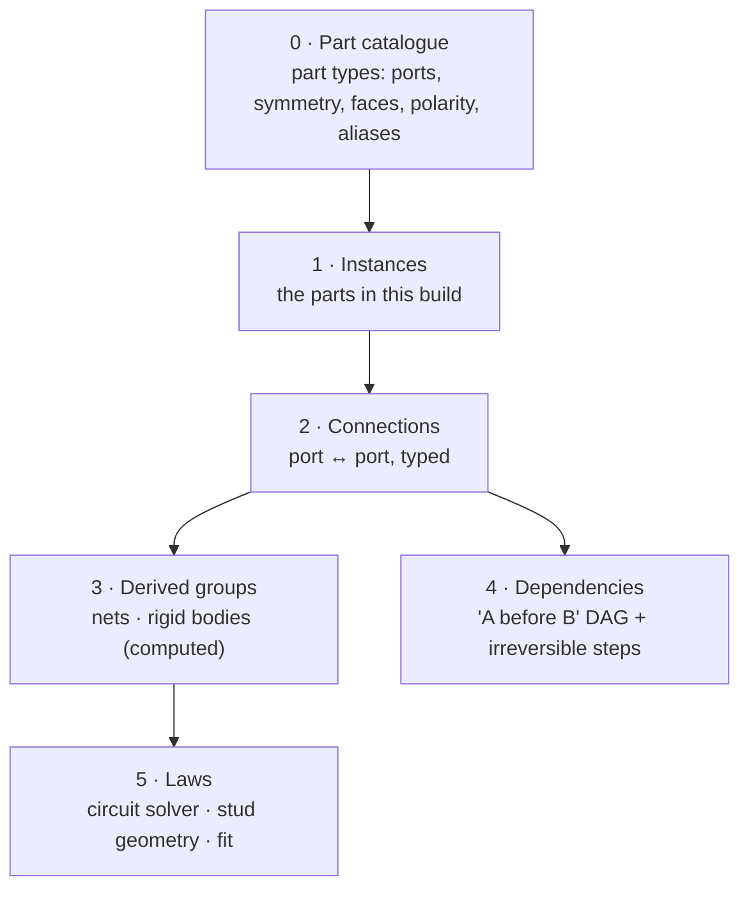
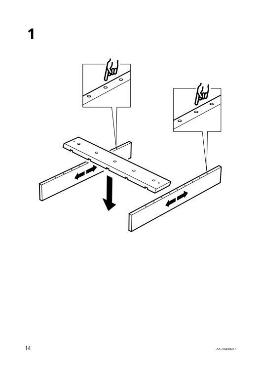
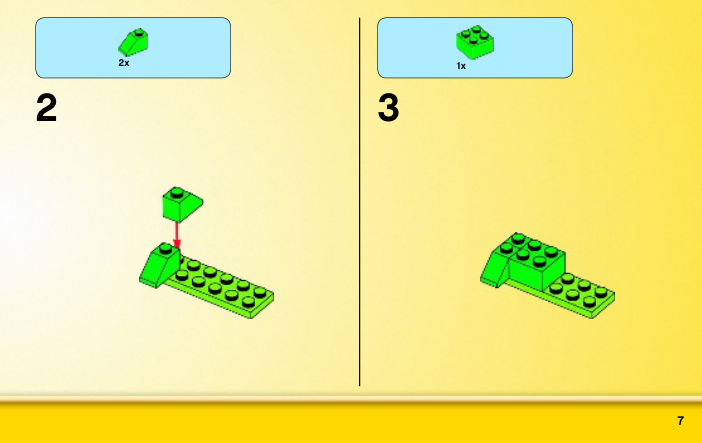
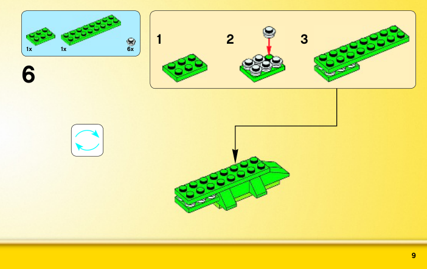
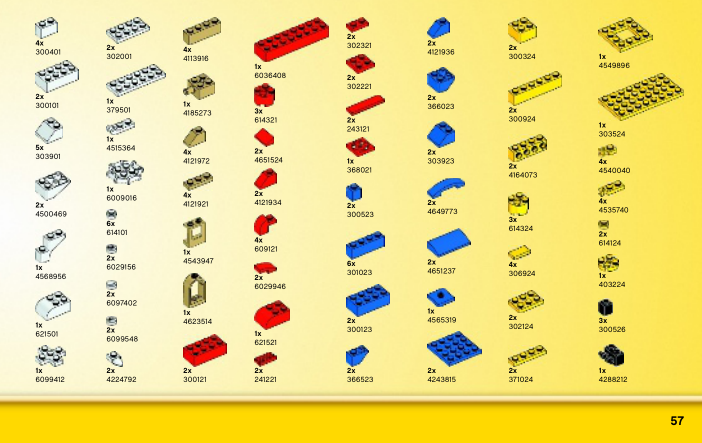
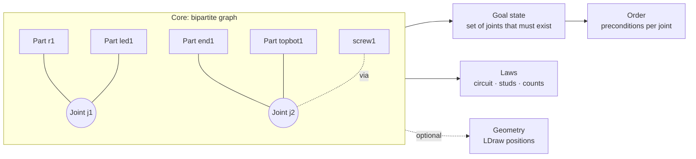
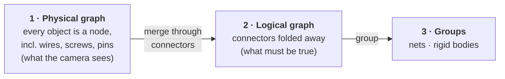
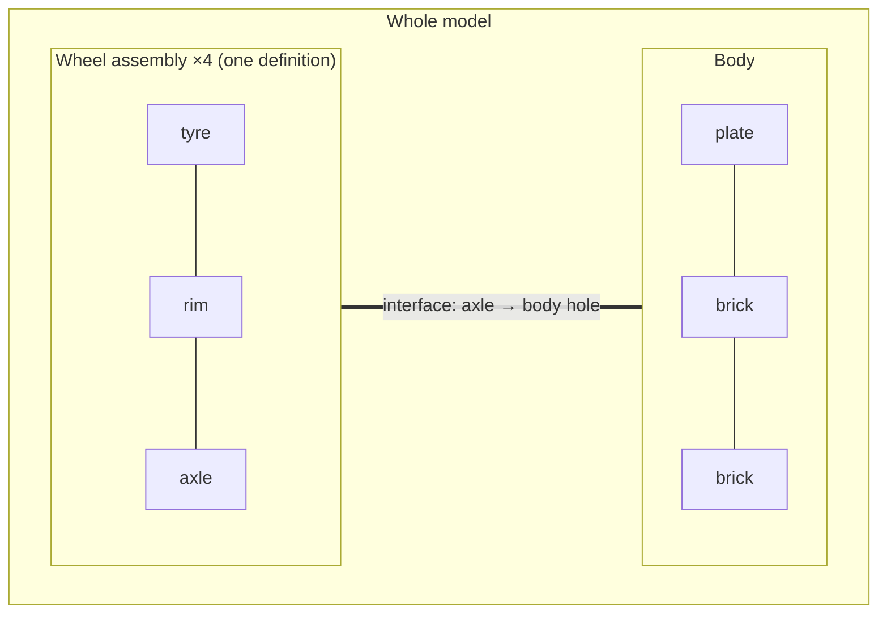

# Pinpoint — Research Log: Object Representation

> **Focus:** one general **object representation** that works for all three target areas: **Database (R29)**
- [Neo4j AuraDB quotas and limits](https://neo4j.com/docs/aura/quotas-and-limits/)
- [Neo4j Aura provisioning (pause rules, third-party)](https://skillselion.com/skills/neo4j-contrib/neo4j-skills/neo4j-aura-provisioning-skill)
- [Supabase free tier limits 2026](https://automationatlas.io/answers/supabase-free-tier-limits-2026/)

**Arduino / robotics**, **furniture (Sauder only, for now)** and **LEGO**. How to create it from instructions, and how to test it.
>
> **Note:** a graph is the leading **candidate**, not a decision. This is an exploration: the goal is whatever representation fits all three cases, which may turn out to be a graph, a set of graphs, or something else.
>
> **How to use this file:** add one entry per research question, newest findings inside the matching section. Each entry has a **question**, **findings** (with sources), a **verdict**, and **open points**. Mark anything not yet checked as *hypothesis* or *to verify*.
>
> Earlier research (Arduino tutor concept, VLM spatial limits, competitors) is in [`research-log.md`](./research-log.md).

### Source policy

**Only official, public manuals from the maker's own website.**

| Area | Official source | Status |
|---|---|---|
| **LEGO** | [lego.com building instructions](https://www.lego.com/en-us/service/building-instructions): search by set number; PDFs are served from `lego.com/cdn/product-assets/…` | ✅ Used (set 10696) |
| **Sauder** | sauder.com (support / assembly instructions, by model number) | ⚠️ **To verify by hand**: sauder.com blocks automated requests (HTTP 403). The Sauder PDF in R7 came from a **retailer's server (Menards)**; it is Sauder's own document, but not from Sauder's site |
| **Arduino** | [docs.arduino.cc](https://docs.arduino.cc/) built-in examples | ✅ Used by CircuitQuest |
| **IKEA** *(postponed)* | ikea.com product pages → assembly documents | ✅ Used (LUSTIGT) |

**Not official, flagged:** **LDraw / OMR** files are made by the LDraw **community**, not by LEGO. They are open and widely used, but are not an official LEGO source. Manual sites such as ManualsLib and Manuals+ are also third party.

**Exception (decided, R13):** LDraw is allowed as an **optional extension**: the official LEGO PDF is always the main source, and if the same set exists in LDraw, that file is used to make extraction easier and more precise.

---

## Contents

| # | Question | Status |
|---|---|---|
| [R1](#r1-are-there-well-written-instructions-we-can-turn-into-step-by-step-lessons) | Are there well-written instructions we can turn into step-by-step lessons? | ✅ First pass done |
| [R2](#r2-what-circuitquest-already-teaches-us) | What does CircuitQuest already teach us about representation? | ✅ First pass done |
| [R3](#r3-existing-ways-to-represent-assemblies) | How has assembly been represented before? | ✅ First pass done |
| [R4](#r4-logic-transitivity-does-12-and-23-mean-13) | Logic: does 1–2 and 2–3 mean 1–3? | 🟡 Hypotheses only |
| [R5](#r5-logic-symmetry-and-reversibility) | Logic: symmetry and reversibility | 🟡 Hypotheses only |
| [R6](#r6-draft-representation) | Draft general representation | 🟡 Sketch only |
| [R7](#r7-a-furniture-brand-with-well-written-manuals) | A furniture brand with well-written manuals | ✅ First pass done: **Sauder** |
| [R8](#r8-proposed-architecture-and-naming) | Proposed architecture and naming conventions | 🟡 Proposal |
| [R9](#r9-can-an-llmvlm-read-a-wordless-ikea-manual) | Can an LLM/VLM read a wordless IKEA manual? | 🟡 One informal test |
| [R10](#r10-decision-sauder-only-ikea-postponed) | **Decision:** Sauder only; IKEA postponed | ✅ Decided |
| [R11](#r11-identify-the-users-ikea-product-then-fetch-its-data) | Identify the user's IKEA product, then fetch its data? | ✅ First pass done |
| [R12](#r12-what-a-lego-manual-looks-like) | What does a LEGO manual look like? Does it have text? | ✅ One manual checked |
| [R13](#r13-decisions-ldraw-and-sauder-scope) | **Decisions:** LDraw as an extension; Sauder scope | ✅ Decided |
| [R14](#r14-brainstorm-graph-or-another-structure) | Brainstorm: graph or another structure? | 🟡 Brainstorm |
| [R15](#r15-first-principles-connection-types-and-part-freedoms) | First principles: connection types and part freedoms (incl. tents) | 🟡 Taxonomy draft |
| [R16](#r16-a-graph-that-accounts-for-connectors) | A graph that accounts for connectors (screws, wires, pins), part by part | 🟡 Proposal |
| [R17](#r17-parts-as-nodes-typed-connections-as-edges) | Parts as nodes, typed connections as edges: which edge types? | 🟡 Proposal, backed by literature |
| [R18](#r18-many-small-graphs-making-bigger-ones) | Many small graphs making bigger ones (hierarchy)? | ✅ **Decided: one graph per manual** |
| [R19](#r19-repeated-sub-assemblies) | Repeated sub-assemblies (the same piece built several times) | ✅ **Requirement set**; details open until build |
| [R20](#r20-manual-survey-connections-across-sauder-lego-and-arduino) | Manual survey: connections across Sauder, LEGO and Arduino; do repeated copies differ? | ✅ Done → [`GRAPH_SPEC.md`](./GRAPH_SPEC.md) |
| [R21](#r21-experiment-can-claude-build-the-graph) | Experiment: can Claude build the graph from 100 LEGO + 100 Arduino manuals? | 🟡 Set up; results in [`GRAPHGEN_RESULTS.md`](./GRAPHGEN_RESULTS.md) |
| [R22](#r22-architecture-parts-first-one-pipeline-for-every-domain) | **Architecture:** parts first, one pipeline for every domain (v3, v4) | ✅ **Decided and built**; v4 under test |
| [R23](#r23-lessons-from-3d-models) | **Lessons:** human step-by-step lessons from a set's 3D model, with bags and a 3D hint page | ✅ **Built**; tested on 5 sets |
| [R24](#r24-one-lesson-pipeline-code-suggests-claude-plans-code-checks) | **Lessons:** one pipeline for LEGO and Arduino: code suggests, Claude plans, code checks | ✅ **Built** |
| [R25](#r25-a-lesson-data-structure-record-graphs-and-one-parts-catalogue) | **Data structure:** lesson record, steps / physical graphs, one parts catalogue | ✅ **Built** → [`DATA_STRUCTURE.md`](./DATA_STRUCTURE.md), [`DATASTRUCTURE.md`](./DATASTRUCTURE.md) |
| [R26](#r26-lego-lessons-from-the-booklet-pdf-alone) | **Lessons from the booklet PDF alone** (no 3D model): builds, sub-builds, parts | ✅ **Built**; 3 sets READY |
| [R27](#r27-batch-tests-10-lessons-per-route-twice) | **Batch tests** on all three routes: 25 sets, 20 Arduino links; every error made a rule | ✅ **Done**; batch two 29/29 READY after one round of fixes |

---

## R1. Are there well-written instructions we can turn into step-by-step lessons?

**Date:** 1 October 2026

**Question:** for each area, do instructions exist that are good enough (clear, complete and ideally machine-readable) to produce a component graph and a step-by-step lesson?

### Summary

| Area | Official instructions | Machine-readable source | Ready to use? |
|---|---|---|---|
| **Arduino / robotics** | Text tutorials with exact pins (Arduino docs, Project Hub) | **Wokwi `diagram.json`**, **Fritzing `.fzz`**: explicit pin-to-pin connections | ✅ **Yes.** Already proven in CircuitQuest |
| **LEGO** | Wordless PDF manuals for most sets, free on lego.com | **LDraw files** (Official Model Repository): every part, position, rotation and **build step** | ✅ **Yes, via LDraw.** Connections must be derived from geometry |
| **IKEA** | Wordless PDF manuals for every product, on ikea.com | **None official.** Research dataset **IKEA-Manual**: 102 objects with parts and assembly trees | ⚠️ **Partly.** Postponed; furniture uses **Sauder** instead (R10) |

### Arduino / robotics

- **Text tutorials are explicit.** Arduino's built-in examples name every part, value and pin (e.g. "LED anode to pin 13 through a 220 Ω resistor"). Text is the easiest input for an LLM.
- **Structured formats exist:**
  - **Wokwi `diagram.json`** stores each connection as a pair of pins, e.g. `["led1:A", "bb1:6b.i"]`. ([Wokwi diagram format](https://docs.wokwi.com/diagram-format))
  - **Fritzing `.fzz`** is a zip containing an XML sketch whose `<connectors>` element lists which part connects to which, and it can export an XML netlist. ([Fritzing sketch format](https://github.com/fritzing/fritzing-app/wiki/2.2-Sketch-file-format))
- **Already proven:** CircuitQuest's `guide_import` turns a real tutorial link into a lesson, and the `llm-lesson-gen` experiment found Claude Sonnet produced electrically equivalent lessons for all three Arduino Basics tutorials in one attempt (see R2).
- **Quality varies:** Project Hub and blog tutorials range from excellent to incomplete. A "well-written" filter is needed: all parts listed with values, every connection stated, code included.

**Verdict:** ✅ Arduino is ready. It is the reference domain for the representation.

### LEGO

- **Official manuals:** almost all LEGO instructions are free PDF downloads on lego.com, searchable by set number. Rebrickable lists ~29,000 instruction files for ~9,600 sets. ([LEGO help](https://www.lego.com/en-us/service/help-topics/article/how-to-download-building-instructions-online), [Rebrickable](https://rebrickable.com/help/where-can-i-download-lego-building-instructions/))
- **But they are images with no words.** Turning them into a machine plan is a research problem in itself: MEPNet (ECCV 2022) reconstructs assembly steps from manual images using keypoint detection and 2D–3D projection. ([MEPNet](https://arxiv.org/abs/2207.12572))
- **The better source: LDraw.** An open file format for LEGO models:
  - each part is one line: `1 <colour> x y z a b c d e f g h i <part.dat>`, i.e. part ID, colour, position and 3×3 rotation;
  - `0 STEP` marks the end of each building step, so **the steps are already in the file**;
  - **positions only, no explicit connections.** Which brick is attached to which must be **derived from geometry** (stud above anti-stud). That is a "real law" check, like electronics. ([LDraw spec](https://www.ldraw.org/article/218.html))
- **Official sets in LDraw:** the **Official Model Repository (OMR)** holds LDraw files of real LEGO sets, searchable by set number. ([OMR](https://library.ldraw.org/omr), [OMR spec](https://www.ldraw.org/article/593.html))
- **Physics precedent:** BrickGPT / LegoGPT (CMU, ICCV 2025) generates LEGO builds brick by brick, rejecting bricks that break **connectivity and stability** rules, with a 47,000-structure dataset (StableText2Lego). This shows LEGO correctness can be checked with physical rules. ([paper](https://arxiv.org/abs/2505.05469))

**Verdict:** ✅ LEGO is usable through **LDraw/OMR**: parts, positions and steps are given, and connections are derived by geometry. PDF manuals are a later, harder input.

*To verify:* how many sets the OMR covers; whether LDCad's "snap" connection metadata gives stud and connection points directly.

### IKEA

- **Official manuals:** every IKEA product has a downloadable PDF manual. They are **wordless by design** (since 1956) so they work in every country without translation. ([IKEA-Manual project](https://cs.stanford.edu/~rcwang/projects/ikea_manual/), [Cadasio on wordless instructions](https://www.cadasio.com/post/designing-assembly-instructions-without-words))
- **Useful structure in the PDFs:** the first pages show the **parts and hardware list** with drawings, quantities and part numbers. This is the most "machine-readable" part. *(To verify across several manuals.)*
- **No official structured data** (no CAD or connection files published).
- **Research datasets give ground truth:**
  - **IKEA-Manual** (NeurIPS 2022): **102 IKEA objects** with 3D parts split to match the manuals, **tree-structured assembly plans** ("how parts are connected during assembly"), manual segmentation and 2D–3D correspondence. **This is ready-made test data for our graph.** ([paper](https://arxiv.org/abs/2302.01881), [project and download](https://cs.stanford.edu/~rcwang/projects/ikea_manual/))
  - **IKEA Manuals at Work** (NeurIPS 2024): links manual steps to real assembly videos (4D grounding). ([paper](https://arxiv.org/abs/2411.11409))
- **AI models struggle with these manuals:** IKEA-Bench (2026) tested 19 VLMs on 29 IKEA products and found they struggle to match manual diagrams to real video. Adding text helps understanding but **hurts diagram-to-video matching**. ([paper](https://arxiv.org/abs/2604.00913))

**Verdict:** ⚠️ IKEA is the hardest. Use **IKEA-Manual** as ground truth to design and test the representation first; treat "PDF manual → graph" as a separate research step (parts list first, then steps).

---

## R2. What CircuitQuest already teaches us

**Date:** 1 October 2026 · **Source:** `~/Desktop/CirquitQuest` (`core/checker.py`, `core/physics.py`, `core/build_methods.py`, `core/guide_import.py`, `core/lesson_gen.py`, `library/parts/*.json`)

CircuitQuest already solves the representation problem **for electronics**. Its principles are the starting point for the general case.

| Principle | How CircuitQuest does it | General lesson |
|---|---|---|
| **Parts have named ports** | Pins like `r1:1`, `led1:A`, `uno:13` | Every part = a node with **ports**; connections join ports, not whole parts |
| **Conductors merge, components link** | Wires and breadboard strips are merged with **union-find** into **nets**; resistors and LEDs sit **between** nets | Two kinds of connection: **pass-through** (merge into one group) and **link** (join two different groups) |
| **Connectors disappear** | Breadboard and wires are `connector_only` and dropped from the final nets | The checked graph is the **logical** graph; how a connection was made physically is a separate layer |
| **Hardware equivalences** | `pin_aliases`: `uno:GND.1` = `uno:GND.3`; every hole in a breadboard strip is the same | Some ports are **the same port by design**; fold them before comparing |
| **Part symmetry** | `symmetric_pins`: a resistor's legs swap freely; a potentiometer's outer legs swap; an LED is `polarized` | Each part declares which ports are **interchangeable** |
| **"Different but correct" is graded** | A symmetric swap is "harmless", neither identical nor wrong | Results need three levels: **exact / equivalent / wrong** |
| **Same goal, different method** | `build_methods`: the same nets built with or without a breadboard (clips, twist, solder) | **What** is connected is separate from **how** it was connected |
| **Real laws** | `physics.py` solves the circuit (nodal analysis): currents, LED states, floating inputs | The graph can be checked by **laws**, not only by matching the tutorial |
| **State-dependent connections** | Buttons, slide switches and relays connect only in some states | Some edges are **conditional** |
| **Part facts live in data** | Library JSON cards hold pins, polarity, symmetry and aliases; the code is generic | Domain knowledge goes in **part cards**; the algorithm stays domain-free |
| **AI never decides correctness** | The LLM writes the lesson, a validator checks it, and the engine checks the build with plain logic | Keep this rule for all domains |

---

## R3. Existing ways to represent assemblies

**Date:** 1 October 2026

| Representation | What it captures | Use for us |
|---|---|---|
| **Liaison graph** | Nodes = parts, edges = physical contacts or joints | Matches our "component graph" |
| **Precedence relations** | "A must be done before B" | Our dependency layer |
| **AND/OR graph** (Homem de Mello & Sanderson, 1986–91) | **All** valid ways to split an assembly into sub-assemblies, compactly | A formal way to represent **any valid order**, our key feature ([AAAI 1986](https://aaai.org/papers/01113-AAAI86-184-and-or-graph-representation-of-assembly-plans/)) |
| **Assembly tree** (IKEA-Manual) | Which groups of parts are joined at each manual step | Ground truth for IKEA tests |
| **Netlist** (electronics) | Groups of pins that are electrically one node | Arduino ground truth (Wokwi, Fritzing, CircuitQuest) |
| **LDraw** | Part positions and steps, no connections | LEGO ground truth after deriving connections |
| **Physics-based planning** ("Assemble Them All", 2022) | Finds a valid order by planning **disassembly** with physics | Possible way to derive valid orders automatically ([paper](https://arxiv.org/abs/2211.03977)) |

**Takeaway:** the field already separates **what connects to what** (liaison graph, netlist) from **in which order** (precedence, AND/OR graph). Our representation should do the same.

---

## R4. Logic: transitivity (does 1–2 and 2–3 mean 1–3?)

**Status:** 🟡 *Hypotheses, to test with examples from all three areas.*

**Working hypothesis:** it depends on the **type** of connection. We need to separate:
- **direct connection**: an edge in the graph (1 is joined to 2);
- **same group**: 1 and 3 belong to the same connected whole, through 2.

| Case | 1–2 and 2–3 ⇒ 1–3? | Why |
|---|---|---|
| **Electrical, through a conductor** (wire, breadboard strip) | ✅ **Yes**: 1 and 3 are the **same net** | A conductor makes an equivalence relation (reflexive, symmetric, transitive), which is why CircuitQuest uses union-find |
| **Electrical, through a component** (resistor, LED) | ❌ **No** | The component **links two different nets**; its two legs are not the same node |
| **Electrical, through a switch or relay** | ⚠️ **Only in some states** | A conditional edge: transitive only while the switch is closed |
| **LEGO, "attached to"** | ❌ Not directly: brick 1 on 2 and 2 on 3 does not mean 1 touches 3 | Direct attachment is a physical contact |
| **LEGO, "same rigid build"** | ✅ **Yes** | All three move together: the same connected component |
| **IKEA, joint (dowel, cam lock, screw)** | ❌ Not directly | Same as LEGO: a joint is a contact |
| **IKEA, "same rigid body"** | ✅ **Yes, once all needed joints are made** | Only if the joints actually make it rigid (e.g. a frame needs its back panel to stay square) |

**Implication for the representation:** each connection type declares whether it is **pass-through** (merges ports into one group, so transitive) or **link** (joins two groups, so not transitive). Groups are computed (union-find for pass-through edges; connected components for "same rigid build").

**Tests to run:** for each area, build small examples where the transitive and non-transitive readings give **different** answers, and check which one matches reality.

---

## R5. Logic: symmetry and reversibility

**Status:** 🟡 *Hypotheses.*

### Part symmetry: can a part go in more than one way?

| Example | Symmetric? | Effect |
|---|---|---|
| Resistor legs | ✅ Interchangeable | Either orientation is correct (CircuitQuest: `symmetric_pins`) |
| LED legs | ❌ Polarised | Only one orientation works (a law: current flows anode → cathode) |
| LEGO 2×4 brick | ✅ 180° rotation looks identical | A rotated placement is the same build |
| LEGO 1×2 slope | ❌ Directional | Rotation changes the shape |
| IKEA wooden dowel | ✅ Either end | Interchangeable |
| IKEA side panel with pre-drilled holes | ⚠️ Often **mirror pairs** (left vs right) | Looks symmetric but isn't: a classic mistake |

**Representation:** each part card lists its **symmetry group** (which ports or orientations are interchangeable), as CircuitQuest's `symmetric_pins` does for electronics.

### Connection symmetry: is "A connects to B" the same as "B connects to A"?
- **Electrical contact:** symmetric.
- **"Sits on top of"** (LEGO stud into anti-stud), **"inserted into"** (dowel into hole): **directional**. The connection is symmetric as a relation ("attached"), but its **ports** are not (stud vs anti-stud, peg vs hole).

### Step reversibility: can a step be undone?

| Reversible | Not reversible |
|---|---|
| Breadboard wire, LEGO brick, IKEA cam lock, screw | Solder joint, glue, nailed IKEA back panel, a snapped clip |

**Why it matters:** irreversible steps limit "any order". The checker should **warn before** an irreversible step is done wrong, while reversible mistakes can just be pointed out.

---

## R6. Draft representation

**Status:** 🟡 *Sketch to be refined after R4 and R5 are tested. Written as a graph because that is the leading candidate; other forms stay open.*

```
Part        id, type → part card (ports, symmetry, polarity, aliases, reversible?)
Port        part:port_name          e.g. r1:1, brick7:stud(2,1), side_panel_L:hole3
Connection  port ↔ port, with:
              kind        pass-through | link | conditional
              direction   symmetric | directional (stud→anti-stud, peg→hole)
              reversible  yes | no
Groups      computed: nets (pass-through) and rigid bodies (connected components)
Dependency  "A before B" (only where physically required)
Laws        domain checks: circuit solver · stud geometry and stability · fit and squareness
```

**How to test it:**
1. **Arduino:** convert CircuitQuest lessons (Wokwi diagrams) into this format and check they round-trip.
2. **LEGO:** derive connections from 3–5 small OMR/LDraw sets; check the derived graph against the steps.
3. **IKEA:** convert 3–5 IKEA-Manual assembly trees; check every manual step maps to graph edges.
4. **Equivalence tests:** for each area, make "different but correct" variants (a swapped resistor, a rotated 2×4 brick, a flipped dowel) and wrong variants (a reversed LED, a mirrored side panel). The checker must classify each as exact, equivalent or wrong.

---

## R7. A furniture brand with well-written manuals

**Date:** 1 October 2026

**Question:** IKEA manuals are wordless. Is there a furniture brand whose manuals are well written enough to explore how to represent furniture generically?

### Candidates

| Brand / source | Manual style | Structure | Fit |
|---|---|---|---|
| **Sauder** (US, flat-pack) | **Text + drawings** on every step | Lettered parts with quantities, numbered hardware shown at actual size, step text naming parts, hardware, counts and tools | ✅ **Best fit** |
| **Tylko** (made-to-measure shelves) | Drawings only, but **personalised** to each shelf | Every part has a code (`C`, `Cl`, `W1`, `Bn`, `Bh`, `Bs`…), each step lists "the parts you need" with count and box number | ✅ Good second: very structured, no text |
| **Opendesk** (open-source furniture) | PDF assembly guide + **CAD files** (DXF/DWG) | Exact geometry of every part; CC licences | ⚠️ Useful for geometry; stopped publishing in 2020, now only in archives ([archive.org](https://archive.org/details/opendesk)) |
| **Ashley** | More written text than IKEA | Not checked in detail | ❓ To check |
| **Amazon Basics** | IKEA-like, minimal text | — | ❌ Same problem as IKEA |
| **IKEA** | Wordless | Parts list + drawings | ⚠️ Use **IKEA-Manual** dataset as 3D ground truth (R1) |

Sources: [Sauder manuals (Manuals+)](https://manuals.plus/category/sauder), [Tylko assembly FAQ](https://tylko.com/en-ot/faq/articles/self-assembly-disassembly/how-do-i-assemble-my-tylko-shelf), [Opendesk (Make:)](https://makezine.com/article/digital-fabrication/machining/opendesk-cnc-furniture/), [Ready-to-assemble brands](https://assemblysmart.com/ready-to-assemble-furniture-brands/).

### Checked example: Sauder 2-Cube Organizer (model 430628)

Read in full ([PDF](https://cdn.menardc.com/main/items/media/SAUDE001/Assembly_Instructions/2114705_instruct.PDF), 12 pages, 4 steps). *Note: this copy is hosted by a retailer (Menards); replace it with the copy from sauder.com once confirmed (see Source policy).*

**Parts list (page 2)**
- Panels: **B** END ×2, **D** TOP/BOTTOM ×2, **E** SHELF ×1
- Hardware: **1** wood dowel ×4, **2** applique card ×1, **3** 3-5/16" hex head screw ×8
- Tool: **4** L-wrench ×1

**Steps (verbatim)**
1. "Fasten the TOP/BOTTOMS (D) to one of the ENDS (B). Tighten four 3-5/16" HEX HEAD SCREWS (3) using the L-WRENCH (4)."
2. "Insert two WOOD DOWELS (1) into the END (B). Push the SHELF (E) onto the WOOD DOWELS (1) in the END (B)."
3. "Insert two WOOD DOWELS (1) into the remaining END (B). Fasten the END (B) to the TOP/BOTTOMS (D) and SHELF (E)… Be sure the WOOD DOWELS in the END insert into the SHELF."
4. Stick appliques over visible screw heads. (Cosmetic.)

Drawings add orientation hints: "Surface with more holes" / "Surface with fewer holes".

**Why this is ideal:** every step names **which parts**, **which hardware**, **how many**, and **which tool**. That is close to a connection list already, so an LLM can extract it from text, as with Arduino tutorials.

### What the example shows for the representation

| Observation in the manual | Representation idea | Parallel in other areas |
|---|---|---|
| "one of the ENDS (B)", B ×2 | The two ends are **interchangeable instances** of one part type | Two identical resistors; two identical LEGO bricks |
| D TOP/BOTTOM ×2, one label for both | Top and bottom are **symmetric** | Resistor legs (`symmetric_pins`) |
| "Surface with more / fewer holes" | Panels have **faces**; orientation matters | LED polarity; LEGO stud vs anti-stud |
| Dowels and screws join panels | **Hardware is a connector**: it joins two panels, like a wire or breadboard strip joins two pins | CircuitQuest drops connectors from the logical nets |
| Step 1 and step 2 touch different joints | Their **order can be swapped** | Wiring the LED before the resistor |
| Shelf E must be on its dowels **before** the second end closes the box | A **physical dependency**: the box would block it | Placing a LEGO brick before covering it |
| B1–D and D–B2 | B1 and B2 end up in **one rigid body** but are **not directly joined** | R4 transitivity: "same group" ≠ "directly connected" |

**Draft logical form of this product:**

```
Parts        B1, B2 (END) · D1, D2 (TOP/BOTTOM) · E (SHELF)
Joints       B1–D1  screw ×2      B1–D2  screw ×2      B1–E  dowel ×2
             B2–D1  screw ×2      B2–D2  screw ×2      B2–E  dowel ×2
Symmetry     B1 ↔ B2 · D1 ↔ D2
Orientation  each panel: face with more holes / fewer holes
Dependency   B1–E before B2 closes (B2–D1, B2–D2, B2–E made together)
Free order   {B1–D1, B1–D2} and {B1–E} in either order
Result       one rigid body {B1, B2, D1, D2, E}
```

**How Sauder products are identified**

| Identifier | Example (2-Cube Organizer) | Where | Use for us |
|---|---|---|---|
| **Model number** (5–6 digits) | `430628` | Manual cover and every page footer | **The product ID.** Selects the product and its manual |
| **SKU** | `211-4705` | Printed next to the model number | Retailer-specific (this one matches Menards' file name); secondary |
| **Lot number + date** | `567740`, 06/21/21 | Lower-right corner of the manual cover | Production batch; identifies the manual **version** |
| **Part letter** | `B` END, `D` TOP/BOTTOM | Part Identification page | Unique **only inside one manual**; Sauder asks for model number + part description to order replacements |
| **Hardware number** | `1` dowel, `3` screw | Hardware Identification page | Same: only meaningful inside one manual |

Sources: the manual itself; [Sauder: order replacement parts](https://www.sauder.com/service/replacement-parts).

**Naming consequence (R8):** part types become `sauder-<model>-<part>`, e.g. `sauder-430628-end`; the manual letter stays as `label`. Hardware stays `hw-<description>` until a cross-product Sauder hardware ID is found.

*To verify:* whether sauder.com offers manuals by model number for direct download; check 3–5 more Sauder manuals (a drawer unit, a desk) for consistency, especially for moving parts (drawers, doors) that add **conditional** connections, like switches in electronics.

**Verdict:** ✅ Use **Sauder** as the main furniture source for designing the representation (text, lettered parts, explicit hardware). Use **Tylko** as a structured but wordless second case, and **IKEA-Manual** as 3D ground truth.

---

## R8. Proposed architecture and naming

**Date:** 1 October 2026 · **Status:** 🟡 *Proposal, based on R1–R7. To be tested on one example per area.*

### Is it "a connected graph"?

**Not quite, for three reasons:**
1. **During a build it is not connected.** Sub-assemblies are built separately (Sauder step 1 and step 2, IKEA LUSTIGT steps 1–3) and joined later. The representation must allow **several separate pieces** and only expect one connected whole at the end.
2. **Some connections join many ports at once.** An electrical net (a breadboard strip with 3 legs in it) is one connection between many pins: a **hyperedge**, not a simple edge. CircuitQuest handles this with union-find.
3. **Order is a separate structure.** "What connects to what" and "what must come first" are different questions (R3). Mixing them into one graph makes "any order" hard to check.

### Recommendation: a layered **port graph**



| Layer | Holds | Arduino | Furniture (Sauder) | LEGO (LDraw) |
|---|---|---|---|---|
| **0 · Part catalogue** | Reusable part **types**: ports, symmetry, faces, polarity, aliases, `connector`, `reversible` | `resistor-1k`: ports `1`,`2`, symmetric | `sauder-430628-end`: holes, two faces | `lego-3001` (2×4 brick): 8 studs, 8 anti-studs, 180° symmetric |
| **1 · Instances** | The parts **in this build**, each pointing to a type | `r1`, `led1`, `uno` | `end1`, `end2`, `topbot1`, `topbot2`, `shelf1` | `b1`…`b40` |
| **2 · Connections** | **Port ↔ port** links, each with a `kind` (below) | `r1:2 ↔ led1:A` | `end1:hole.t1 ↔ topbot1:hole.l1` via `screw1` | `b2:stud.1.1 ↔ b7:anti.1.1` |
| **3 · Derived groups** | **Computed, never stored**: nets (electrical) and rigid bodies (mechanical) | nets via union-find | rigid bodies via connected components | rigid bodies |
| **4 · Dependencies** | A **precedence DAG** over connections, plus flags for irreversible steps. **Any valid order = any topological order** of this DAG | (rarely needed) | `end1–shelf1` before `end2` closes | lower bricks before upper |
| **5 · Laws** | Domain validators run on layers 2–3 | circuit solver (CircuitQuest `physics.py`) | fit, squareness, hardware counts | stud alignment, stability |

**Connection kinds** (answers R4):

| `kind` | Meaning | Transitive? | Examples |
|---|---|---|---|
| `merge` | Ports become **one** node | ✅ Yes (union-find) | wire, breadboard strip, header socket |
| `link` | Two **different** nodes joined by a part | ❌ No | resistor, LED, motor |
| `join` | Mechanical contact; parts become **one rigid body** | ❌ Not directly, ✅ for "same body" | screw, dowel, cam lock, stud-in-anti-stud |
| `conditional` | Exists only in some **states** | ⚠️ Only in that state | button, relay, drawer, hinge |

**Connectors are parts too.** Screws, dowels and wires are **instances with ports** (`screw1`, `wire3`), so the system can count them against the parts list. Then, as CircuitQuest already does, they are **folded away** into a clean logical view (`end1 ↔ topbot1`) for checking.

**How "different but correct" works:** before comparing the expected build with what the camera sees, both are put into a **canonical form**:
1. fold **aliases** (all `uno:GND.*` → `uno:GND`; all holes in a strip → one strip);
2. fold **symmetric ports** (resistor legs; a 2×4 brick rotated 180°);
3. match **interchangeable instances** (`end1` ↔ `end2`, two identical resistors). This is a graph-matching (isomorphism) step; builds are small, so standard algorithms such as VF2 in NetworkX are fast enough.

The result is then **exact / equivalent / wrong**, as in CircuitQuest.

### Naming conventions

**Principle: reuse each domain's own official IDs wherever they exist, wrapped in one common pattern.**

| Thing | Pattern | Examples | Why |
|---|---|---|---|
| **Part type** | `domain-id` in kebab-case, using the official number if there is one | `resistor-1k`, `arduino-uno` · `lego-3001` (LDraw/BrickLink number) · `ikea-109536` (IKEA hardware number printed in the manual) · `sauder-430628-end` | Stable, searchable, matches CircuitQuest's library; official numbers make catalogue lookups possible |
| **Instance** | short lowercase name + number | `r1`, `led1`, `uno` · `end1`, `shelf1`, `screw3` · `b12` | Wokwi/CircuitQuest style; short enough for logs |
| **Source label** | kept as an attribute, never as the ID | `{"id": "end1", "label": "B"}` | Manual letters (Sauder "B") are only unique inside one manual |
| **Port** | `instance:port`, sub-parts separated by dots | `r1:1`, `led1:A`, `uno:13`, `bb1:18t.d` · `end1:hole.t1`, `end1:face.inner` · `b7:stud.2.1`, `b7:anti.2.1` | Already the Wokwi convention for pins and breadboard holes; dots give a natural hierarchy |
| **Connection** | `c` + number, or the port pair | `c4`, or `r1:2~led1:A` | `~` reads as "connected to" |
| **Step** | `s` + number, with the source step number as an attribute | `s3 {"source_step": 3}` | Steps are suggestions; the checker uses connections, not step numbers |
| **Derived group** | `net:<lowest port>` / `body:<lowest instance>` | `net:uno:13`, `body:end1` | Deterministic, so the same build always gets the same names |

**Units and coordinates:** millimetres, right-handed, Z up. LDraw uses its own units (1 LDU = 0.4 mm) and −Y up, so convert at import.

### Minimal example (Sauder 2-Cube Organizer)

```json
{
  "parts": [
    {"id": "end1",    "type": "sauder-430628-end",     "label": "B"},
    {"id": "end2",    "type": "sauder-430628-end",     "label": "B"},
    {"id": "topbot1", "type": "sauder-430628-topbot",  "label": "D"},
    {"id": "topbot2", "type": "sauder-430628-topbot",  "label": "D"},
    {"id": "shelf1",  "type": "sauder-430628-shelf",   "label": "E"},
    {"id": "dowel1",  "type": "hw-wood-dowel",         "label": "1"},
    {"id": "screw1",  "type": "hw-hex-screw-3-5-16",   "label": "3"}
  ],
  "connections": [
    {"id": "c1", "kind": "join", "ports": ["end1:hole.t1", "topbot1:hole.l1"], "via": "screw1"},
    {"id": "c5", "kind": "join", "ports": ["end1:hole.m1", "shelf1:hole.l1"], "via": "dowel1"}
  ],
  "dependencies": [
    {"before": "c5", "after": "c9", "why": "shelf must sit on end1's dowels before end2 closes the box"}
  ],
  "interchangeable": [["end1", "end2"], ["topbot1", "topbot2"]]
}
```
*(Shortened: the full build has 8 screws, 4 dowels and 12 connections.)*

---

## R9. Can an LLM/VLM read a wordless IKEA manual?

**Date:** 1 October 2026 · **Status:** 🟡 *One informal test (Claude reading one manual), plus published evidence. Not a benchmark.*

### Test: IKEA LUSTIGT wall shelf ([PDF](https://www.ikea.com/us/en/assembly_instructions/lustigt-wall-shelf__AA-2046060-5-100.pdf), AA-2046060-5)

20 pages: 10 pages of multilingual safety text, 1 tools page, 1 hardware page, 1 "possible layouts" page, 5 steps.



*Step 1 of the LUSTIGT manual: drawings and arrows only; the boards carry no letters or numbers.*

**What Claude could read reliably from the drawings:**

| Item | Read correctly? | Notes |
|---|---|---|
| Tools | ✅ | Phillips screwdriver, spirit level |
| Hardware | ✅ | One screw type, **109536 ×5** |
| Step 2 and 3 counts | ✅ | 2 screws + 3 screws = 5 ✔ matches the hardware page, a useful **consistency check** |
| Overall structure | ✅ | Five shelf boards slot onto a vertical spine; screwed through the spine; hung on the wall; three ladder-style clips added at shelf ends |
| **Valid alternative layouts** | ✅ | Page 13 shows **four** correct arrangements (shelves left/right in different patterns). IKEA itself documents "different but correct" |
| Step 4 wall screws | ✅ | Not included (the safety text says so); the icon compares wall plugs |

**What was uncertain or missing:**

| Problem | Why it matters |
|---|---|
| **Panels have no letters or part numbers** | The parts list has only the screw; boards must be identified by shape. Hard to name instances reliably |
| **Which face or edge of a board goes where** | Shown only by small "hand" close-ups of hole patterns, the fine spatial detail VLMs are weakest at (Spatial Blindspot, R1) |
| **Exactly which slot each shelf uses** | Arrows show sliding direction, not exact positions |
| **Exact hole each screw goes into** | Small magnified circles; position, not just count, is hard |

### Published evidence
- **IKEA-Bench (2026):** 19 VLMs on 29 IKEA products. They struggle to match manual diagrams to real video, and adding text **hurts** diagram-to-video matching. ([paper](https://arxiv.org/abs/2604.00913))
- **MEPNet (2022):** reading LEGO manuals precisely needed a **purpose-built** keypoint and 3D-projection model, not a general VLM. ([paper](https://arxiv.org/abs/2207.12572))
- **Manual-PA (2024):** learns 3D part assembly from instruction diagrams with a dedicated model. ([paper](https://arxiv.org/abs/2411.18011))

### Verdict

**Partly.** A VLM can get the **skeleton**: tools, hardware and counts, which parts join in each step, and the overall structure. It is **not reliable for the precise parts**: which face, which hole, which slot. That precision is exactly what a checker needs.

**Suggested approach for IKEA:**
1. VLM extracts the **skeleton** (parts by shape, hardware counts, joins per step).
2. **Consistency rules** catch errors (hardware totals match the parts page; every part is used; steps form a valid order).
3. Fill in precise geometry from **3D data** where available (IKEA-Manual's 102 objects), or let the **user confirm** ambiguous details once.
4. Compare with **Sauder** (text) to measure how much the missing words cost.

This makes "wordless manual → representation" a **research contribution** in its own right, rather than a dependency for the first prototype.

---

## R10. Decision: Sauder only, IKEA postponed

**Date:** 1 October 2026 · **Status:** ✅ Decided

**Decision:** for furniture, the project supports **Sauder only** for now. IKEA is postponed to future work.

**Why IKEA was not chosen as the starting point:**

| Reason | Evidence |
|---|---|
| **Manuals are wordless by design** | Every step is a drawing; there is no text to extract (R1, R9) |
| **Panels are not labelled** | The LUSTIGT parts list names only the screw (109536 ×5); boards have no letter or number (R9) |
| **The precise details are the hardest part for AI** | Which face, which hole and which slot appear only in small close-ups, the fine spatial detail VLMs are weakest at (R9; [Spatial Blindspot](https://arxiv.org/pdf/2601.09954)) |
| **Published results agree** | 19 VLMs struggle to align IKEA diagrams with real footage ([IKEA-Bench](https://arxiv.org/abs/2604.00913)); LEGO manuals needed a purpose-built model ([MEPNet](https://arxiv.org/abs/2207.12572)) |
| **No official structured data at scale** | IKEA publishes no part or connection files; its official 3D dataset has 5 products under a non-commercial licence (R11) |

**Why Sauder instead:** every step is written in words, parts are lettered with quantities, hardware is numbered with counts, and tools are named. An LLM can extract it from text the same way CircuitQuest extracts Arduino tutorials (R7).

**What would bring IKEA back:** a reliable "picture manual → representation" pipeline (R9 approach), or product data that includes parts (R11). Either is a research contribution in its own right.

---

## R11. Identify the user's IKEA product, then fetch its data?

**Date:** 1 October 2026

**Question:** if the user already has the IKEA product, can we **identify exactly which product it is**, pull its **part information from another source**, and then use the manual?

### Step 1: identify the exact product

| Method | Reliability | Notes |
|---|---|---|
| **Read the box label** | ✅ **Exact** | Every IKEA box shows the **8-digit article number** (e.g. `304.499.08`) and "Box 1(2)"-style package counts. Easy to read with OCR, no VLM needed ([IKEA: product details](https://www.ikea.com/ca/en/customer-service/knowledge/articles/e7cg2eg5-2536-47b9-bb1b-10003300c772.html)) |
| **Scan the box barcode** | ✅ Likely exact | The barcode reportedly encodes the article number. *To verify* the exact format |
| **Read the manual's document number** | ✅ **Exact** | Every manual carries its number, e.g. `AA-2046060-5` (LUSTIGT) |
| **Photo of the assembled product** | ⚠️ Good, not exact | IKEA's own app has visual search (GrokStyle) that finds "similar or the exact" product ([TechCrunch](https://techcrunch.com/2018/03/16/grokstyles-visual-search-tech-makes-it-into-ikeas-place-ar-app/)). Variants (size, colour) are easy to confuse |
| **VLM on the unassembled parts** | ❌ Poor | Before assembly the user has flat panels that look alike across many products. This is the wrong moment for visual recognition |

**Finding:** identifying the product is **easy and exact**, but through the **box label or manual number (OCR)**, not by a VLM looking at the parts.

### Step 2: fetch part information from elsewhere

| Source | What it gives | Limits |
|---|---|---|
| **IKEA product page** (by article number) | Official assembly PDF, package count, dimensions | No part or connection data ([how to find assembly documents](https://www.ikea.com/us/en/customer-service/knowledge/articles/1656c41a-1a58-4e59-a77a-bae69f28f1bb.html)) |
| **Spare-part numbers** in the manual | Hardware IDs (6–8 digits) and counts, orderable from IKEA | **Hardware only**; panels have no number ([IKEA spare parts](https://www.ikea.com/us/en/customer-service/knowledge/articles/3e09f6eb-5c91-48e4-8878-d8c144d36b38.html)) |
| **"View in 3D" model** on the product page | GLB model of the **assembled** product | Not officially downloadable (only via third-party scripts); assembled state, not parts; terms of use unclear |
| **IKEA 3D Assembly Dataset** (official, 2021) | GLB/OBJ of the assembled product with parts in the scene hierarchy, plus the manual, article and document numbers | **Only 5 products** (LACK, 2× EKET, BEKVÄM, DALFRED); **CC BY-NC-SA 4.0**: research only, **no commercial use** ([GitHub](https://github.com/IKEA/IKEA3DAssemblyDataset)) |
| **IKEA-Manual** (Stanford research) | 102 products with **separate parts** and assembly trees | Research dataset; fixed set of products (R1) |

**Finding:** apart from the hardware list, **no source gives panel-level part data at scale**. 3D data exists for **5 + 102 products**, for research use.

### Step 3: then use the manual

Knowing the exact product **helps** reading the manual:
- the hardware list and counts become **known facts**, used to check the VLM's reading;
- for the ~107 products with 3D data, the **geometry resolves** "which face, which hole";
- the right manual is fetched automatically, so the user never has to find it.

It does **not** remove the main problem: the steps are still **drawings**, and turning them into connections is the R9 challenge.

### Verdict

| Part of the idea | Possible? |
|---|---|
| Identify the exact product | ✅ Yes: OCR the box label or manual number (better than a VLM) |
| Fetch the official manual automatically | ✅ Yes, via the product page |
| Fetch part data from elsewhere | ⚠️ Only hardware at scale; full parts for ~107 research products, not for commercial use |
| Skip reading the drawings | ❌ No; the steps exist only as pictures |

This supports the R10 decision. It also defines a clean **future-work path for IKEA**: identify by label → fetch manual → VLM reads the skeleton → checked against the official hardware list → precise geometry from the 3D datasets where available.

---

## R12. What a LEGO manual looks like

**Date:** 1 October 2026

**Question:** are LEGO manuals also wordless, like IKEA's? What can be read from them?

### Example: LEGO Classic 10696 (Medium Creative Brick Box)

[Official PDF](https://www.lego.com/cdn/product-assets/product.bi.core.pdf/6114394.pdf), 60 pages, several small models.

**Steps: no words.** Each step is a picture with:
- a **parts box** showing which pieces to add, with **counts** ("2x");
- the **step number**;
- **red arrows** showing where a piece goes.



*Steps 2–3: a parts box (2× slope, 1× 2×2 brick), a red arrow for placement, no text.*

**Sub-assemblies and turning the model** are shown with symbols, not words: a framed box with mini-steps 1–2–3, then an arrow to where the sub-assembly attaches, and a rotate icon.



*Step 6: a sub-assembly built in its own box (mini-steps 1–3), then attached; the circular-arrows icon means "turn the model".*

**But the parts inventory is real text.** The last pages list **every element with its count and Element ID** as selectable text in the PDF, e.g. `4x 300401`, `2x 300101`, `5x 303901`.



*Page 57: the inventory. Each piece has a count and a 6–7 digit Element ID, extractable as text.*

### What this means

| | IKEA (LUSTIGT) | LEGO (10696) | Sauder |
|---|---|---|---|
| Step text | ❌ None | ❌ None | ✅ Full sentences |
| Parts per step | ⚠️ Drawn, unlabelled | ✅ **Parts box with counts** on every step | ✅ Named with letters |
| Parts inventory | ⚠️ Hardware only | ✅ **Every piece, Element ID + count, as text** | ✅ Letters + quantities |
| Sub-assemblies | Drawn | ✅ Marked with framed boxes | Text |
| Machine-readable alternative | ❌ | ✅ **LDraw / OMR** (R1) | — |

**Why LEGO is much easier than IKEA despite having no words:**
1. **Every piece is identified** by an Element ID in the inventory. Element IDs map to part shape and colour through catalogues such as Rebrickable and BrickLink *(to verify the exact lookup)*. Older 6-digit IDs appear to be the design number plus a colour code (`3004` + `01` = white 1×2 brick); newer 7-digit IDs are not structured that way.
2. **Each step's parts box** says exactly which pieces are added, so a VLM only has to recognise known pieces, not unknown panels.
3. **Positions sit on a stud grid**, so "where" is a discrete choice, which suits the grid approach (geometry + labelled grid + VLM) from the earlier research.
4. **LDraw files** of official sets give parts, positions and steps directly, with no image reading at all.

**Verdict:** ✅ LEGO manuals have no step text, but they are **far more structured** than IKEA's (identified pieces, per-step parts lists, a grid). For the first prototype use **LDraw/OMR files**; reading the PDF is a later option, helped by the text inventory.

*To verify:* whether set 10696 (or another small set) is in the OMR, so the same model can be compared in both forms.

---

## R13. Decisions: LDraw and Sauder scope

**Date:** 1 October 2026 · **Status:** ✅ Decided

1. **LEGO: official PDF first, LDraw as an extension.** The official lego.com PDF is the primary source. **If the set is available in LDraw** (e.g. in the OMR), the LDraw file is used as well, giving the LLM exact parts, positions and steps instead of reading pictures.
2. **Sauder: shape the design, don't implement yet.** Sauder is **considered when designing the representation** (screws and dowels as connectors, panel faces, interchangeable parts, physical dependencies), so the structure will fit furniture later. It is **not implemented** in the first version.
3. **First implementation targets:** Arduino / robotics and LEGO.

---

## R14. Brainstorm: graph or another structure?

**Date:** 1 October 2026 · **Status:** 🟡 *Brainstorm. Options and trade-offs; no decision yet.*

### What the structure must handle

Collected from R1–R13:

| # | Requirement | Example |
|---|---|---|
| 1 | **Connections that join many points at once** | A breadboard strip with 3 legs; a screw through 2 panels; one stud row |
| 2 | **Symmetry and interchangeable parts** | Resistor legs; two identical END panels; a 2×4 brick rotated 180° |
| 3 | **Any valid order**, plus real dependencies | Wire the LED or the resistor first; the shelf before the second end |
| 4 | **Separate pieces during the build** | Sub-assemblies (LEGO step 6 box; Sauder steps 1 and 2) |
| 5 | **Conditional connections** | Button pressed; drawer open |
| 6 | **Checkable by laws** | Circuit solver; stud geometry; hardware counts |
| 7 | **An LLM can write it reliably** | From a tutorial, a Sauder manual, an LDraw file |
| 8 | **The camera can fill it in** | Detected connections map onto the same structure |
| 9 | **Geometry when available** | LDraw positions |
| 10 | **One structure for all areas** | Arduino, LEGO, later Sauder |

### Candidate structures

| Structure | Idea | Strengths | Weaknesses |
|---|---|---|---|
| **A. Simple graph** (liaison graph) | Parts = nodes, connections = edges | Simple; well known | Can't say **which point** of a part; can't join 3+ points in one connection (req. 1) |
| **B. Port graph** (R8 draft) | Parts have named ports; edges join ports | Says exactly where (`r1:2`, `b7:stud.2.1`); matches Wokwi/CircuitQuest | A 3-way connection needs several edges or a special rule |
| **C. Hypergraph** | One connection (hyperedge) can join **any number** of ports | Fits nets, screws and stud rows naturally (req. 1) | Less familiar; fewer ready-made tools |
| **D. Bipartite graph** (parts ↔ joints) | **Two kinds of node**: parts, and **joints**. A joint links to every port it joins | Same power as a hypergraph, but an ordinary graph, so standard tools work. Hardware (screws, wires) can sit on the joint | Slightly more nodes |
| **E. Tree** (assembly tree) | Sub-assemblies nested inside each other | Matches manuals and LDraw sub-models (req. 4) | Encodes **one** order; can't express "any order" (req. 3) |
| **F. AND/OR graph** | Every valid way to split the product into sub-assemblies | The formal answer to "any order" | Grows very fast; hard for an LLM to write |
| **G. Goal state + preconditions** (planning style, like PDDL) | The build is a **set of facts** that must be true at the end; each fact may list **preconditions** | "Any order" comes for free: whatever satisfies the preconditions is valid. Easy for an LLM ("this joint needs X first") | Needs a separate view for structure and geometry |
| **H. Constraint model** (CSP) | Variables = where each part goes; constraints = laws | "Different but correct" = **any solution** that satisfies the constraints | Heavier to solve; harder to explain to the user |
| **I. Scene graph** (positions) | Each part's position and rotation (LDraw, glTF) | Exact geometry; matches the camera's view | **No connections** (R1); they must be derived |
| **J. Triples / knowledge graph** | `subject – relation – object` statements | Very flexible; natural for an LLM to output | Too loose on its own; needs a schema |

### Emerging idea: not one structure, but one core plus views

No single structure meets all ten requirements. A promising combination:



1. **Core: a bipartite graph of parts and joints (D).** Joints are first-class: a joint lists the ports it connects, its `kind` (merge / link / join / conditional, R8), and the hardware used (screw, dowel, wire). This covers requirements 1, 2, 5, 8 and 10.
2. **Goal = the set of joints that must exist (G).** Checking a build means comparing the **set** of joints the camera sees with the goal set, not a sequence. Any order is accepted by default (req. 3).
3. **Order only where physics demands it:** each joint may have **preconditions** ("j9 needs j5"). No preconditions = any order (req. 3, 4).
4. **Laws run on the core** (req. 6). **Geometry is optional** and attached when LDraw exists (req. 9).
5. **What the LLM writes is plain JSON lists** (parts, joints, preconditions), close to triples (J), which is easy to generate and validate (req. 7).

**Same core, three areas:**

| Area | Parts | Example joint | Kind | Precondition |
|---|---|---|---|---|
| Arduino | `r1`, `led1`, `uno` | `j1: {r1:2, led1:A}` | merge (one net) | — |
| LEGO | `b2`, `b7` | `j4: {b2:stud.1.1, b2:stud.1.2, b7:anti.1.1, b7:anti.1.2}` | join | `j3` (b2 must be placed first) |
| Sauder *(design only)* | `end1`, `topbot1` | `j2: {end1:hole.t1, topbot1:hole.l1}` via `screw1` | join | — |

### Questions to settle next
1. **Joints as nodes (bipartite) or as hyperedges?** Same meaning; the choice is about tooling. Bipartite works with standard graph libraries (e.g. NetworkX).
2. **How fine is a LEGO joint?** One joint per stud, or one joint per brick-on-brick contact (listing all studs)? The second is closer to how people think.
3. **Where do symmetry rules live:** only in the part catalogue, or can a build override them?
4. **Do preconditions point to joints or to states?** "j9 needs j5" vs "j9 needs body {end1, shelf1} to exist".
5. **Is a step still useful?** Steps could become just suggested groupings of joints for teaching, not part of correctness.

---

## R15. First principles: connection types and part freedoms

**Date:** 1 October 2026 · **Status:** 🟡 *Taxonomy draft. Built from real manuals (Arduino, Sauder, IKEA, LEGO, a Coleman tent) and two engineering classifications.*

**Goal:** before choosing a structure (R14), list **every kind of connection** and **every freedom a part has** in real manuals. The structure must be able to express all of them, including domains not yet planned, such as **tents**.

### New evidence: a tent manual

**Coleman Evanston 6 tent** (model 2000001589). Its setup steps, verbatim ([PDF](https://needhamlibrary.org/wp-content/uploads/2022/10/LoT-user-guide-ColemanEvanston6PersonDomeTent.pdf)):

| Step text | What it adds to our picture |
|---|---|
| "Assemble all poles by interlocking the **shock-corded** sections" | **Pre-linked parts**: sections already tied by elastic; the user only completes the chain |
| "**Insert** black Main Poles **through** the black trimmed sleeves… forming an X" | **Threading**: a long part slides through a channel; **colour-coded matching** (black pole ↔ black sleeve) instead of IDs |
| "Make sure grey Main Poles **overlap** the black Main Poles" | **Layering**: "A over B" matters, not just "A touches B" |
| "Insert end of each pole into **pins** in the corners" | **Insertion** (pin into pole end) |
| "**Apply pressure** to each forming **arches**" | **Stressed connection**: the joint only holds while a part is **bent under tension** |
| "Attach **frame clips** along edges… to the poles" | **Clip/snap**, many identical, any order |
| "Stretch tent until **taut**, then secure metal loops… with **stakes**" | **Tension** as a required state; **anchoring to the ground** (the world is a part) |
| "**Hook and loop** fasteners… should be **centered** over the poles" | **Alignment** requirement; velcro |
| "Unfold tent… with the door facing the **desired direction**" · "narrow end **into the wind**" | **Free orientation to the world**, with a recommendation |

### Two engineering references

- **DIN 8593 (joining processes):** classifies joining into assembling, filling, mechanical means (screws, rivets), forming, welding, soldering, adhesives, and textile joining, and characterises each by **how the parts hold together** and **whether the joint can be undone** ([DIN 8593-0](https://www.dinmedia.de/en/standard/din-8593-0/65031206)).
- **Kinematic pairs (Reuleaux):** a joint is described by the **freedom it leaves**: rigid (0), revolute/hinge (1 rotation), prismatic/slide (1 translation), screw (1, coupled), cylindrical (2), spherical (3), planar (3) ([kinematic pair](https://en.wikipedia.org/wiki/Kinematic_pair)).
- **CAD "mates"** (e.g. coincident, concentric, parallel, distance) are how CAD tools describe assemblies: **constraints between features**, not part-to-part links. *(Background knowledge; to verify against a CAD source.)*

### Part 1: connection types seen in real manuals

| # | Mechanism | Examples | Areas |
|---|---|---|---|
| 1 | **Rest / gravity** (no fastening) | Rainfly draped over the tent; a shelf resting on pins | Tent, furniture |
| 2 | **Insertion (friction / form fit)** | Dowel in hole; LEGO stud in anti-stud; leg into breadboard hole; pole end onto pin | All |
| 3 | **Threaded** | Screw, bolt and nut, cam lock (twist to lock) | Furniture, robotics |
| 4 | **Snap / clip** | Tent frame clips; IKEA ladder clips; Technic pins; battery clips | All |
| 5 | **Sliding / threading** | Pole through a sleeve; shelf sliding into a groove (LUSTIGT step 1); drawer runners | Tent, furniture |
| 6 | **Hinge / pivot** | Door hinges; Technic axles; servo horns | Furniture, LEGO, robotics |
| 7 | **Tension / tie** | Guy lines; straps; velcro; zips; cable ties | Tent, general |
| 8 | **Pre-linked / elastic** | Shock-corded pole sections; poles bent into arches | Tent |
| 9 | **Electrical contact** | Wire in breadboard; jumper on header; screw terminal | Arduino |
| 10 | **Permanent material** | Solder; glue; nails; staples | Electronics, furniture |
| 11 | **Anchoring to the world** | Tent stakes into ground; wall screws (LUSTIGT); anti-tip straps | Tent, furniture |
| 12 | **Logical / configuration** | The Arduino sketch assigns pin 13 as an output; a pin swap needs a code change | Arduino |
| 13 | **Relation, not a joint** | "Grey pole **over** black pole"; rainfly **over** tent; "centred over" | Tent, LEGO |

**Observation:** the mechanisms keep growing with each new domain. A fixed list of "kinds" (as in R8: merge / link / join / conditional) will not survive tents or the next domain. **Describe each connection by properties instead.**

### Part 2: properties of a connection

| Property | Values | Examples |
|---|---|---|
| **Reversibility** | by hand · with a tool · damaging · permanent | LEGO brick (hand) · screw (tool) · snap clip that can break (damaging) · solder, glue, nails (permanent) |
| **Freedom left after joining** (kinematic pair) | rigid · hinge · slide · screw · cylinder · ball · flexible | Screwed panel (rigid) · door (hinge) · drawer, pole in sleeve (slide) · fabric, cords (flexible) |
| **How many parts it joins** | 2 · many | Dowel (2) · breadboard strip (many) · pole + sleeve + 2 pins (many) |
| **Direction** | symmetric · directed | Twisted wires (symmetric) · peg → hole, stud → anti-stud, male → female (directed) |
| **What holds it** | gravity · friction · form · force · material · tension | Rainfly (gravity) · LEGO (friction) · cam lock (form) · screw (force) · glue (material) · guy line (tension) |
| **Domain role** | mechanical · electrical · both · logical | Dowel · breadboard wire · screw terminal · code pin assignment |
| **Electrical behaviour** (if electrical) | same node (merge) · through a part (link) | Wire · resistor (R4) |
| **State dependence** | always · only in some states | Button, relay, zip, drawer, door |
| **Required condition** | none · tension · alignment · tightness · bent | "Taut", "centred over", "tighten", "form arches" |
| **Adjustable position** | fixed · choose from slots · continuous | Fixed hole · shelf-pin height, breadboard row · guy line length |
| **Tool needed** | none · named tool | L-wrench, screwdriver, mallet |
| **Order sensitivity** | free · needs access first · needs another joint first | Clips (free) · shelf before the box closes (access) · pins after poles are threaded (needs) |
| **Visible to the camera** | yes · partly · hidden | Wire (yes) · cam lock (partly) · screw inside a panel (hidden) |

### Part 3: freedoms of a part

| Freedom | Meaning | Examples | Correct? |
|---|---|---|---|
| **Identical instances** | Any copy of the part can go in any matching place | Two Sauder ENDs; identical bricks; identical stakes and clips; identical resistors | ✅ Swapping copies is the **same** build |
| **Rotational symmetry** | The part looks the same after a rotation | Resistor 180°; 2×4 brick 180°; 2×2 brick 90°; round brick, dowel, stake: any angle | ✅ Rotated = same |
| **End-to-end flip** | Either end can go first | Dowel; resistor; pole section (if symmetric) | ✅ Usually same |
| **Mirror pairs (chirality)** | Left and right versions that are **not** interchangeable | IKEA/Sauder left vs right side panels; LEGO left/right wedge plates | ❌ Swapping is **wrong**… |
| **Whole-build mirror** | The **entire** build mirrored is still valid | LUSTIGT's four official layouts (R9); tent door facing either way | ✅ …unless the **whole** build is mirrored consistently |
| **Faces / sides** | A part has a correct side | Sauder "surface with more holes"; finished vs raw edge; fabric inside vs outside | ❌ Wrong face = wrong |
| **Polarity** | Looks nearly symmetric but is **electrically directional** | LED, electrolytic capacitor, diode, battery | ❌ Reversed = wrong (a law) |
| **Position freedom** | Several places work equally | Any free breadboard row; any free GPIO pin (with a code change, CircuitQuest `pin_substituted`); shelf-pin height | ✅ Equivalent |
| **Substitution** | A **different** part works too | 220 Ω vs 330 Ω for an LED; any stake; a different-coloured brick if colour doesn't matter | ⚠️ Equivalent **if a law or rule allows it** |
| **Colour / code matching** | Identity comes from a colour code, not shape | Black pole ↔ black sleeve; Tylko colour-coded pieces | ❌ Mismatch = wrong even if it fits |
| **Pre-linked / composite** | Arrives partly connected | Shock-corded poles; Tylko pre-installed hardware; an Arduino board | Fixed facts, not steps |
| **Flexible / deformable** | Shape changes when used | Fabric, cords, wires, bent poles | Routing usually doesn't matter; tension may |
| **Reusable vs single-use** | Can be taken out and reused | Stake (reusable) · wall plug, glue (single use) | Affects how safely a mistake can be undone |

### Part 4: freedoms of the whole build

| Freedom | Examples |
|---|---|
| **Order** | Any order that respects real dependencies (R8, R14) |
| **Parallel sub-assemblies** | LEGO step-6 box; Sauder steps 1 and 2; assembling all tent poles first |
| **Whole-build variants** | LUSTIGT's 4 layouts; mirrored builds |
| **Orientation to the world** | Tent door direction; "narrow end into the wind"; furniture against a wall |
| **Optional parts** | Cosmetic appliques (Sauder step 4); extra hardware ("you may receive extra") |

### What this means for the structure

1. **Connections need properties, not a short list of kinds.** Each connection carries values for reversibility, freedom left, direction, holding mechanism, state, required condition and so on. New domains add **values**, not new structure.
2. **Parts need a symmetry description:** identical instances, rotation group, end flip, chirality (mirror pair), faces, polarity and colour code.
3. **Connections happen between features, not whole parts:** stud ↔ anti-stud, pole end ↔ pin, sleeve ↔ pole, leg ↔ hole. A **compatibility table** says which features can mate (like CAD mates).
4. **The world is a part:** ground, wall and floor get ports (stakes, wall screws).
5. **Relations that are not joints must fit too:** "over", "centred over", "facing the door".
6. **Some connections hold only under a condition** (taut, bent, tightened), so a connection can have a **state that must be reached**, not just "made / not made".
7. **Reversibility shapes guidance:** permanent or damaging connections must be checked **before** they are made; reversible ones can be checked after.

### Open questions
- Is "freedom left" (kinematic pair) needed in v1, or only for hinges and drawers later?
- Should colour coding be a part property (identity) or a matching rule between features?
- How are layering relations ("over") checked by the camera?
- Which properties can an LLM reliably extract from a manual, and which need the part catalogue?

---

## R16. A graph that accounts for connectors

**Date:** 1 October 2026 · **Status:** 🟡 *Proposal. Tents are paused for simplicity; scope is Arduino, LEGO and (design-only) Sauder.*

**Question:** what graph can represent **every** connection, part by part (every LEGO brick, every screw, every wire), including parts that only act as **connectors**?

### Do connectors exist in every area?

| Area | Pure connectors (their only job is to join) | Parts that are also connectors |
|---|---|---|
| **Arduino** | Jumper wires; breadboard strips; header sockets | The board itself: its GND pins are joined inside it |
| **Sauder** | Screws, dowels, cam locks, nails | — |
| **LEGO (System)** | None: bricks join directly, stud to anti-stud | **Every brick**: a plate laid across two bricks joins them |
| **LEGO (Technic)** | **Technic pins, axles, axle joiners, bushings** | Beams |

**Finding:** "connector" is **a role, not a category**. A wire and a screw are pure connectors, but a LEGO plate can be a structural part *and* the thing holding two other bricks together. The graph must not depend on labelling parts as connectors in advance.

### Proposal: three levels of the same graph



1. **Physical graph:** **every object is a node**, including every wire, screw, dowel and Technic pin, so counts match the parts list. Edges are **contacts between ports** ("this screw is in this hole"). This is part by part and is what the camera sees. Wokwi's `diagram.json` is already at this level (it includes the breadboard and wires).
2. **Logical graph:** the physical graph with connectors **folded away**: "end1 joined to topbot1 (2 screws)", "uno:13 and r1:1 are one net". This is what the build must achieve, and where **different but correct** is decided: two different wiring routes give the same logical graph.
3. **Groups:** computed from the logical graph: electrical **nets** and mechanical **rigid bodies**.

### The trick: ports as nodes, with internal edges

To fold connectors away without special-casing them, **make every port a node** and describe what happens **inside** each part with internal edges:

| Edge | Between | Meaning | Examples |
|---|---|---|---|
| **contact** | ports of **different** parts | They touch or are joined | `screw1:shank ↔ end1:hole.t1`; `b7:anti.1.1 ↔ b2:stud.1.1`; `wire1:a ↔ uno:13` |
| **internal · conducts** | ports of the **same** part | Electrically one node | Wire end to end; all holes in a breadboard strip; `uno:GND.1 ↔ uno:GND.2` |
| **internal · through** | ports of the **same** part | Joined, but **not** one node (a component in between) | `r1:1 → r1:2` (resistor); `led1:A → led1:C` (directed) |
| **internal · rigid** | ports of the **same** part | Part of one solid object | All studs and anti-studs of a brick; a screw's head and shank; a panel's holes |
| **internal · moves** | ports of the **same** part | Joined but free to move | A non-friction Technic pin (rotates); a hinge |

Then everything is plain graph search, the same for every area:
- **Nets** = connected groups of ports over `contact` + `internal · conducts` edges. *(Transitive, R4.)*
- **Rigid bodies** = connected groups over `contact` + `internal · rigid` edges.
- **Logical graph** = contract every **pure connector** (a part whose ports are all linked by `conducts` or `rigid`, and that has no other role) into the edge it creates.

A **connector** is then simply a part whose internal edges pass straight through, which is exactly what CircuitQuest's `connector_only` and `pin_aliases` already do for wires and breadboards.

### Worked examples

**Arduino: LED + resistor on a breadboard**
```
Physical:   uno:13 —contact— wire1:a ═conducts═ wire1:b —contact— bb1:3b.g ═conducts═ bb1:3b.h —contact— r1:1
            r1:1 ─through─ r1:2 —contact— bb1:6b.h ═conducts═ bb1:6b.i —contact— led1:A ─through→ led1:C …
Logical:    net{uno:13, r1:1}   net{r1:2, led1:A}   net{led1:C, uno:GND}
```
Moving the resistor to another breadboard row changes the **physical** graph, but not the **logical** one, so it is **equivalent**.

**Sauder: END joined to TOP with two screws**
```
Physical:   screw1:shank —contact— end1:hole.t1     screw1:shank —contact— topbot1:hole.l1
            screw2:shank —contact— end1:hole.t2     screw2:shank —contact— topbot1:hole.l2
            (each screw: head ═rigid═ shank; each panel: holes ═rigid═ each other)
Logical:    end1 ↔ topbot1  {via: screw ×2}
Groups:     body{end1, topbot1, screw1, screw2}
```

**LEGO System: brick b7 on brick b2, part by part**
```
Physical:   b7:anti.1.1 —contact— b2:stud.1.1    b7:anti.1.2 —contact— b2:stud.1.2   (… one edge per stud)
Logical:    b7 ↔ b2  {studs: 2×2 overlap}
```
No connector part: bricks join directly, so physical and logical are almost the same, and a **plate bridging two bricks** naturally becomes the thing that puts them in one rigid body.

**LEGO Technic: two beams joined by a pin**
```
Physical:   pin1:end.a —contact— beam1:hole.3     pin1:end.b —contact— beam2:hole.1
            friction pin: end.a ═rigid═ end.b     non-friction pin: end.a ═moves(rotate)═ end.b
Logical:    beam1 ↔ beam2  {via: pin1, freedom: rigid | rotates}
```

### Why this fits the earlier findings

| Earlier finding | How this graph handles it |
|---|---|
| Transitivity depends on the connection (R4) | `conducts` and `rigid` are traversed for groups; `through` is not |
| Connectors must be counted (R8, R11) | Every screw, wire and pin is a node |
| Different but correct (R8) | Compare **logical** graphs, after symmetry folding |
| Symmetry and polarity (R5, R15) | Internal edges: `through` can be directed (LED) or not (resistor); symmetric ports are listed in the part catalogue |
| Reversibility, freedom, direction (R15) | Properties on `contact` and `internal` edges |
| Separate sub-assemblies (R14) | The graph may have several components until the end |
| Order (R14) | Preconditions sit on logical connections, kept separately |

### Open questions
1. **LEGO granularity:** one `contact` edge per stud (exact, many edges) or one per brick pair with a list of studs? Per stud is easier to check from the camera on a grid; per brick pair is easier to read.
2. **Where internal edges come from:** the part catalogue (library cards, as CircuitQuest does), never from the LLM.
3. **Size:** a 500-piece LEGO set has thousands of stud ports. Is that fine for the checker (probably yes), and for the LLM (it should output logical connections only, and the physical level is derived)?
4. **Is a breadboard a connector?** It is a pure connector electrically, but it also holds parts in place mechanically. Do we need both layers at once?

---

## R17. Parts as nodes, typed connections as edges

**Date:** 1 October 2026 · **Status:** 🟡 *Proposal, backed by literature.*

**Idea (from the user):** **every physical part is a node**, including screws, dowels, wires and Technic pins. **Edges are connections, each with a type** (contact, or whatever other kinds exist). Which edge types do we need?

### Is this an established approach?

**Yes.** It is the classic **liaison graph** from assembly engineering, usually extended with **attributes on the edges**:

| Source | What it says |
|---|---|
| **Whitney, *Mechanical Assemblies* (2004)** | In the **liaison diagram**, nodes are parts and lines are joints. He separates a **mate** (a joint that **fixes position**) from a **contact** (touching, but **not locating**) ([MIT OCW notes](https://ocw.mit.edu/courses/2-875-mechanical-assembly-and-its-role-in-product-development-fall-2004/5baabc86dc23c4bfaedad8bdb64aa0c8_cls6_7cnstrnt04.pdf)) |
| **Bonino et al. (CAD journal, 2024)** | Each part is a node; information goes **"in the edges and in their attributes"**. Two standard graphs: the **Liaison Graph** (contacts) and the **Blocking/Precedence Graph** (which part blocks another's path, used for **order**). Edges can be **weighted by contact type** ([paper](https://cad-journal.net/files/vol_21/CAD_21(6)_2024_1045-1062.pdf)) |
| **Fusion 360 Gallery assembly dataset (Autodesk)** | 8,251 real CAD assemblies stored as **NetworkX node-link graphs**. Joint types: **rigid, revolute, slider, cylindrical, pin-slot, planar, ball** ([dataset docs](https://github.com/AutodeskAILab/Fusion360GalleryDataset/blob/master/docs/assembly_joint.md), [JoinABLe, CVPR 2022](https://arxiv.org/abs/2111.12772)) |

**Verdict:** ✅ "Parts as nodes, typed and attributed edges" is the standard representation. It is also **simpler and more readable** than R16's ports-as-nodes. **The same information fits**: the ports move into **edge attributes**, and each part's **inside behaviour** (a wire conducts end to end; a resistor does not) moves into the **part catalogue**.

### Proposed edge types

A **small, fixed set of types**, each with **open attributes** (the R15 lesson: new domains add attribute values, not new types).

| Edge type | Meaning | Examples | Literature |
|---|---|---|---|
| **`joined`** | Held together; fixes relative position | LEGO stud in anti-stud; screw in panel; dowel in hole; wire in breadboard hole; Technic pin in beam | Whitney's **mate** |
| **`contact`** | Touching, **not** fastened | A shelf resting on shelf pins; two bricks side by side; a panel against the wall | Whitney's **contact** |
| **`electrical`** | Current can flow between them | Wire end ↔ breadboard hole; header pin ↔ socket; screw terminal | Netlist |
| **`blocks`** | **Not touching**, but one is in the way of the other being added | END B2 blocks shelf E once closed; a top brick blocks a bottom one | Blocking/precedence graph |
| **`relation`** *(optional)* | A spatial rule that is not a joint | "aligned with", "over", "facing" | (from R15; mostly tents, kept for later) |

One physical connection can carry **more than one** type: a jumper wire pushed into a breadboard is both **`joined`** (held by friction) and **`electrical`**. The graph is a **multigraph**: the same two parts may have several edges.

### Edge attributes

| Attribute | Values | Example |
|---|---|---|
| `ports` | which feature on each part | `{"b2": "stud.1.1", "b7": "anti.1.1"}`; `{"wire1": "a", "bb1": "3b.g"}` |
| `method` | how it is made | insert · screw · snap · slide · place · glue · solder · nail |
| `holds_by` | what keeps it together | friction · form · force · material · gravity |
| `freedom` | motion left (Fusion 360 joint types) | rigid · revolute · slider · cylindrical · ball |
| `reversible` | can it be undone | hand · tool · damaging · permanent |
| `direction` | which side goes into which | `null` or `{"from": "dowel1", "into": "end1"}` |
| `tool` | tool needed | L-wrench · screwdriver · none |
| `state` | only in some states (switches, drawers) | `null` or `"pressed"` |

### What lives in the part catalogue, not in the graph

| Inside behaviour of a part | Example | Used for |
|---|---|---|
| Which ports **conduct** to each other | Wire end a ↔ end b; breadboard strip holes; `uno:GND.1` ↔ `uno:GND.2` | Computing **nets** |
| Which ports are joined **through** a component | Resistor `1` → `2`; LED `A` → `C` (directed) | Circuit laws, not nets |
| Which ports are **interchangeable** | Resistor legs; a 2×4 brick rotated 180° | "Different but correct" |
| Faces, polarity, mirror pair | Sauder "more holes" face; LED polarity; left/right panels | Orientation checks |

**Pure connectors** (wire, screw, dowel, Technic pin) are then just parts whose catalogue says "everything passes straight through". The logical view (R16 level 2) is computed by **contracting** them, with no special edge type needed.

### Worked example (JSON, NetworkX-style)

```json
{
  "nodes": [
    {"id": "uno",   "type": "arduino-uno"},
    {"id": "bb1",   "type": "breadboard-half"},
    {"id": "wire1", "type": "jumper-wire"},
    {"id": "r1",    "type": "resistor-220"},
    {"id": "b2",    "type": "lego-3001"},
    {"id": "b7",    "type": "lego-3001"},
    {"id": "end1",  "type": "sauder-430628-end", "label": "B"},
    {"id": "topbot1","type": "sauder-430628-topbot", "label": "D"},
    {"id": "screw1","type": "hw-hex-screw-3-5-16", "label": "3"}
  ],
  "edges": [
    {"u": "wire1", "v": "uno",  "type": "joined",     "ports": {"wire1": "a", "uno": "13"}, "method": "insert", "reversible": "hand"},
    {"u": "wire1", "v": "uno",  "type": "electrical", "ports": {"wire1": "a", "uno": "13"}},
    {"u": "wire1", "v": "bb1",  "type": "joined",     "ports": {"wire1": "b", "bb1": "3b.g"}, "method": "insert"},
    {"u": "wire1", "v": "bb1",  "type": "electrical", "ports": {"wire1": "b", "bb1": "3b.g"}},
    {"u": "b7",    "v": "b2",   "type": "joined",     "ports": {"b7": "anti.1.1", "b2": "stud.1.1"}, "method": "insert", "holds_by": "friction", "freedom": "rigid"},
    {"u": "screw1","v": "end1", "type": "joined",     "ports": {"end1": "hole.t1"}, "method": "screw", "tool": "l-wrench", "reversible": "tool"},
    {"u": "screw1","v": "topbot1","type": "joined",   "ports": {"topbot1": "hole.l1"}, "method": "screw"}
  ]
}
```

### Trade-off against R16 (ports as nodes)

| | **Parts as nodes (R17)** | Ports as nodes (R16) |
|---|---|---|
| Readability | ✅ One node per real object | ❌ Many nodes per object |
| What an LLM writes | ✅ Natural ("screw1 joins end1") | ⚠️ Verbose |
| Matches literature and tools | ✅ Liaison graph; Fusion 360 / NetworkX | ⚠️ Less common |
| Computing nets and rigid bodies | ⚠️ Needs the catalogue's inside rules (one extra step) | ✅ Plain graph search |
| Same information? | ✅ Yes: ports are edge attributes | ✅ Yes |

**Recommendation:** use **parts as nodes** as the stored representation. Expand to ports internally only when computing nets or rigid bodies.

### Open questions
1. **LEGO edge granularity:** one `joined` edge per stud, or one per brick pair with a list of studs in `ports`? *(Same question as R16.)*
2. **`electrical` as its own edge or as an attribute** of `joined`? Separate edges make "show me all electrical connections" trivial; one edge keeps counts simple.
3. **`blocks` edges:** written by the LLM from the manual, or derived from geometry (LDraw) where available?
4. Do we need **`contact`** in v1, or only `joined` + `electrical`?

---

## R18. Many small graphs making bigger ones?

**Date:** 1 October 2026 · **Status:** ✅ *Decided (see below): **one graph per manual**.*

> **Decision (1 October 2026):** each manual produces **exactly one graph**: all its parts as nodes, all its connections as edges. No separate sub-graphs. A sub-assembly from the manual is at most an **optional tag** on the nodes (e.g. `"group": "wheel"`), used for teaching and progress, never for correctness. The analysis below is kept as background.

**Idea (from the user):** build the representation from **many small graphs** that combine into bigger ones, ending in the whole object. For LEGO: small sub-assemblies → bigger sections → the full model.

### Evidence that real builds are hierarchical

| Source | Hierarchy it shows |
|---|---|
| **LEGO manuals** | Framed **sub-assembly boxes** with their own mini-steps, then attached to the main model (10696 step 6, R12) |
| **LDraw MPD files** | A model is split into **submodels** (`0 FILE wheel.ldr`). The main model references them; a submodel can be **used several times** and **nested** ([LDraw MPD](https://wiki.ldraw.org/wiki/MPD)) |
| **IKEA-Manual** | Assembly plans are **trees** of sub-assemblies (R1) |
| **Sauder** | Steps 1 and 2 build two separate pieces that step 3 joins (R7) |
| **Electronics** | Modules and shields: a motor-driver board is a small circuit used as one part |
| **Engineering literature** | The **Hierarchical Attributed Liaison Graph (HALG)** describes a product as layers of sub-assemblies, each layer a liaison graph, with connection attributes such as type, direction and stability ([Springer, 2005](https://link.springer.com/article/10.1007/s00170-005-0036-7)) |

### Benefits

| Benefit | Example |
|---|---|
| **Reuse** | Define a LEGO wheel assembly once, use it 4 times (as LDraw already does) |
| **Matches how manuals teach** | One sub-assembly = one teaching chunk ("build the wing, then attach it") |
| **Smaller problems** | Checking a 500-piece set is easier as 20 checks of 25 pieces |
| **Parallel work** | Sub-assemblies can be built in any order, even by two people |
| **Natural for the LLM** | Extract one sub-assembly at a time from the manual |
| **Progress** | "Wing: done ✅, body: 60%" |

### The catch: people don't always build the manual's way

A builder may skip the sub-assembly and **attach parts straight onto the main model**. The result is identical, but the manual's hierarchy was never followed. If correctness were tied to the hierarchy, a correct build would be marked **wrong**, the exact problem the project exists to fix.

**Rule:** the hierarchy is a **suggestion for teaching and tracking**, **not** part of correctness, **unless physics requires it** (e.g. a part that cannot be reached once the model is closed). That case is already covered by **dependencies** (`blocks` edges, R17).

### Proposal: one flat graph plus a hierarchy overlay



1. **Flat graph = the truth.** All parts and all connections (R17). The checker always compares flat graphs, so any build route is accepted.
2. **Groups = the overlay.** A group is a named set of nodes that can contain other groups (a tree, or a DAG when reused):
   - `kind: "manual"`: a sub-assembly from the manual, used for teaching and progress;
   - `kind: "module"`: a reusable definition used several times (the wheel ×4), expanded into the flat graph at load time;
   - `kind: "required"`: must really be built first (physics), backed by a dependency;
   - `kind: "derived"` *(computed)*: what is actually connected right now (rigid bodies / nets), used to track what the user has built.
3. **Interfaces.** A group lists the **edges that leave it** ("wheel attaches to body via axle → hole"). From outside, a group then behaves like a single part with ports, which is how a module or shield works in electronics.

**Example (JSON sketch):**
```json
{
  "groups": [
    {"id": "wheel",  "kind": "module", "nodes": ["tyre", "rim", "axle"], "interface": [{"node": "axle", "port": "end.b"}]},
    {"id": "wheel_fl", "instance_of": "wheel"},
    {"id": "wheel_fr", "instance_of": "wheel"},
    {"id": "body",   "kind": "manual", "nodes": ["p1", "p2", "p3"]},
    {"id": "model",  "kind": "manual", "groups": ["body", "wheel_fl", "wheel_fr"]}
  ]
}
```

### Verdict

**Good idea, with one condition:** the small graphs must be an **overlay on one flat graph**, not the only representation. Then we get reuse, teaching chunks, smaller checks and progress tracking, without rejecting builders who take a different route.

### Open questions
1. Can groups **overlap** (a part in two groups), or must they nest strictly? LDraw and manuals nest strictly; derived groups may overlap with manual ones.
2. When a module is reused, how are instance names generated? (`wheel_fl.tyre`, using the R8 dot convention?)
3. Should the camera check **group by group** (cheaper, matches the manual) while the final check uses the flat graph?

---

## R19. Repeated sub-assemblies

**Date:** 1 October 2026 · **Status:** ✅ *Requirement set; details open until we build it.*

> **Requirement (1 October 2026):** when a manual says a sub-assembly is made **N times**, the final graph **must contain N separate copies** (N× every part, N× every connection), never one. How the LLM writes it, templates, mirroring and overrides stay **open until we try building it**. The proposal below is background.

**Question:** many manuals build **the same sub-assembly several times** (four wheels, two identical legs, "repeat for the other side"). How does one graph per manual handle that?

### How manuals show it *(general knowledge; to confirm on real examples)*

| Area | Typical form |
|---|---|
| LEGO | A sub-assembly box with a **multiplier** ("2x", "4x"); sometimes a **mirrored** version for the other side |
| Sauder / furniture | "**Repeat** steps 3–4 for the other side"; "assemble two legs" |
| Arduino | The same circuit block several times (e.g. 3 LEDs, each with its own resistor) |

### Proposal

| Stage | What happens |
|---|---|
| **1 · Extraction (LLM)** | The LLM writes the sub-assembly **once**, with `"repeat": 4` (and `"mirror": true` if the manual shows a mirrored copy). This keeps its output short and matches the manual |
| **2 · Expansion (code)** | Code **expands** it into 4 explicit copies in the one graph, with generated names: `wheel1.tyre`, `wheel2.tyre`… Every copy's parts are real nodes, so **counts are exact** (4 tyres, 4 rims) |
| **3 · Tags** | Each copy's nodes get `"group": "wheel"` and `"copy": 1…4` (the optional tag from R18) |
| **4 · Checking** | The checker compares graphs **up to symmetry** (R8). Identical copies are **interchangeable as whole groups**: any finished wheel can go on any axle, and swapping two wheels gives an equivalent graph |

**Mirrored copies:** if the manual says left and right are mirror images, the copies are **not** interchangeable with each other (R15: mirror pairs). Copy 1 left can only be swapped with other left copies.

**Consistency check:** after expansion, total part counts must match the manual's **inventory** (LEGO's Element ID list, Sauder's parts list). A forgotten "×4" shows up immediately as a count mismatch.

**Order:** copies can be built in any order, one after another or interleaved. This already follows from "the flat graph is the truth".

### Example

```json
{"template": {"id": "wheel", "repeat": 4,
              "parts": [{"id": "tyre", "type": "lego-…"}, {"id": "rim", "type": "lego-…"}],
              "edges": [{"u": "tyre", "v": "rim", "type": "joined"}]}}
```
expands to
```
nodes: wheel1.tyre, wheel1.rim, wheel2.tyre, wheel2.rim, wheel3.tyre, wheel3.rim, wheel4.tyre, wheel4.rim
edges: wheel1.tyre—wheel1.rim, …, wheel4.tyre—wheel4.rim     (+ each wheel's edge to the body)
```

### Open questions
1. Keep the **template** in the stored file (smaller, shows intent), or store only the expanded graph (simpler)?
2. Can a repeated copy differ slightly ("same as before, but use the red brick")? If so, copies need **overrides**. **→ Answered in R20: yes, in all three areas.**

---

## R20. Manual survey: connections across Sauder, LEGO and Arduino

**Date:** 1 October 2026 · **Status:** ✅ Done. Output: **[`GRAPH_SPEC.md`](./GRAPH_SPEC.md)** (naming, connection types, rules). Scripts and data: [`research/`](./research/).

**Questions:** (1) what kinds of connection appear in real manuals, and (2) **do repeated copies of a sub-assembly ever differ** (R19 open question)?

### What was scraped

| Area | Source | Size |
|---|---|---|
| Sauder | Sauder's own booklets, retailer-hosted (sauder.com blocks bots) | 13 manuals, 543 sentences |
| LEGO | LDraw models of 30 official sets + LDraw parts library | 22,423 pieces |
| Arduino | CircuitQuest lessons (48 of 53 from docs.arduino.cc) + part library | 1,090 connections |

### Connections found

**Sauder:** the actions are **Fasten** (162), **Insert** (34), **Push** (31), **Slide** (14), **Turn** (10), **Peel/stick** (7). The hardware is screws (126 mentions), **cam locks** (55), back panels (46), **drawer slides** (32), brackets (31), metal pins (25), dowels (22), **anti-tip straps** (18), handles (13), **hinges** (12), nails (8), glides, interlock tracks and cam dowels. New compared with earlier entries: **cam locks** (twist to lock), **grooves** (a panel slides into grooves in three other panels, with no hardware), **anchoring to the wall**, and **conditions** ("unit must be squared up", "equal margins").

**LEGO (by piece count):** studs on bricks/plates 7,733 · **Technic pins 3,930** · Technic beams 2,190 · **axles 1,557** · tiles (no top studs) 1,040 · axle joiners and bushes 919 · **flexible** hoses, tubes and chains 822 · minifigure parts 731 · wheels/tyres 542 · gears and turntables 444 · **hinges 410** · doors/windows 371 · **clips and bars 209** · **ball joints 19** · **stickers 12**. So LEGO **does have pure connectors** (pins, axles, joiners), and several **moving** joints.

**Arduino:** legs in breadboard holes 609 · board pin ↔ breadboard via wire 301 · breadboard ↔ breadboard via wire 180. Connector parts in the library: jumper wire (two kinds), alligator clip wire, breadboard, solder, heat-shrink, USB cable. Placement rules already in the library: `legs_placed_together` (59 cards), `straddles_center_gap` (20), `pin_domains` (12).

### Do repeated copies differ? **Yes, in every area.**

| Difference | Sauder | LEGO | Arduino |
|---|---|---|---|
| Identical | "Repeat… for the remaining DRAWERS" (16 of 21 repeats) | 165 reused sub-models in 18 of 30 sets, up to ×8 | 6 identical LED blocks (`arrays`) |
| **Different part** | "Repeat… for the small drawers **using the SMALL DRAWER FRONTS (K)**…" | Beam 13 ↔ Beam 9; round plate ↔ round plate with tabs | 10 kΩ vs 220 Ω in the same block (`calibration`) |
| **Different colour** | — | Red car ↔ white car, identical parts (6753); one sub-model in two colours (10001) | Red / yellow / green LEDs (traffic light) |
| **Mirrored** | "Repeat… for the **RIGHT DOOR** (H)" | Left/right windows, doors, bed sides; Wing 2×3 **left ↔ right** | — |
| **Where it attaches** | each drawer in its own opening | each copy at its own position | each LED block on its own pin |

**Decision for the spec:** copies are expanded to N real copies (R19), with **overrides** for `replace`, `props` (colour, value), `mirror`, `add`/`remove` and `attach`. See GRAPH_SPEC §8.

### Limits
- Sauder PDFs came from retailers' servers, not sauder.com (source policy).
- Hardware and verb counts come from keyword matching, so they are approximate.
- LEGO near-copies were found by comparing part lists (same parts, or all but 1–2 differing); some are coincidental, but the clear left/right and colour cases were checked by hand.
- 3.9% of LEGO pieces (868) are LDraw parts outside the official library and were not classified.

---

## R21. Experiment: can Claude build the graph?

**Date:** 1 October 2026 · **Status:** 🟡 Set up; results in [`GRAPHGEN_RESULTS.md`](./GRAPHGEN_RESULTS.md) once run.

**Question:** given our spec (connection types, rules, naming) and the catalogue, how well and how fast does Claude turn a real manual into the graph, and can it create part types the first time it meets them (store on demand)? For now the program is given the manual's link or set number directly; identifying the product comes later.

**Code:** [`code/graph/`](./graph/). The pipeline per manual:
1. Send the manual to Claude (structured output = the `ExtractedGraph` schema; spec, hint and catalogue in a cached system prompt).
2. Add new part types to the catalogue, marked `unverified` (store on demand).
3. Expand repeats into N real copies, with overrides.
4. Check the spec rules (unknown parts, missing/over-used ports, incompatible ports, unused parts).
5. Compute the logical view (nets), score against the answer key, record time, tokens and cost.

**Test sets** (built by `tests/research/scrape/lego_official.py` and `arduino_official.py`):

| Domain | Input Claude reads | Answer key |
|---|---|---|
| LEGO (100 sets) | The **official lego.com instructions PDF** (pictures) | Parts: the official set inventory from **Rebrickable**'s public database (element ID → part and colour). Connections: **LDraw** model of the same set; which plain brick/plate/tile designs clutch which, computed from 3D positions |
| Arduino (100 tutorials) | The **official Arduino tutorial** (markdown from github.com/arduino/docs-content) + up to 2 circuit images | 48 have **CircuitQuest's verified circuit** (electrical nets compared by signature). The rest are scored on the spec rules and on whether every part family the tutorial lists is present |

**Model:** Claude Sonnet 5 (chosen by the user to test cost first), adaptive thinking, effort `high`.

**Known limits of the scoring:**
- LEGO connections are compared by **design pair** among plain bricks, plates and tiles only; slopes, Technic, minifigures etc. are not scored.
- The Arduino answer key is CircuitQuest's circuit; where it differs from the tutorial (e.g. an extra LED in Button) those parts are excluded by hand only for known cases.
- Arduino nets are compared strictly: a resistor placed on the other side of an LED (electrically equivalent) counts as different.

---

## R22. Architecture: parts first, one pipeline for every domain

**Date:** 4–5 October 2026 · **Status:** ✅ Decided and built ([`code/tests/research/pipeline.py`](./graph/pipeline.py), [`code/tests/research/domains.py`](./graph/domains.py), [`code/graph/parts/`](./graph/parts/)); v4 under test, results in [`GRAPHGEN_RESULTS.md`](./GRAPHGEN_RESULTS.md).

**Why:** R21 showed Claude reads electronics tutorials well but LEGO booklets poorly: on 99 sets, v2 found 76% of the pieces by design and 44% of brick contacts, at 457 s and $1.48 a set, and its repair loop fixed form, not content. Vision on whole PDFs guesses which piece is which from small pictures. The architecture below was worked out in a design discussion with an AI assistant on 4 October 2026 and adopted as the plan.

### The decisions

| # | Decision | Reason |
|---|---|---|
| D1 | **Know the parts before building the graph.** A manual's parts come from a structured source first; Claude only connects them. | Structured inventories are exact; vision misses or invents small pieces. |
| D2 | **LEGO parts: Rebrickable.** Use its free daily CSV dump as the local database, not scraping; the live API (`/api/v3/lego/sets/{set}/parts/`, `/lego/parts/{part}/`) only for what the dump lacks (a set released this week). | Complete for sets older than a few days; no rate limits; scraping would break its terms. BrickLink (OAuth, approval needed) and Brickset (set-level only) kept as alternatives. |
| D3 | **LEGO graph, two paths.** **Path A:** if the set has an LDraw model (LDraw Official Model Repository), parse it by code: exact positions, steps (`0 STEP`), no AI. **Path B:** if not, split the official PDF step by step and give Claude one step at a time with the Rebrickable part names. | LDraw files cover popular sets (fan-made, not every set); a single step with the parts list is far less cluttered than a whole PDF. |
| D4 | **One architecture for every domain.** The 6 layers (0 part catalogue, 1 instances, 2 connections, 3 derived groups, 4 dependencies, 5 laws) are shared; domains differ only by **data** (catalogue cards) and **Layer 5 validators**. No per-domain pipeline. | Separate architectures would duplicate logic and multiply maintenance. |
| D5 | **Ingestion is decoupled from the graph.** Each source has a small **site adapter** (fetch code + its prompt rules); a **registry** (`registry.json`, data, not Markdown) maps domains to sources; one **central ingestion function** routes a URL or name to the right adapter; one **universal prompt engine** (Claude + a schema) turns any source's content into the standard card; a **schema gate** stores valid cards and quarantines the rest. | A site changing its layout means changing one adapter; a new domain means one adapter and one registry row. Markdown is kept for people (this file), JSON for the machine. |
| D6 | **Scraper first, LLM second.** Fetch the page with code, read its JSON-LD product data, strip menus and scripts, check it is a real product page, and only then send the cleaned text to Claude. | ~80–90% fewer tokens than letting the model browse; shop pages blocked to bots are reached through official APIs instead. |
| D7 | **Electronics sources:** Adafruit, SparkFun, Seeed, Pololu by page; DigiKey and Mouser through their official APIs. No global part numbering exists, so parts are found by name and given ids by naming rules. | Hobby shops publish pinouts and guides; distributors cover raw components and datasheets. |
| D8 | **Layer 0 cards are reusable:** a card describes a part type (ports with kinds, what conducts inside, symmetric ports, polarity, rotation symmetry, mirror twin, geometry, source) and never a tutorial. Scrape once, use forever. | The tutorial-specific part (which hole, which step) lives in Layers 1–4. |
| D9 | **Deterministic before LLM:** never ask a model what code can compute (plain LEGO brick cards from their names, contacts from LDraw geometry, nets by union-find). | Milliseconds and free, and exact. |
| D10 | **Lookup order for any part:** local Layer 0 store → the source (Rebrickable / a shop) → fallback (Claude reading the PDF), each result stored for the next manual. | Cost and latency fall as the catalogue fills. |

### How it is built

```
registry.json (data) ──► sources.py (one adapter per site: search, fetch_data, deterministic, prompt rules)
                                   │
                ingest.py: local store ► route ► fetch + existence check ► code card | prompt engine ► schema gate
                                   │                                                         │
                         cards.py: Layer 0 store (JSON) ◄──────── valid ─────────────────────┘── invalid ► quarantine
                                   │
pipeline.py (same code for every domain; domains.py gives each domain's recipe):
   1 parts  ► 2 build (builders in recipe order: ldraw | pages | one-shot) ► 3 check (logical view + laws)
            ► 4 repair (recipe's policy) ► 5 upkeep (card any part type the model had to draft)
```

| Recipe field | Electronics | LEGO |
|---|---|---|
| Parts list first | **by code, no Claude call:** the tutorial's hardware section is read and each item found in the card store by free-text search (MongoDB `$text` style: weighted fields, stop words, stemming, "phrases", -exclusions, ranked by text score; other names in `aliases.json`); only unmatched parts go to the shops (top result per shop, at most 3 checks) | Rebrickable set inventory (local dump); booklet parts page by code, then Claude, as fallback |
| Part cards from | registry `electronics`: Adafruit → SparkFun → Pololu → Seeed → Mouser → DigiKey | registry `lego`: Rebrickable (code for plain bricks/plates/tiles, prompt engine for the rest) |
| Builders, in order | one-shot (tutorial + images) | `ldraw` (Path A) → `pages` (Path B) |
| Prompt | full verified catalogue | only this set's cards + its parts list; "an edge to every piece it rests on" |
| Laws (Layer 5) | circuit checks E1–E5 + spec rules | LEGO checks L1–L4 + spec rules |
| Repair | every issue, up to 2 rounds (as v2) | real errors only (E1–E5, L3 separate groups, L4 pieces differ from the list) |

### Where the build differs from the discussion, and why

- **Step splitting is by page, not by step.** Newer booklets print step numbers as text (they could be cropped by code), but older ones are 2 scanned pages with no text. A page holds one to four steps; cropping single steps reliably needs layout detection, which is left for later. Each page is one turn, in one conversation, so pieces from earlier pages stay known.
- **Naming keeps the verified catalogue's ids** (`resistor` with `value=220`, not `resistor-220`): the 82 verified CircuitQuest cards and the answer keys use them (decided in R21). New types follow the discussion's rules (`temp-dht11`, `arduino-nano-33-ble`, `rpi-pico-w`).
- **Electronics parts are matched by code, not by a Claude call.** v3's Claude matching step plus shop lookups cost 56 s a tutorial and did not change accuracy. v4 reads the parts list and searches the card store by code (milliseconds); only parts the store lacks go to the shops, with a budget per part.
- **DigiKey and Mouser adapters are written but idle** until their free API keys are in `.env` (`DIGIKEY_CLIENT_ID`/`DIGIKEY_CLIENT_SECRET`, `MOUSER_API_KEY`); their pages refuse plain requests (HTTP 403 / "access denied"), and the discussion's Jina Reader also returned 403.

### What testing found so far

- **The schema gate earned its place at once:** 4 of the 82 *verified* electronics cards failed it (repeated pin names on three boards, a DIP switch whose behaviour named pins it did not list); fixed at the source.
- **Building every LEGO card:** 1,018 distinct pieces in the 100 sets: 46 by code, 972 by the prompt engine in 25 batches; 2 minutes, $1.16, once.
- **Path A is fast but an LDraw model is not always the set as sold:** 3 s a set by code, but only 23 of 100 models have exactly the official piece count, 71 are within 20%, and 15 differ by more than half (extra minifigures, alternate or several models in one file). Path A should be used only when the model's piece list agrees with Rebrickable's; otherwise fall back to Path B.
- **On our test set Path A cannot be scored for accuracy:** the LDraw models are also the answer key for contacts, so it scores 100% by construction. It is measured for speed and coverage only; Path B is the one evaluated for accuracy.

### v5: one targeted fix per domain (5 October 2026)

The evaluation (`code/tests/tools/evaluate.py`: parts and graph scored separately, with the most frequent mistakes) showed where each domain fails, so v5 changes **one thing per domain** to measure its effect:

| | Change | Evidence that motivated it |
|---|---|---|
| Electronics | **E6 parts-count law:** quantities stated in the tutorial's list must match the graph | When the parts are right, v2's circuit is right 27 times in 29; the wrong parts are mostly counts |
| Electronics | **Pin notes as data** (`code/graph/parts/card_notes.json`) | The LED matrix and MIDI tutorials fail in every version |
| LEGO | **`rests_on` output:** each piece names every piece it sits on; code makes the joins | Claude wrote about one join per piece (a chain); a brick usually rests on 2–3 |
| Any domain | **Agreement of two independent builds** (`code/tests/tools/consensus.py`): both graphs are compared on the logical view (nets, direct joins), components are aligned by type and neighbourhood, only agreed relations are kept. Built and tested, **switched off** | Raises precision at double the cost; cannot catch a mistake both builds share |

Scoring was made fairer for every version alike: a reviewed answer-key list (`data/reference/answer_key_review.json`), series-order equivalence for resistors/LEDs, and LEGO contacts over slopes and round/special pieces too. Results: [`GRAPHGEN_RESULTS.md`](./GRAPHGEN_RESULTS.md).

**Free-text part search.** Electronics parts are matched to cards by a MongoDB `$text`-style index (`code/graph/parts/search.py`): weighted fields (id, aliases, name, category), stop words, stemming, quoted phrases, -exclusions, text score; component values (220 ohm, 100 nF) are left out of the query, sizes are normalised ("8 x 8" → 8x8), and a hit must contain two thirds of the query's terms and every model number. Other names live in `aliases.json` (data).

**LEGO v5 result (all 100 sets, 7 October 2026).** `rests_on` with the booklet read page by page finds the most real contacts of any version (recall 0.70; v3 0.64, v2 0.55) because Claude names more supports per piece (1.36 joins per piece; v3 1.15). Page by page costs exactness, though: only 65% of sets have exactly the right pieces (v3 100%), since pages repeat pieces already built and an additive repair cannot remove them. Joins are less often real (precision 0.36; v3 0.46), as pieces get joined to parts from earlier pages they do not touch. It is also slower and dearer than v3 (432 s and $1.71 per set; v3 362 s and $0.95). Conclusion: keep `rests_on`, but read the whole booklet in one turn, which is what v6 does.

### v6: geometry laws and reading links (6 October 2026)

| | Change | Evidence that motivated it |
|---|---|---|
| Electronics | **Breadboard placement laws** (B1/B2, as CircuitQuest checks): a part's legs in nearby holes and in order; a pushbutton straddles the gap. Same rule in the prompt | Claude had no sense of the board's geometry |
| Electronics | **Pin-table law** (E11) and **LED-matrix resistor law** (E12: resistors on rows only or on columns only) | row-column-scanning was wrong in v1–v5 |
| LEGO | **Path A at stud level** (`lego_model.py`: studs, receptacles, physical laws G1–G4, cross-check with the box model); **Path B reads the whole booklet** in one turn | Page-by-page (v5) lost exact pieces; whole-booklet v3 had them all |
| Any domain | **`open_page` tool** (`code/graph/arduino/browser.py`, served by the same MCP server as `lookup_part`): headless Chrome runs the page's JavaScript and returns its text and circuit images; only the recipe's sites can be opened | docs.arduino.cc builds pages in JavaScript, so a plain fetch (WebFetch) returned no text. The app should take a tutorial's link, not a saved copy |

Result: electronics v6 has no real model errors (28/28 reviewed), and reading the 48 built-in examples from their links is as accurate as reading the saved text, at the same speed. Details: [`GRAPHGEN_RESULTS.md`](./GRAPHGEN_RESULTS.md).

### v7: LEGO contacts (7 October 2026)

| | Change | Evidence that motivated it |
|---|---|---|
| Scoring | **Answer key from stud geometry** (`lego_model.py`): clutch and pin joins from the parts library's primitives, for every kind of piece. Validated by hand-built models with known answers, physical laws G1–G4 per model, cross-check with the box method. Ambiguous joins (a stud two pieces seem to hold) are not scored; 38 "trusted" sets | The old key saw only plain bricks, plates and tiles, assumed models stand upright (40457-1 is tilted 45°), and expanded custom parts embedded in 26 model files into primitives (7893-1: 803 "pieces", really 419) |
| LEGO | **One id per physical piece** from the parts list | Most missed contacts are between identical pieces (Plate 1×6 on Plate 1×6) |
| LEGO | **Positions on the stud grid**; code computes joins from them (scored separately) | Claude picks the wrong one of several look-alike plates |
| LEGO | **Laws L6–L10** for Path B: ids once, step order, nothing on smooth tiles, stud capacity, positions agree with `rests_on` and never overlap | Half the joins Claude wrote were not real (old key) |

Re-scored with the stud key, every version's joins are more often real than the old key said (v3: 0.53, not 0.46), and the ranking of v1–v5 holds. Pieces are compared under one name per physical piece (Rebrickable part relationships, letter variants, an alias list: `lego_model.canon`), since the parts list and the 3D models name mould variants differently; this raised the scorable share of pieces from 90% to 97%. Details: [`GRAPHGEN_RESULTS.md`](./GRAPHGEN_RESULTS.md).

### v8: placements instead of guessed connections (7–8 October 2026)

| | Change | Evidence that motivated it |
|---|---|---|
| LEGO | **Claude gives each piece's placement** (column and row in studs, layer in plates, turn/tilt/roll in degrees); **code finds the connections** from the pieces' real 3D shapes (`lego_model.py`) | v7: half the connections Claude wrote were not real |
| LEGO | **Snapping:** quarter turns, the piece's own studs onto the grid, a piece settled onto the studs of the pieces it says it rests on, pins into holes | Rough readings must still give exact connections |
| LEGO | **Laws L11–L14:** two pieces in one space, a piece held by nothing, `rests_on` contradicting the placements, one stud in two pieces | Physical impossibilities are cheap to detect and to send back for repair |
| LEGO | **Text guides** for blind builders (LEGO Audio & Braille, Bricks for the Blind) added when a set has one | They state stud offsets and orientation in words |
| LEGO | **Step pictures:** each step's picture compared with the previous one, new pieces boxed in red (`step_diff.py`); optional labelled grids and close-ups | Research: models find exact positions more easily when they can read labels |
| Both | **AR export:** steps, an anchor piece, positions, the booklet picture of each step; electronics with breadboard positions and an equivalence-aware live check (`ar.py`, `ar_circuit.py`) | The AR app needs where each piece goes, not only what touches what |

Result in plain words: the engine is exact when the placements are right (99.9% of connections from true placements),
but Claude places only about **25%** of pieces in the right spot, however the pictures are shown (whole booklet,
red boxes, grids, close-ups, or Opus; six-set test). v8 does write far fewer invented connections than v7. The
limit is reading exact positions from drawings, which the research on vision models predicts. Details and the
five-way table: [`GRAPHGEN_RESULTS.md`](./GRAPHGEN_RESULTS.md) section 5.

### v9: render and compare (8 October 2026, first version)

Let geometry check Claude's guess instead of trusting its stud counting (`lego_model.py`, `v9.py`). For each booklet
step: draw Claude's pieces so far, fit the camera so the drawing covers the model in the step's picture, take the
pixels that changed since the previous step in the new piece's colour, and move the new piece to the nearby placement
(±2 studs, ±3 plates, the four quarter turns) whose drawn outline covers them best. Tested on the v8.2 answers of the
6 sets (no new model calls):

| | In place | Connections found | Connections real |
|---|---:|---:|---:|
| v8.2 as Claude answered | 20% | 42% | 55% |
| v9, any nearby placement allowed | 12% | 39% | 55% |
| v9, only placements that sit on the stated supports and overlap nothing | 19% | 42% | 56% |

What we learned: the camera fit works (the drawn outline matches the booklet's model, IoU 0.84–0.86 on 41589-1), but
drawing each piece as a plain box is too crude to tell nearby placements apart, and changed pixels also come from
call-outs and arrows. Without physical rules the moves are mostly wrong; with them almost nothing moves (6 of 335
pieces).

**Second version: real shapes and colour.** Pieces drawn with their real LDraw triangles (studs, slopes), the camera's
side chosen by colour (a cube-shaped model fits the same outline from four sides), and each candidate scored by how
many pixels of the drawn picture have the same LEGO colour as the booklet picture around the new piece. On two sets
(30103-1, 41589-1): in place **40% → 32%** (25 pieces moved, mostly to wrong spots).

Why it does not work yet: the camera is fitted to Claude's own placements, which are mostly wrong, so the drawing it
compares against is itself off by about the size of the corrections we want (a stud or two). Render and compare would
need a camera found independently of Claude's answer (for example from the booklet's own parts call-outs or from the
first steps, which are usually right) before it can correct individual pieces.

### Which 3D models can be used (9 October 2026)

All 1,470 LDraw OMR models were audited against their sets (`tests/research/scrape/omr_audit.py`): 619 usable at first,
**1,306 of 1,421 (92%)** after fixing how pieces are counted on each side (minifigures and Fabuland figures, custom
parts, segmented hoses and cables, renamed and alias parts, assemblies, alternate builds, numbering schemes;
`lego_model.mpd_sections`, `lego_model.reconcile`, `lego_model.pair_by_name`). The pipeline's Plan
A check uses the same reading, so Plan A now applies to about twice as many sets. Details: `data/reference/omr_audit.md`.

### Related work: MEPNet (Stanford and MIT, ECCV 2022)

[MEPNet](https://cs.stanford.edu/~rcwang/projects/lego_manual) ("Translating a Visual LEGO Manual to a
Machine-Executable Plan", Wang et al., [paper](https://arxiv.org/pdf/2207.12572)) solves the same problem as Path B:
from manual pictures, place each new component in 3D. Its approach is close to our v9 idea, done with learned
models: a network finds the new component's 2D keypoints and mask in the step picture, and 2D-to-3D projection with
a known camera and LEGO's connection rules (studs) turns them into a 3D pose. It reports **88.7% pose accuracy** on
its synthetic LEGO data. Code and trained weights are public ([github.com/Relento/lego_release](https://github.com/Relento/lego_release),
MIT licence).

What it would take to use it here:
- **Its inputs are not our PDFs.** It reads manual-style pictures rendered from LDraw models with a known camera,
  plus the 3D shapes (voxels) of the new components and of the model built so far. Official booklet pages differ in
  style (backgrounds, call-outs, arrows, sub-assemblies), so the networks would likely need fine-tuning on renders that
  look like real booklets.
- **It assumes the camera is known.** That is exactly what our v9 lacked: v9 fitted the camera to Claude's own
  (mostly wrong) placements.
- **Hardware:** trained on 4 Titan RTX GPUs for 5 days; running it needs a CUDA GPU and PyTorch3D (a cloud GPU, not
  this Mac).
- **Fit with our pipeline:** we already have what it needs besides the pictures: each piece's 3D shape (LDraw),
  the pieces of each step (Claude, or the parts list), and the model so far.

## R23. Lessons from 3D models

**Date:** 9–12 October 2026 · **Code:** `code/graph/lego_3d/lesson.py`, `assembly.py`, `bags.py`, `lesson_viewer.py` ·
**Results:** [`GRAPHGEN_RESULTS.md`](./GRAPHGEN_RESULTS.md) section 6

**Question:** reading exact placements from booklet pictures stays at about 25% (R22, v8–v9), even with written guides.
Can we still make a good, human lesson for a set?

**Answer: yes, from the 3D model.** 1,306 sets have a usable 3D model (R22, "Which 3D models can be used"). It gives
every piece's exact place, so code knows the true graph. Claude then does only what it is good at: grouping pieces
into sensible steps and writing them in plain words ("Put a red 2×4 plate on the two black 2×2 bricks"). Code checks
every plan, so a bad graph cannot become a bad lesson.

### The decisions, in plain words

| Decision | Why |
|---|---|
| **Claude plans from the graph, not the pictures** | Pictures give wrong positions; the 3D model's graph is exact |
| **Steps of 3–6 pieces**; identical sub-assemblies together | 1-piece steps (v1: 100 steps for 155 pieces) are tedious; big steps are hard to follow |
| **Real physics:** each piece has a direction it goes on (down onto studs, up from below, sideways, along an axle, into a clip), and its path must be clear (pieces as 4-LDU cubes, slid in along that direction) | The user found steps that could not be built: a piece put on after the piece that covers it |
| **Nothing floats:** a new piece must click, clip or slide onto something already built | Small tiles were placed before the plate they sit on; bars before their clips |
| **Follow LEGO's own order** (the official steps recorded in the 3D model) | Designers already solved the order; before this rule 57% of pieces were out of LEGO's order, now 0% on the two sets regenerated |
| **Open bag 1, 2 … from the booklet** | Nothing else records bags. Claude reads bag numbers and call-outs from the booklet (a reading task, which works); code checks the counts |
| **Shrink big booklets** before sending them | Booklets over about 15 MB never reached Claude; redrawn as page images they are 4–10 MB and still readable |
| **Main build only** | 3-in-1 booklets hold B and C models, but no official 3D files exist for them (Rebrickable lists 284 alternates for 7 sets, none by LEGO; fan files cannot be downloaded by API) |
| **3D hint page:** pieces animated from their real direction; a sub-assembly shown alone while it is built, then lined up and pushed onto the model | The learner sees how a piece goes on, not only where |

### What testing found

- Desert Racers (65 pieces): every check passes, 19 steps, 0% out of LEGO's order, $0.61.
- Off-Road Buggy (371 pieces): 92 steps in LEGO's order; 12 physical-path warnings left, mostly on Technic pins and
  axles, which the cube shapes treat as solid (likely false alarms).
- Audi (262 pieces): the booklet reading now finds bag 1 (steps 1–28) and bag 2 (steps 29–62) and the separate
  minifigure, $0.88. The full lesson with bags is being regenerated.

### Open questions

- Should a physical-path warning give way when LEGO's own order says the piece goes first? (Done: LEGO's order now overrules it.)
- **Next rule:** within one official step, a base goes before what sits in it (6245-1: a cannon before its base).
- Clips and bars are found from part names; a list of clip and bar parts would be safer.
- A batch test on about 20 varied sets (Technic, City, Creator, Architecture) before calling it general.

## R24. One lesson pipeline: code suggests, Claude plans, code checks

**Date:** 12–15 October 2026 · **Code:** `code/graph/lessons.py`, `lesson.py`, `circuit_lesson.py`, `assembly.py`,
`lego_model.py`, `compare_cq.py`, `compile_check.py`, `lesson_batch.py` · **Write-ups:**
[`HOW_IT_WORKS.md`](./HOW_IT_WORKS.md) (plain-language walk-through: pipelines, code and AI, prompts and inputs),
[`LESSONS.md`](./LESSONS.md) (rules and results)

**Question:** can one pipeline make step-by-step lessons for LEGO and Arduino alike, and how should the work be split
between code and Claude?

**Answer:** one lesson loop (`lessons.make`) with a recipe per domain, as for graphs (R22). The best split found is
**code suggests, Claude plans and writes, code checks**:
- **Suggest (code):** code knows the exact facts (the graph, LEGO's own steps, each wire's holes).
- **Plan and write (Claude):** Claude is good at order, grouping and plain words.
- **Check (code):** code checks every plan against physical and circuit rules, and sends problems back.

### The decisions, in plain words

| Decision | Why |
|---|---|
| **Code suggests the steps; Claude orders, groups and writes** | Arduino: code alone gave one part per step (LED Bar Graph 35 steps); Claude alone could miss a wire. LEGO: Claude alone started from nothing; code alone gives no words and tiny steps |
| **Generic physical rules in Claude's instructions** (way in, nothing floats, base first, what spans comes after, locking pieces last, stop end first, one push for sub-assemblies, things that move, see what you do) | Each was found wrong in a real test build (the Buggy) and generalised; code's checks (S1–S13) still verify them |
| **The sketch wins over the page's text** (E11: pins the sketch reads must be wired) | A page can contradict its own sketch (joystick: text pin 6, sketch pin 2); a lesson must run |
| **A page with no runnable sketch gets one written for its circuit**, marked as such | 5 pages (cloud, MATLAB, PLC) had none; a lesson must run |
| **Shields join their pins to the board's** (datasheet table) | A stacked shield's pins were missing from every graph |
| **Better joins:** stud sockets from a part's own studs when its outline gives none; wheels on built-in pins; all figure parts | Clips, handles, car bases and Fabuland figures were seen as "only resting" |

### How it works: two reused pipelines, a recipe per domain

**The graph pipeline** (`pipeline.run_case`: parts → build → check → repair → save) and **the steps pipeline**
(`lessons.make`: source → suggest → plan → check → repair → finish) are the same for every domain. LEGO and Arduino
differ only in their recipe:

| | Graph | Steps |
|---|---|---|
| **LEGO** | Code only, from the official 3D model (studs, sockets, pins, axles matched; name rules for clips, hinges, wheels, figures; LEGO's steps and sub-builds read). Claude only when there is just the booklet PDF (code cuts out each step and boxes the new pieces; Claude places them; code joins them from the real shapes) | Code suggests a plan from LEGO's own steps; Claude merges, splits and reorders it and writes the words, following generic physical rules; code checks S1–S13 and W1–W3; Claude repairs; code moves leftover pieces and rewords steps whose words differ from the 3D page |
| **Arduino** | Claude reads the tutorial link (with tools to open the page and look up parts); code checks electrical laws E1–E11, adds stacked shields' connections from a datasheet table, finds the sketch (examples, page, linked file, online editor), and follows the sketch where the page contradicts it | Code suggests each part and wire with exact holes; Claude orders, groups (up to 3) and writes the words and extras; code checks W1–W4, O1, C1–C3; the sketch is compiled for the lesson's board |

**AI is used in 8 places, code everywhere else.**

| Domain | AI calls |
|---|---|
| LEGO | Placing pieces from a booklet PDF; reading bag numbers; planning and writing the lesson; rewording changed steps |
| Arduino | Reading the circuit; planning and writing the lesson; writing a sketch when a page has none; fixing a sketch that does not compile |

Each AI call has a fixed prompt, an input built by code, and a structured output that code checks (HOW_IT_WORKS.md
section 5).

**What Claude is given to plan a LEGO lesson:** code writes each piece of the graph as one line.

```
b4 | official step 2 | Plate 1 x 3 | Yellow | col 2 row 0 layer 1 turn 360 | on: b1 | clicks onto: b9 | touches: b11
```

- **The fields:** id; LEGO's step and sub-build; name; colour; position in studs and plates; the pieces it sits
  on; the pieces it fastens to; the pieces it only touches.
- **Then:** code's suggested plan and the problems the checks find in it.
- **For Arduino:** each suggested step lists the part or wire, every leg with its hole or pin ("12t.c" = column
  12, top half, row c), what it connects, and whether it has a right way round.

### What testing found

- **Arduino:**
  - **Lessons:** all 95 lessons from links pass every check, plus one note: a pin the sketch drives that the circuit
    does not use, which works fine.
  - **Compiling:** 90 of 95 sketches compile for their own board (`arduino-cli`, needs Rosetta on Apple Silicon).
    The other 5 need Arduino Cloud (3) or a library that does not support the Nano Matter (2).
  - **Tutorial bugs fixed by the smallest change that compiles:** a typo (`prinln`), and MIDI note names (`A3` had
    silently meant the analog pin).
  - **Against CircuitQuest's 48 shared lessons:** circuits identical in 27 (match score 0.75), sketches in 21
    (similarity 0.84). Most differences are where CircuitQuest changed the tutorial's circuit and we follow it.
  - **Shorter lessons:** the new ordering cut build steps by 25% across all lessons (881 → 665).
- **LEGO, old way against new way:**
  - **8 small sets:** repair rounds 16 → 6, cost $1.77 → $0.66, 0 issues left either way.
  - **8 bigger sets (Technic and System, made both ways the same night):**
    - first-plan issues fell sharply on Technic (42101: 14 → 4; 42102: 10 → 2);
    - issues left were the same kind both ways;
    - cost $10.32 → $9.39.
  - **271 sets made both ways** (old lessons against the full run, all judged by today's checks):

| | Old | New |
|---|---:|---:|
| Lessons with no issues | 60% | **92%** |
| Issues left | 198 | **39** (−80%) |
| Repair rounds | 429 | **224** |
| Cost | $60.78 | **$38.54** (−37%) |

  - **The Off-Road Buggy (371 pieces):** 137 steps, 0 issues. Every problem step found by hand is right: the drive
    motor fitted before its axles, pins before the beam over them, the differential after its axle, the motor
    block with the motor last.
- **What the leftovers taught us (each now a generic rule):**
  - **Sets with several separate models** (a truck, a street lamp, cones, a figure): LEGO's file may list a small
    one first. The main model is now the biggest, and the others are set beside it, never attached.
  - **Joins the 3D library does not mark:**
    - parts "with Axle/Pin";
    - turntables, hinges;
    - bars into holes and through round plates;
    - plates "with 2 Clips";
    - stud holes;
    - round tiles on a centre stud;
    - arches and brackets whose sockets are not at the bottom of their outline.

    Together these add about 10% more real stud joins on 60 sample sets, with no false ones (the "one stud in two
    pieces" count stays at 27).
  - **Words:** code names in the instructions ("block 42", "drivemotor") and text that starts from the part the 3D
    page puts on last are found by code and reworded.
  - **Real limits, rare:** a part only wedged in place, and cardboard with no holes in the 3D file.
  - **Blind re-runs do not help.** Re-making a lesson with the same rules gives Claude another roll of the dice: of
    4 tried, 1 got better and 3 worse. Re-run only lessons whose issue matches a newly fixed gap, and keep the
    version with fewer issues.
- **The full run (15 October):**
  - 482 lessons made, 85% passing every check, $137, sets up to 371 pieces.
  - 229 sets were marked failed by the subscription's *weekly* limit, which the retry rule did not recognise. Fixed,
    and those sets are being made again (`lessons-batch-14.log`).

### Open questions

- **Leftovers:** what the full run leaves, mostly "only rests" (S3) and LEGO sub-builds put on the model (S9).
  Which are join gaps and which are planning mistakes?
- **Visibility rule:** is "every new piece visible" (S13) too strict when pieces in the same step cover each other?
- **The checker:** the next big part. When the learner says "done", compare what they built with the step's expected
  state, with adaptive feedback as in CircuitQuest; a vision model and AR later.

---

## R25. A lesson data structure: record, graphs and one parts catalogue

**Date:** 18–19 October 2026 · **Code:** `code/graph/lesson_store.py`, `lesson_store.py`, `lesson_store.py`, `naming.py`,
`pins.py`, `code_links.py`, `part_catalogue.py`, `part_metadata.py`, `part_review.py`, `progress.py`, `tutor_mcp.py` ·
**Write-ups:** [`DATA_STRUCTURE.md`](./DATA_STRUCTURE.md) (the specification), [`DATASTRUCTURE.md`](./DATASTRUCTURE.md)
(the data as it is, generated from the store), the shared page *Pinpoint Lesson Data*

**Question:** how should a lesson be stored so that the steps, the parts and their connections, the code and the
parts catalogue can all be reached together, by the tutor and by the AR check, for LEGO and Arduino alike?

**Answer:** a **multilayer labelled property graph** with a **type–instance split** (a part definition in the
catalogue, its copies in the lesson):
- **Lesson record** (`lesson.json`): name, link, what it is about, how it works, troubleshooting, the expected
  result, the parts list, the substitutions; it points to its graphs (a missing one is `null`, never empty).
- **Steps graph** (`instruction.json`): steps and their order (`NEXT_STEP`; the previous step is worked out, not
  stored), what each step `PLACES` and `MAKES`, `DEPENDS_ON` (strict order, from the joins) and `ALIGNS_WITH`
  (two parts must share a breadboard strip, in any order); the upload step carries the code and its links to pins.
- **Physical graph** (`physical.json`): part instances and their joins, with one vocabulary for every domain
  (`method`, `holds_by`, `freedom`, `reversible`).
- **One parts catalogue** (`parts.json`): LEGO and Arduino together (`metadata.domain`), each card with standard
  metadata (schema v2: maker, model, chip, voltages, studs…, each value's source named) and its substitutes.
- **Every fact stored once**; an audit rebuilds each saved lesson from the graphs alone (Blink and Fade exactly).

Decided along the way: naming rules N1–N6 given to Claude from the start; a generic name ("resistor") reuses a part
we have; a second Claude session reviews the parts with the catalogue in reach, and only what code confirms counts;
the parts are settled (matched, reviewed, added, described) **before** the circuit is built; pins carry what they
can do, so the code can move a pin (CircuitQuest-style), and a substitution that would break the sketch is refused.
Tests: a tutor reading the lesson only through tools answered 15/15 conversation turns, including questions about
other steps.

---

## R26. LEGO lessons from the booklet PDF alone

**Date:** 19–20 October 2026 · **Code:** `code/graph/lego_booklet/pdf_lesson.py` (the pipeline), `booklet_layout.py` (the
booklet's layout), `step_diff.py` (cuts, overlays, arrows), `booklet_size.py` (areas by code) · **Sets:** 30103-1
Car (32 pieces), 30105-1 Stephanie and Mailbox (41), 30055-1 Vulture Droid (42) · **Results on the page:** section 3
of *Pinpoint Lesson Data*, and [`DATASTRUCTURE.md`](./DATASTRUCTURE.md) §3

**Question:** can a lesson be made from a LEGO booklet PDF when there is no 3D model? Models were not good at working
out exact joins from pictures (R21), so the lesson has **no physical graph**: a strict-order steps graph, each step
saying which parts-list rows it adds, how many, where, and what the model looks like.

**Answer: yes, for the three small sets tested**, all three READY (every piece of the parts list placed by a step),
with the order matching the set's 3D model (used only to score, never to build) at 1.000, 0.976 and 0.891–0.910
inside each build, for $0.6–1.0 and 4–8 minutes a set.

### How it works

| | Who | What |
|---|---|---|
| parts list | code | the set's inventory from Rebrickable (all 106 booklets are covered), and a **parts sheet**: a numbered picture of every row in its colour |
| layout | code | the booklet's builds, main steps, boxed **sub-builds** (with their "2x") and arrows, read from the PDF (below) |
| pictures | code | each step cut at the booklet's own 300 DPI; an **overlay** of what changed against its own previous step; the changed areas enlarged; the arrows' start enlarged |
| read | Claude (Sonnet) | per step: which numbered parts are new, how many, where; a full description; what changed; the instruction for a child |
| check | code | every part a row, never more than is left, the call-out box agrees, no part ids in the words, and the **size check** (below); problems go back once or twice |
| repair | code first, then Claude | leftovers: symmetry (hidden twins), balance between neighbouring steps, size fill; then a recount (Opus) and a last allocation that code accepts only with evidence (the step's words name the colour, confidence ≥ 0.6); every repaired step is reworded and flagged for review |
| build | code | lesson record, steps graph, names (one small call with the set's name), the gate: READY only if every piece is placed |

### What each change did (Car 30103-1 unless named)

| Change | Why | Effect |
|---|---|---|
| parts list as text, previous + current picture | first version | order 0.909–0.981 across runs; two pink tiles under the seat missed in most runs |
| leftover repair (Claude picks the step) | pieces no step added | placed the tiles in the wrong step; counting per step instead, with code choosing, was better |
| **parts sheet** (a picture per row) | the reader only had names | both tiles read the first time; 0.981 |
| **overlay** + description + what changed | show what is new | 1.000; a bracket moved to its right step |
| cut to the step (divider lines, panels) | adverts and "rate this set" panels in the picture | step 7's grille read directly; step 8's double count gone |
| arrow rule + what the previous step added | a piece shown with arrows was counted again next step | double count gone |
| **parts-used gate** + evidence-checked allocation | a lesson must not ship with pieces missing | an unsure guess (0.5) refused: NOT READY instead of wrong |
| **symmetry** (the 3D route's S11) | the far side of the model is hidden | the hidden wheels found |
| **300 DPI** (was 150) | the seams between tiles | sharp seams; still 1 run in 2 misses the tiles |
| **size by code**: each part's outline from its LDraw model, step 1 for the scale, new area per colour | code's own evidence for counts | a read with the panel alone measures 1.7× its pink: asked again, or the tiles filled in by size |
| **balance**: the whole new area of two neighbouring steps compared | a white piece read one step early (colour cannot show it) | code found the pair and the two candidates; Claude picked the headlight mudguard; moved 4 → 5 (the order score could not see it) |
| **arrows from the PDF** (red line + filled head; the clipped line walked back to its start) | arrows were taken for changes | arrows never counted; the reader is shown what sits at the arrow's start |
| no "top 22%" rule; moved pieces and pixels gone to background taken out | a plate floating above the model was hidden | caught |

### Generalising to other sets: the layout was the problem

Run on two new sets, the order fell to **0.643** (Stephanie and Mailbox) and **0.734** (Vulture Droid). The reads
were not the cause: the **step cutter** took the most common digit size for the step numbers (the sub-build numbers
in the droid's booklet, so all seven main steps were dropped), sorted two builds on one page by number (mailbox 1,
stand 1, mailbox 2…), and knew no sub-builds. A layout parser fixed it, from the PDF itself:
- **main steps** are the largest step-number digits; a **new build** starts where the numbers start again, read
  column by column;
- a **sub-build** is a cream panel with its own smaller numbers (none: one step), a "2x" beside it, attached in the
  main step its **dark connector line** leads into (followed through its bends; a thin filled shape counts), else the
  next main step in reading order;
- a panel whose line leads elsewhere (a **figure** drawn finished beside it) is a **build of its own**, and that
  finished picture is its last step (where Stephanie's letter is);
- two steps one above the other are split at the **empty strip** between their pictures, not at the lower number (a
  mailbox taller than its "2");
- each step is compared with **its own previous step** (in its build or sub-build); the first starts from nothing.

The order is now scored only inside each build: separate builds have no order between them, and a 3D model file
lists them in whatever order its author chose.

### The data structure for builds (decided with the user)

- the first step (`overview`) **SHOWS** each build; each build **STARTS** at its own step 1; **NEXT_STEP** runs only
  inside one build or one sub-build (the mailbox's last step does not point to the stand);
- steps are numbered as the booklet: `flower-stand-7`; a sub-build is **part of the main step that needs it**, its
  steps `flower-stand-7.1`, `7.2`…; the main step STARTS it, and the edge carries its name and "2x";
- a step that puts a sub-build on can still add loose pieces of its own (it is told so, and its new area is checked
  against the sub-build's pieces and its own).

### Results

| Set | Builds · sub-builds | Steps | Ready | Order inside builds | Model pieces matched | Cost |
|---|---|---|---|---|---|---|
| 30103-1 Car | 2 · 0 | 9 | yes | 1.000 | 30/35 | $0.59 |
| 30105-1 Stephanie and Mailbox | 3 · 4 | 19 | yes | 0.976 | 34/41 | $0.99 |
| 30055-1 Vulture Droid | 1 · 3 (wings 2x) | 17 | yes | 0.891 | 42/42 | $0.75 |

Pieces not matched to a step are mostly minidoll parts that the inventory and the 3D model split differently. The
three sets' 58 parts now all have catalogue cards and metadata (8 minidoll parts carded, 54 drafted; $0.51).

### What this shows

- **Code should cut and measure; Claude should read and word.** Every large gain came from giving the reader better
  evidence made by code (the parts sheet, the overlay, the booklet's own resolution, the arrows, the layout), and
  every repair that holds is code checking Claude's answer against a measurement.
- **A score can hide errors.** The order score could not see a piece one step early when the two steps are next to
  each other in the model; the area balance could.
- **Run-to-run variance is real.** The two pink tiles under the Car's seat were read in some runs and not others; the
  gate makes such a run NOT READY instead of wrong.
- **Open:** a clean re-run of all three sets from scratch after the last fixes; more sets (bigger, with parts boxes
  per step and pages with several sub-builds); a part-for-part substitute table (two 1 x 2 plates for one 2 x 2).

---

## R27. Batch tests: 10 lessons per route, twice

**Date:** 20–22 October 2026 · **Code:** `code/graph/lego_booklet/pdf_lesson.py`, `booklet_layout.py`, `booklet_check.py`,
`booklet_eval.py`, `lesson_store.py`, `lego_ids.py`, `code_links.py`, `lesson_store.py`, `part_review.py`,
`pinouts.py`, `browser.py` · **Runs:** `tests/experiments/batch_20261020/` (batch one) and `tests/experiments/batch_20261022/`
(batch two): set lists, `run.sh`, logs, `results.tsv`, `findings.json` · **Review pages:** batch one
`claude.ai/artifact/Q8zeCr6wj1Lq8e1JhqUwjw`, batch two `claude.ai/artifact/CXf5gzMQCVRu8zukUYtWPX`

**Question:** does lesson creation work on sets and tutorials it has never seen, on all three routes (a LEGO booklet
PDF, a LEGO 3D model, an Arduino tutorial link), and does every part it needs get created?

**Method.** A batch is 10 LEGO sets made twice (from the booklet PDF and from the 3D model) and 10 Arduino links,
three at a time per route. Every error found is fixed **as a rule in the creation code**, never by hand in one
lesson, and the fix is checked on the earlier lessons so it does not make them worse. A booklet lesson is scored
against the set's 3D model (`booklet_eval`; never used to build it): each piece is in the model's step (exact), one
step off, in the wrong step, or missed. The 3D model's steps and the booklet's are lined up by a monotone alignment
that matches the most pieces.

### Batch one (20–21 October): 15 sets, 10 links

The person reviewing the lessons found errors in most of the first booklet lessons. Each review note became a rule:

| Found | Rule now |
|---|---|
| steps missed, cut through the picture, a sub-build made its own step | **page check**: Claude sees each page with code's cut drawn on it and corrects boxes and where panels go; code refuses a box that drops the step's number, is little more than the number, or is much smaller than code's own box; crops then grow to take in any shape they cut through, never another step's number |
| scanned booklets (no text layer) with no steps found | OCR with Apple Vision at two resolutions, then Claude reads each page's numbers and code snaps each to its glyph; cream panels found by colour |
| a piece placed more times than the set has | **the parts list is a hard limit** (`enforce_inventory`): over-placed pieces are recounted by Claude only in the steps that place them, and code trims the rest from the least sure steps |
| a sub-build's pieces counted again where it is attached | `attach_overcount` |
| the "balance" repair | scored against the 3D models it moved 3 pieces wrong for every 1 right: **off by default** (`--balance`) |
| Arduino: chips with no pin names (LCD, 74HC595) | `pinouts.py`: the Wokwi element's pin list, else a datasheet pinout drafted by Claude and checked by code |
| Arduino: a part replaced by a look-alike, a join with no port | checks E7 and V5 |
| 3D: missing cards, LDraw numbers, prints, minifigure assemblies | cards made when missing; `lego_ids` matches prints, moulds, LDraw aliases and assemblies; minifigures do not have to match ("as long as it looks the same") |

After all the fixes every booklet was made again: 538 → 530 of 829 model pieces in the right step (0.649 → 0.639),
the same within the run-to-run variation (±4 pieces a booklet), with clear gains on the worst reviewed sets (Backhoe
22 → 28 of 41). With balance off the panda (40396-1) read 51 of 53. Then **every piece of the set must be used**: the
last repair used to drop a piece Claude was under 60% sure of, so 2 booklets left pieces out; a guess now goes to
Claude's best step, flagged for review, and all 18 booklets use exactly their set's pieces.

### Batch two (22 October): 10 new sets, 10 new links

The sets (all have a booklet PDF and a 3D model and were never used before): 4904-1, 8658-1, 7603-1, 7268-1,
7613-1, 4991-1, 7803-1 (all scanned), 30161-1, 31028-1 and 5761-1 (two Creator 3-in-1 sets). The links (docs.arduino.cc
tutorials never made before): knight-rider, multiple-blinks, tilt-sensor, two-switches-one-pin,
interfacing-a-joystick, capacitance-meter, unipolar-stepper-motor, clap-detector, secrets-of-arduino-pwm, opamp.

**Was it made without issues? Not on the first run; yes after one round of rule fixes.** The first run left 12 of 30
cases with a problem: 3 Arduino lessons failed to start, 6 lessons had problems the final check found, and 3
booklets had the wrong structure (the check found none of these; scoring and looking at the pages did). Each was
fixed as a general rule:

| Route | First run | Cause | Rule now |
|---|---|---|---|
| Arduino | 3 failed before reading the page | the headless browser failed to start with several starting at once | `browser.render` starts it again, up to 3 times |
| Arduino | PWM tutorial built on an Adafruit Metro Mini | "an ATmega168 or ATmega328 board": the Uno failed R3 (no ATmega168), so the parts lookup's look-alike was kept | R3: one of the chips a lesson offers is enough. With the Uno the page has no circuit (an oscilloscope explanation) and is refused, like SPI |
| Arduino | "code uses pin 13, nothing wired" (3 lessons) | pin 13 is the board's own LED | a pin the board's card names LED_BUILTIN (or aliases so), driven as an output, needs no wire |
| Arduino | "code uses pin 0" (capacitance meter) | `analogRead(0)` was read as digital pin 0 | a bare number in `analogRead` is the analog input: A0 |
| Arduino | "resistor-220 is listed but not in the build" (2) | every resistor-N row is the resistor card, so the first row took every resistor | a row naming a value takes only parts of that value |
| Arduino | "r2-r1 is never made" (opamp) | two legs twisted together: no step's targets named the join | a twisted or soldered join between two parts is made by the step that places the second |
| Arduino | "net uln1:10-uln1:7 is not in the final check" (stepper) | the ULN2003's input and output are joined through the chip, and unused | a net joins at least 2 parts |
| 3D | "join never made" (7613: 6, 30161: 8) | an attached sub-assembly's pieces still counted as the sub-assembly, so a later piece on them never joined | attached pieces belong to what they went onto |
| 3D | 4 wheels "not on the inventory" (5761) | the model has wheel and tyre as one LDraw shortcut (6014bc02), the set lists rim and tyre | `lego_ids.shortcut_parts`: the shortcut's own parts; one piece accounts for both rows |
| Booklet | 8658: 20 steps, 13 repairs | page 2 builds a combination with another set ("8655 + 8658 ="), read as a second build of this set | a page whose text names this set and another set number (not a year, never the first page) is left out; the page check asks Claude too, but Claude did not see it (it looks at the boxes) |
| Booklet | 5761, 31028: 37 and 66 repairs | a 3-in-1 booklet holds three models, each from all the pieces, read as one build | for a set in Rebrickable's 3-in-1 theme whose numbers restart at 1 for another long build, the lesson is model A, the others are recorded (`alternate_models.json`); model A need not use every piece |

**Results after the fixes:** 29 lessons, all READY with 0 problems, and 1 page correctly refused.

| Route | Made | READY | Problems | Time each (median) | Cost |
|---|---|---|---|---|---|
| Booklet PDF | 10 | 10 | 0 (every set piece used; model A only for 3-in-1) | 6 min | $13.01 |
| 3D model | 10 | 10 | 0 | 1.5 min | $2.70 |
| Arduino link | 9 (+1 refused) | 9 | 0 | 4.5 min | $1.23 |

Booklet times run 4–26 minutes because 9 lessons ran at once. 13 parts were created (8 LEGO, 5 electronics: the
ULN2003, the stepper, a tilt sensor, an I2S microphone and the Metro Mini, which no lesson uses now).

Booklets against their 3D models, pieces in the right step (minifigures left out):

| Set | Steps | Right step | One off | Repairs | Note |
|---|---|---|---|---|---|
| 7603-1 | 13 | 31/33 | 0 | 4 | |
| 31028-1 Sea Plane (3-in-1) | 17 | 43/53 | 2 | 6 | was 34/53 with all three models |
| 4904-1 Elephant | 10 | 26/32 | 4 | 3 | |
| 7268-1 | 10 | 25/32 | 0 | 4 | |
| 7803-1 | 9 | 29/38 | 0 | 1 | |
| 5761-1 Mini Digger (3-in-1) | 14 | 38/53 | 0 | 4 | was 29/53 with all three models |
| 8658-1 Big Bling Wheelie | 11 | 22/31 | 1 | 0 | was 19/31 with the combination page |
| 4991-1 Police Helicopter | 12 | 20/28 | 4 | 2 | the model's steps do not follow the booklet |
| 7613-1 | 12 | 22/34 | 1 | 3 | the model's steps do not follow the booklet |
| 30161-1 | 16 | 25/44 | 4 | 1 | the model's steps do not follow the booklet |
| **All** | | **281/378 (0.743)** | | | batch one: 0.649 (other sets; minifigures were scored then) |

**The score is a lower bound where the 3D model was not drawn to the booklet.** Three of the models have far fewer
steps than the booklet (7613: 9 against 12; 30161: 9 against 16) and put pieces in another order (30161's tail
lights in step 1). Looking at 7613's two pages against its lesson, only **2 pieces** are really in the wrong step (a
white 2 x 4 plate shown in step 6 read in step 10, a white curved piece of step 10 read in step 5), not the 11 the
score counts. `booklet_eval` now reports `model_follows_booklet` (the model has at least 0.8 as many steps as the
booklet's main steps), and the review page marks the others.

**Regression check, and a mistake from batch one it found.** Regenerating `DATASTRUCTURE.md` showed Blink's
circuit as **one** net, where it has three. Batch one had made nets follow every part's `internal_pass_through` (so a
Grove cable's wires join its ends), but resistors, LEDs and buttons carry one too, so a whole circuit merged into one
net and the final-check comparison passed without saying anything. Nets now follow the pass-through of cables and
connectors only. The stricter nets then showed two more checker gaps: a final check that names a net through a
connector's pin ("header pin 15 to the resistor", "header pin 15 to the LCD's A") had both pairs dropped (the pin is
folded away), so pairs that meet at a connector pin are now joined first; and a sketch that toggles the built-in LED
(`digitalWrite(led, !digitalRead(led))`) reads the LED's own state, which needs no wire. With all of it, batch
one's 15 3D lessons, all 18 Arduino lessons of both batches and Blink rebuild with 0 problems; the tests went from
70 to 81.

### What this shows

- **The final check does not see structure.** All 30 first-run lessons that were made passed or nearly passed the
  check, yet 3 booklets were built from the wrong pages (a combination page, two alternate models). Only scoring
  against the 3D model and looking at the pages found them. Such errors need rules about the booklet as a whole, made
  from facts code can check (the set's theme, set numbers on a page, numbers starting again at 1).
- **Most first-run problems were checker rules, not lessons.** 6 of the 9 problems in Arduino and 3D lessons were
  right lessons that a rule judged wrong (pin 13, analogRead(0), resistor values, twisted legs, chip-only nets,
  shortcut wheels). A wrong rule is as costly as a wrong lesson: it hides the real problems.
- **The parts list as a hard limit only helps when the booklet is one model.** For a 3-in-1 set it spread the pieces
  over three models; for a combination page it pulled the set's pieces into another set's steps.
- **A check that cannot fail proves nothing.** The merged nets made every circuit agree with its final check. A
  checker rule needs a case where it must fail (the tests now include one per rule).
- **What remains is timing:** a piece that is in the picture is read one or more steps early or late. Next: read each
  uncertain step twice and keep what both reads agree on.

### Rerun of both batches (27 October)

Every batch lesson was made again with all the rules since: 25 sets as booklet and 3D lessons, and 20 Arduino links
(`tests/experiments/batch_20261027`; the lessons from before are in `before/`). It cost about $10 in Claude calls.

| Route | Clear | What was left |
|---|---|---|
| Booklet | 25/25 READY | 5761-1 (a 3-in-1 set) was NOT READY until model A got its own parts list (below) |
| Arduino | 18/18 made, 2 refused | SPI and Secrets of Arduino PWM have no circuit, so they are refused by design |
| 3D model | 17/25 with no plan issues (18 before) | 8 sets with 1-6 issues, mostly S3 "only rests there" |

Every lesson is valid in the store (77/77). The issues the 3D lessons have left differ from run to run, because
Claude makes a new plan each time: 41502-1 went 6 → 2 and 30161-1 2 → 1, while 31028-1 went 1 → 6 and 3931-1 1 → 3.
31028-1 split LEGO's float build (official steps 41-53, interleaved) into two sub-assemblies attached one after the
other, so one of the two always goes against LEGO's order. 3931-1 built a "garnish" that only rests on the model and
never attached it. Code cannot fix either one by moving pieces, because in the 3D model those pieces really only rest
there.

The rerun found five bugs, all fixed:
- **The wire tutorial.** That page holds several circuits, and Claude extracted a different one on each of three
  runs. Each run showed one more gap in how a step's joins are matched:
  - a wire end pushed onto a module's pin is now in the step's `at`;
  - every `at` key names its part, so two cables in the same sockets stay apart;
  - a module's step joins the Grove cable plugged into it;
  - the final check follows a cable's lead from one end to the other.
- **A failed case returned exit code 0.** So the batch built the store from a stale lesson. `lessons` now exits 1.
- **Model A of a 3-in-1 set** was checked against the whole set's inventory. Its parts list is now the pieces its
  steps place, and each row keeps the set's own count.

## R28. Same input, same lesson? The repeat test, a checker that varied, and prompts and models in promptfoo

**Date:** 28–30 October 2026 · **Code:** `code/graph/lessons.py` (the loop), `code/graph/lego_3d/lesson.py`
(check, side_builds) · **Runs:** `tests/experiments/repeat_20261028/` (run1–run3),
`research/promptfoo/round1/` (three models), `research/promptfoo/round2/` (v8 against v9: config, `results.json`,
every lesson in `runs/`); the harness (provider, checks, config) is `research/promptfoo/harness/`

**Question:** can we guarantee a lesson is made correctly however Claude goes about it? Three parts: does the same
input give a clean lesson every time; when it does not, is the cause Claude, our checker or the source; and does a
better prompt or another model help?

### The repeat test: 30 lessons, the whole flow three times

The 10 batch-two sets as booklet and 3D lessons and the 10 batch-two Arduino links, each made three times from
scratch (about 21 minutes a run; two first attempts were thrown away: one hit the usage limit, the other ran while
the Mac slept, so calls now wait and retry on both, and runs keep the Mac awake with `caffeinate`).

| Route | Run 1 | Run 2 | Run 3 |
|---|---|---|---|
| Booklet | 10/10 READY | 10/10 | 10/10 |
| Arduino | 9/9 (1 refused by design) | 9/9 | 9/9 |
| 3D model | 8/10 | 8/10 | 8/10 |

Nothing varied between runs. The same two 3D lessons failed every time, and **in both the checker, not Claude,
was the cause: no plan could pass.**
- **30161-1 Batmobile (S9).** The 3D model's rear 1 x 4 plate and its two lights are joined to nothing (the plate
  only lies edge to edge against the wheel plate), yet LEGO lists them in its sub-build 'unit 1'. Built into that
  sub-assembly they are a loose group (S2, S3); left out, S9 says the sub-build is incomplete.
- **31028-1 Sea Plane (S3).** LEGO builds the floats as one sub-build and clips it on as one. Our join finder sees
  three loose groups, so S3 says the sub-assembly would fall apart. Measured: the 1 x 6 cross-plate (b44) runs
  through the rear curved slope (b46), sharing 50 of its shape cubes, and the front curved slope (b41) overlaps
  the 1 x 4 plate (b42) in the same way. Only one of each pair can be there, so **the model file places these
  pieces wrongly** (most likely the slopes sit one plate higher, on the cross-plate). There is no join to find.

### The checker gave different answers to the same plan

Re-checking the saved plans found a worse problem: the same 10014-1 plan got 9, 20 or 31 issues depending on the
Python process. `side_builds` (which finds the units LEGO builds off the model) merged pieces in Python's set
order, which changes with every process, so which pieces made a unit changed and S9 and S7 judged a different
target each time. S6 had a smaller case (the way a block is pushed on was chosen by `max` over set order). Both
now go in a fixed order; 10014-1 gives the same answer under 6 hash seeds, and 246 saved plans checked under two
seeds agree. **Part of the run-to-run variation blamed on Claude was the target moving.**

### Checker and loop fixes, each tested before it went in

Every rule change was compared on all saved 3D plans (901: the repeat runs, the batch backups, the store), old
checker against new in one process on the same model, so only the rule can make a difference.

| Change | Plans changed | Issues removed | New issues | Kept? |
|---|---|---|---|---|
| S9: pieces nothing joins to the rest of LEGO's sub-build are not asked for | 3 | 3 S9 (30161-1, 3937-1) | 0 | yes |
| S3: trust a sub-assembly that is exactly LEGO's sub-build | 15+ | 14 S3, 2 S2 | 0 | **no**: also cleared 'trailer', 'engines', 'cake', which may be real |
| S3: the same, only where its loose groups overlap | 18+ | S3 on 'droid', 'heart on a stick', 'nixel' ... | 0 | **no**: neighbouring boxes overlap too often to prove a join |
| S3: a sub-assembly nothing in the model fastens to is set in place (fix 1) | 124 | 193 S3 "nothing fastens it" | 0 | yes: clean plans 624 → 662 |
| The loop keeps the plan with the fewest issues of all rounds (fix 2) | | | | yes |

Fix 1 removes only S3 issues that asked for lock pieces our data does not have, so no plan could fix them; the
only way to pass was to stop building the part as a sub-assembly. Most are figures, BrickHeadz feet, cake tiers,
trailers and decorations, likely joins the finder misses (where it is wrong, the lesson says "put the foot on"
without naming a lock, which is still physically right). Fix 2 came from sonnet on 31028-1: its issue counts went
11 → 12 → 1 → 7, and the loop kept the 7. A unit test checks it (answers with 3, 1, 5 issues end with the
1-issue plan); 89 tests pass.

### promptfoo: the lesson prompt across models and prompt versions

[promptfoo](https://www.promptfoo.dev/) (0.124.1) runs a grid of test cases against providers, with assertions,
repeats and a results viewer. Our setup (`research/promptfoo/harness/`):
- **a test case** is one set; **a provider** is one model (and prompt version). `provider.py` runs the product's
  whole 3D flow for it, as its own process with `LESSON_OUT` pointing into `runs/`, never the store: the planning
  prompt, up to 3 repairs, code's order fix and rewording, the final check;
- **the metrics are ours**: promptfoo does not know what a good lesson is. `checks.py` scores each lesson with our
  checker: `final_clean` passes only with 0 issues (score 1/(1+issues)); `first_shot` scores the first answer
  before any repair (always passes, so the prompt itself can be compared). promptfoo adds pass counts, the named
  scores summed per provider, cost and latency (token counts are passed back too from 30 October; the runs below
  show 0 tokens).

**Round 1 (29 October): three models, prompt v8, 10 sets × 2 runs, before fixes 1 and 2.** 51/60 clean; all 9
failures were 30161-1 and 31028-1.

| Model | Clean | First answer clean | Mean first-answer issues | Median time | Cost (20 lessons) |
|---|---|---|---|---|---|
| opus | 18/20 | 11/20 | 1.50 | 73 s | $6.34 |
| sonnet | 17/20 | 9/20 | 2.50 | 80 s | $5.86 |
| haiku | 16/20 | 12/20 | 1.75 | 217 s | $0.87 |

**Round 2 (30 October): v8 against v9, three models each, 10 sets × 2 runs, with fixes 1 and 2.** v9 rewrote the
instructions: each rule named by its check (the repair messages say "S3: ..."), "joined to (either way)" in place
of the misleading "clicks onto" (it listed pieces sitting on a piece as pieces it clicks onto), LOOSE marks on
pieces nothing else is fastened to, an order of priority when rules conflict ("never break a physical rule to keep
LEGO's order: code moves pieces back into LEGO's order after you"), and the answer's fields with examples.

| | v8 (the product's) | v9 |
|---|---|---|
| Lessons clean | 53/60 | 53/60 |
| Clean leaving out 31028-1 (the model fault) | 53/54 | 53/54 |
| First answer clean | **30/60** | 24/60 |
| Mean first-answer issues | **1.63** | 4.30 |
| S7 (LEGO's order) issues in first answers | **69** | 215 |
| S3 issues in first answers | 8 | **0** |
| S7 issues left in final lessons | **0** | 41 |
| Cost (60 lessons) | **$12.19** | $13.87 |

Per model on v8: opus 18/20 clean (12 first answers clean, $6.63), sonnet 18/20 (9, $4.59), haiku 17/20 (9, $0.98,
about three times slower). v9 was worse for every model, sonnet most (mean first-answer issues 2.20 → 6.75).

### What this shows

- **When a lesson fails every time, suspect the checker and the source first.** Both lessons that never passed
  were right plans judged by a rule that could not be met (a piece joined to nothing; a model file with pieces in
  the same place). A rule a correct plan cannot pass makes the result depend on which of two valid choices the model
  happens to make (30161-1: models that laid the plate straight on passed, models that built it as a sub-assembly
  failed).
- **A checker must be deterministic before anything else is measured.** Set order changed the target between
  processes; now every check orders its pieces.
- **An exemption that clears the case you want also clears cases you cannot see.** The two broad S3 exemptions
  were rejected because the regression comparison showed what else they removed. The kept fixes remove only
  issues no plan could fix.
- **Keep the best answer, not the last.** A repair can make a plan worse.
- **The prompt is not the bottleneck; the repair loop and the code fixes carry the lesson.** With v8 every model
  reaches 53/54 on the sets the source allows, but only half the first answers are clean. Opus and sonnet are
  equal on the final result; haiku gives the same lessons for a seventh of the cost, slower.
- **Telling the model "code will fix it" makes it stop doing it.** v9's priority line tripled the S7 issues, and
  code's order fix cannot reorder inside a step. The LOOSE marks did help (S3 in first answers 8 → 0; 30161-1
  clean 6/6 against 5/6). Next: v10 = v8 with the LOOSE marks, "joined to" and the rule codes only, compared on
  the sets whose first answers varied most.
- **31028-1 needs a source decision**, not a checker rule: correct the float pieces' positions in our copy of the
  model, or leave the set out as a known source fault.

**Round 3 (30 October): v8 against v10, sonnet and haiku, the 5 sets whose first answers varied most (30161-1,
4904-1, 4991-1, 7603-1, 7613-1) × 2 runs** (`research/promptfoo/round3/`, 36 minutes). v10 is v8 word for word
plus only what helped in v9: each rule marked with its check's code, the input's "joined to" and LOOSE explained.
Not v9's order of priority or its line that code fixes the order.

| | v8 | v10 |
|---|---|---|
| Lessons clean | 20/20 | 20/20 |
| First answer clean | 7/20 | **9/20** |
| Mean first-answer issues | 1.85 | **1.40** (sonnet 1.50 → 0.80, haiku 2.20 → 2.00) |
| Repairs per lesson | 0.75 | **0.65** |
| S7 issues in first answers | 22 | **15** |
| Cost (20 lessons) | $2.38 | **$2.02** |

With the priority line gone, S7 fell instead of tripling. The sample is small (20 lessons a prompt) and single runs
vary widely (haiku on 7613-1: 0 and 6 issues), so v10 leans better on every measure without proving it. Tokens per
10 lessons: sonnet about 0.5 M, haiku 1.3–1.4 M.

**Round 4: opus, v8 against v10, the same 5 sets × 2 runs** (`research/promptfoo/round4/`; rounds 3 and 4
side by side: `research/promptfoo/compare_v8_v10.json`). For opus v10 was worse: mean first-answer issues 0.30 → 1.00
(S6 and W3), first answers clean 8/10 → 6/10; all 20 lessons ended clean.

| Prompt + model | Clean | First answer clean | Mean first-answer issues | Repairs | Median time | Cost (10 lessons) |
|---|---|---|---|---|---|---|
| **v8 + opus** | 10/10 | **8/10** | **0.30** | **0.20** | 92 s | $2.48 |
| v10 + opus | 10/10 | 6/10 | 1.00 | 0.40 | 85 s | $2.55 |
| v8 + sonnet | 10/10 | 5/10 | 1.50 | 0.60 | 106 s | $1.96 |
| v10 + sonnet | 10/10 | 5/10 | 0.80 | 0.60 | 68 s | $1.61 |
| v8 + haiku | 10/10 | 2/10 | 2.20 | 0.90 | 281 s | $0.42 |
| v10 + haiku | 10/10 | 4/10 | 2.00 | 0.70 | 301 s | $0.41 |

**Decision (30 October): 3D lessons use prompt v8 with opus** (`LegoLessons.default_model`; the bags and rewording
calls use the same model). v9 and v10 were then taken out of the code: their text is in
`research/promptfoo/prompt_versions.py`, the switch in `research/removed_code/`.

**Repeat test with the choice (30 October): the 10 sets' whole 3D flow on v8 + opus, 4 times**
(`tests/experiments/repeat_v8_opus_20261030/`: per run the lessons, every prompt sent, logs, the store check;
`summary.txt`). Each run: the booklet's bags read, the plan and repairs, code's fixes, the store build, validation.

| | Result |
|---|---|
| Lessons clean | 36/40; 9 of 10 sets clean in all 4 runs; 31028-1 has the float S3 every run (the model fault) |
| Instructions, bags-read prompt, plan prompt | byte for byte the same in all 4 runs, for all 10 sets |
| Rewording prompt | differs (it rewords the steps the plan made) |
| Steps per set across runs | the same or within 1-2 (30161-1: 10-15) |
| Grouping agreement between runs (share of piece pairs grouped alike) | 0.94-0.99 |
| Cost | $12.17 (about $0.30 a lesson); about 8 minutes a run of 10 |

**The input is deterministic and the lesson is right every time; only where the step boundaries fall varies.**
The same set and code give the same prompt in every run (the ordering fixes above); Claude then splits or merges a
step differently, every version passing every check. A whole-flow comparison across all
three routes with one model for every call (`research/promptfoo_flow/`) was set up but not run; the switches it
needs are in the same patch.

---

## R29. A database for the lessons: Neo4j

**Date:** 3–4 November 2026 · **Status:** chosen and loaded (4 Nov: all 77 lessons and the catalogue, 16,624
nodes and 25,669 links in the shape of the plan, checked against the files; saving a lesson updates it); the code reading from it is next ·
**Code:** `code/graph/db.py` · **Design:**
[`DATA_STRUCTURE.md`](./DATA_STRUCTURE.md) §10

**Question:** where should the lessons and parts live once the phone app needs them, and so that the Mac does not
hold everything? Two needs: a store for the data itself, which is a graph, and a store for files (step pictures,
learners' photos).

### What there is to store

| | Size | Goes to |
|---|---|---|
| 77 lessons (28 booklet, 28 3D-model, 21 Arduino): steps, part instances, joins | 3,017 nodes, 11,654 edges | the database |
| Parts catalogue: 1,254 parts, 11,118 ports | 3.8 MB (`parts.json`) | the database |
| Booklet step pictures, overlays, parts sheets (linked from each booklet step) | ~190 MB | file storage |
| Parts checks (gather results), later learners' photos | small; grows with use | database + file storage |
| Old runs, benchmarks, datasets, booklet reading intermediates, model weights | ~2.9 GB | **neither**: kept local, or deleted when no longer needed |

Everything that goes in, counted as a graph with every port a node too: about **15,000 nodes and 26,000
relationships**. Only finished lessons and the catalogue go in, not test material.

### Options compared

| | Neo4j AuraDB Free | Supabase (Postgres) | Firebase (Firestore) |
|---|---|---|---|
| Data model | **property graph**: nodes and typed relationships, both with properties: our structure as it is | tables; the graph as `nodes` and `edges` tables, followed with recursive SQL | documents; links between documents by hand |
| Following links ("every step that uses this part") | one Cypher pattern | joins / recursive queries | several reads in code |
| Free tier | 200,000 nodes, 400,000 relationships, 1 GB | 500 MB data, 1 GB files, logins | 1 GB data, 5 GB files, logins |
| Files | no | yes | yes |
| Pauses when idle | reportedly after ~3 days (resume in the console) | after 7 days | no |

**Decision: Neo4j**, because the lesson data is already a property graph (GRAPH_SPEC): steps, part instances and
parts are nodes; `PLACES`, `NEXT_STEP`, `DEPENDS_ON`, `joined` (with `u_port`, `v_port`, `method`, `holds_by`) are
typed links with properties. Nothing has to be flattened, and the questions the product asks are walks along those
links (the parts of a step; which boards can stand in for the Uno and with which pin changes; every lesson that uses
a minifig head). The data is about 13 times under the free limits. Neo4j holds no files, so the step pictures and
photos go to a file store in the EU (Supabase Storage or Cloudflare R2, to be chosen); each step keeps a link to its
picture. Region: **Belgium** (in the EU like Ireland, about 10 ms more than London).

### Design points found while mapping the data

- **The shape of the plan** (*Pinpoint Lesson Data* §1), kept as simple as it allows: the record links to its first
  step only and the steps follow on; the lesson `NEEDS` its parts (one link per parts-list row, with count, colour,
  value and the instances it stands for); steps place instances; instances are catalogue parts. The four subgraphs
  meet at the parts. Only things are nodes; a row, a join, "this step places this" are links with properties. Two
  earlier loads the same day were bigger and harder to read: every step and instance hung off the lesson and joins
  were nodes (20,377 nodes), then a node per parts-list row (19,004). Every lesson now has instances, booklet
  lessons too (one per copy on the parts list, given to the step that places it; the booklets account for all
  1,158 copies): a part is stored once and each copy carries its colour.
- **Ids are per lesson** (`b1`, `step-1` are in many lessons), so nodes are keyed by `lesson_id` + `id`; parts are
  keyed by `part_type_id` alone and shared by every lesson, which is why "one card per design" (below: prints and colours are properties
  of the copy) matters: one minifig head node links every lesson that uses one.
- **The JSON files stay the source** while the database is integrated: the loader rebuilds the database from them
  (same input, same graph), so a paused or deleted free instance loses nothing.

### Before the database: the data cleaned (3 November)

- **One card per LEGO design:** a printed piece was its own part (the minifig head once per face); now the print
  is a property of the copy, like colour. 121 printed cards merged into 61 plain pieces, 33 lessons rewritten
  (`lego_ids.unprinted`, applied on every save).
- **Electronics cards and `parts.json` in sync:** the gather check's research step had overwritten four verified
  cards (resistor, LED, pushbutton, slide switch) with shop products; restored, and research can no longer replace
  a card from another source (`ingest.same_source`). A rebuild of `parts.json` now changes nothing.
- Validation: 77/77 lessons valid; 114 unit tests pass.

**Done 4 November:** the instance (Belgium), the loader (`./pinpoint db load`: constraints, the store loaded, a
lesson replaced whole, re-runnable), the check against the files (`./pinpoint db check`: every lesson matches),
the example queries on the live data, and saving a lesson updates the database. One thing the load found: Arduino
parts lists name a resistor by its value (`resistor-220`, CircuitQuest's name); it is loaded as the part
`resistor` with the value on the link, by the lesson store's own rule.

**Next:** the code reading from the database (lesson store, gather check, tutor tools) and the file store for
pictures.

## Next steps

- [x] Lessons from 3D models for LEGO (R23)
- [x] One lesson pipeline for LEGO and Arduino; Arduino lessons from links (R24)
- [x] Decide old vs new on bigger LEGO sets: the new way (R24)
- [x] Compile-check every Arduino sketch (`arduino-cli`): 90 of 95 (R24)
- [ ] Finish the full LEGO lesson run with the final method, then fix the kinds of leftovers it shows (R24)
- [x] Choose the database: Neo4j AuraDB (graph) + an EU file store for pictures (R29)
- [ ] Integrate the database: instance, loader, code reading from it, step pictures to file storage (R29)
- [ ] Reusable builds table
- [ ] The checker: VLM reads a photo of the build, code compares with the step's expected state, adaptive feedback; then AR
- [ ] Regenerate the Audi, Cherry Picker and London lessons with all rules (R23)
- [x] Batch tests: 25 sets and 20 Arduino links on all three routes, every error made a rule (R27)
- [ ] Booklet reading: read each uncertain step twice and keep what both reads agree on (R27)
- [ ] Lessons for a 3-in-1 set's models B and C (`alternate_models.json`, R27)
- [x] Repeat test, deterministic checker, fixes 1 and 2, promptfoo: three models and prompt v8 against v9 (R28)
- [x] Prompt v10 (v8 + LOOSE marks, "joined to", rule codes) against v8 in promptfoo: slightly better, no regression (R28)
- [x] Prompt and model for 3D lessons: v8 + opus (R28)
- [ ] 31028-1 floats: correct the model's positions or mark it a source fault (R28)
- [ ] Part info and pin maps for AR (Arduino Uno, Nano, MKR; Raspberry Pi; LEGO)
- [ ] Settle the R14 questions, then write one Arduino lesson and one small LEGO set in the chosen structure
- [ ] Find a small LEGO set available both as an official PDF and in LDraw (R13)
- [ ] Collect 3–5 more Sauder manuals (include drawers or doors) and write each in the draft form
- [ ] Download 3–5 small LDraw/OMR sets; try deriving stud connections from positions
- [ ] Check the OMR coverage and LDCad snap metadata
- [ ] Collect 5 well-written Arduino tutorials and 2–3 robotics kit builds
- [ ] Build test cases for transitivity (R4) and symmetry (R5) in all three areas
- [ ] Refine the draft representation (R6)
- [ ] Test: a manual with a repeated sub-assembly ("4x") must produce a graph with 4 copies; check total part counts against the manual's parts list
- [ ] *(Postponed, R10)* IKEA: VLM extraction on 5–10 manuals scored against IKEA-Manual; inspect its assembly-tree format

---

## Sources

**Arduino / robotics**
- [Wokwi diagram.json format](https://docs.wokwi.com/diagram-format)
- [Fritzing sketch file format](https://github.com/fritzing/fritzing-app/wiki/2.2-Sketch-file-format)
- CircuitQuest source: `~/Desktop/CirquitQuest`, live at [circuitquest.onrender.com](https://circuitquest.onrender.com)

**LEGO**
- [LEGO Classic 10696 building instructions (PDF)](https://www.lego.com/cdn/product-assets/product.bi.core.pdf/6114394.pdf)
- [LEGO: download building instructions](https://www.lego.com/en-us/service/help-topics/article/how-to-download-building-instructions-online) · [Rebrickable instructions](https://rebrickable.com/help/where-can-i-download-lego-building-instructions/)
- [LDraw file format specification](https://www.ldraw.org/article/218.html) · [LDraw Official Model Repository](https://library.ldraw.org/omr) · [OMR specification](https://www.ldraw.org/article/593.html)
- [MEPNet: Translating a Visual LEGO Manual to a Machine-Executable Plan (ECCV 2022)](https://arxiv.org/abs/2207.12572)
- [BrickGPT / LegoGPT: Generating Physically Stable and Buildable Brick Structures from Text (ICCV 2025)](https://arxiv.org/abs/2505.05469)

**Furniture**
- [Sauder 2-Cube Organizer 430628 manual (PDF)](https://cdn.menardc.com/main/items/media/SAUDE001/Assembly_Instructions/2114705_instruct.PDF) · [Sauder manuals (Manuals+)](https://manuals.plus/category/sauder)
- [Tylko: how to assemble](https://tylko.com/en-ot/faq/articles/self-assembly-disassembly/how-do-i-assemble-my-tylko-shelf)
- [Opendesk CNC furniture (Make:)](https://makezine.com/article/digital-fabrication/machining/opendesk-cnc-furniture/)

**IKEA**
- [IKEA 3D Assembly Dataset (official, GitHub)](https://github.com/IKEA/IKEA3DAssemblyDataset)
- [IKEA: where to find product details](https://www.ikea.com/ca/en/customer-service/knowledge/articles/e7cg2eg5-2536-47b9-bb1b-10003300c772.html) · [IKEA: assembly instructions](https://www.ikea.com/us/en/customer-service/knowledge/articles/1656c41a-1a58-4e59-a77a-bae69f28f1bb.html) · [IKEA: small spare parts](https://www.ikea.com/us/en/customer-service/knowledge/articles/3e09f6eb-5c91-48e4-8878-d8c144d36b38.html)
- [GrokStyle visual search in IKEA Place (TechCrunch)](https://techcrunch.com/2018/03/16/grokstyles-visual-search-tech-makes-it-into-ikeas-place-ar-app/)
- [IKEA LUSTIGT wall shelf manual (PDF)](https://www.ikea.com/us/en/assembly_instructions/lustigt-wall-shelf__AA-2046060-5-100.pdf)
- [Manual-PA: Learning 3D Part Assembly from Instruction Diagrams (2024)](https://arxiv.org/abs/2411.18011)
- [IKEA-Manual: Seeing Shape Assembly Step by Step (NeurIPS 2022)](https://arxiv.org/abs/2302.01881) · [project page and dataset](https://cs.stanford.edu/~rcwang/projects/ikea_manual/)
- [IKEA Manuals at Work: 4D Grounding of Assembly Instructions on Internet Videos (NeurIPS 2024)](https://arxiv.org/abs/2411.11409)
- [IKEA-Bench: VLMs for Cross-Depiction Assembly Instruction Alignment (2026)](https://arxiv.org/abs/2604.00913)
- [Designing assembly instructions without words (Cadasio)](https://www.cadasio.com/post/designing-assembly-instructions-without-words)

**Assembly representation**
- [A hierarchical approach to disassembly sequence planning (HALG), Springer 2005](https://link.springer.com/article/10.1007/s00170-005-0036-7)
- [LDraw MPD (multi-part document) format](https://wiki.ldraw.org/wiki/MPD)
- [Whitney: Kinematic constraint in assembly (MIT OCW 2.875)](https://ocw.mit.edu/courses/2-875-mechanical-assembly-and-its-role-in-product-development-fall-2004/5baabc86dc23c4bfaedad8bdb64aa0c8_cls6_7cnstrnt04.pdf)
- [Bonino et al.: Liaison-Based Enriched CAD Model Representation for Assembly Tasks (CAD journal, 2024)](https://cad-journal.net/files/vol_21/CAD_21(6)_2024_1045-1062.pdf)
- [Fusion 360 Gallery assembly joint dataset](https://github.com/AutodeskAILab/Fusion360GalleryDataset/blob/master/docs/assembly_joint.md) · [JoinABLe (CVPR 2022)](https://arxiv.org/abs/2111.12772)
- [Coleman Evanston 6 tent setup guide (PDF)](https://needhamlibrary.org/wp-content/uploads/2022/10/LoT-user-guide-ColemanEvanston6PersonDomeTent.pdf)
- [DIN 8593-0: Manufacturing processes, joining (overview)](https://www.dinmedia.de/en/standard/din-8593-0/65031206)
- [Kinematic pair (Wikipedia)](https://en.wikipedia.org/wiki/Kinematic_pair)
- [And/Or Graph Representation of Assembly Plans (Homem de Mello & Sanderson, AAAI 1986)](https://aaai.org/papers/01113-AAAI86-184-and-or-graph-representation-of-assembly-plans/)
- [Assemble Them All: Physics-Based Planning for Generalizable Assembly by Disassembly (2022)](https://arxiv.org/abs/2211.03977)

**Evaluation**
- [promptfoo](https://www.promptfoo.dev/docs/intro/): test grids of prompts and providers with assertions, repeats and a results viewer; custom Python providers and assertions (used in R28)
